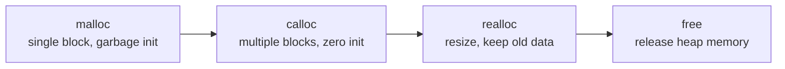

# Advanced C - Lecture 4: Dynamic Memory Allocation and Strings

## Dynamic Memory Allocation

**Dynamic memory allocation** lets a C program allocate memory **at runtime** instead of compile time. Four functions in `stdlib.h` do it: **`malloc`**, **`calloc`**, **`realloc`**, **`free`**.



> [!NOTE]
> Memory allocated on the heap is **not** released automatically. The programmer must call `free()`; otherwise it leaks.

## `malloc()`

**`malloc()`** allocates **one contiguous block** of the requested size. It does **not** initialize the memory (garbage value initially). Returns `NULL` if insufficient memory.

```c
ptr = (cast_type*) malloc(byte_size);
// e.g.
ptr = (int*) malloc(n * sizeof(int));
```

- Always use `sizeof` to compute sizes — they vary by machine.
- Returns a `void*` that is cast to the needed pointer type.

## `calloc()`

**`calloc()`** allocates **multiple blocks** (contiguous array). It takes **two arguments**: number of blocks and size of each. Memory is **initialized to zero**. Returns `NULL` on failure.

```c
ptr = (int*) calloc(10, sizeof(int));
// equivalent malloc:
ptr = (int*) malloc(10 * sizeof(int));
```

| Feature        | `malloc`          | `calloc`          |
| -------------- | ----------------- | ----------------- |
| Arguments      | one (total bytes) | two (count, size) |
| Initialization | garbage           | zero              |
| Use            | single block      | array of blocks   |

## `realloc()`

**`realloc()`** changes the size of an already-allocated block **without losing old data** (contents are moved/copied). Newly added bytes are **uninitialized**.

```c
ptr = (int*) realloc(ptr, 2 * sizeof(int));
```

- First arg: pointer to old block; second: new size.
- Returns `NULL` on failure; old data may be lost if the new size is **smaller**.

## `free()`

**`free(ptr)`** releases dynamically allocated memory back to the heap. Required after use.

## Strings

A **string** is a **one-dimensional array of characters terminated by a null character `'\0'`**. Each character occupies one byte; the last character must always be `'\0'`.

Two declaration forms:

```c
// char array (manual null terminator)
char ch[10] = {'j','a','v','a','t','p','o','i','n','t','\0'};
char ch[]  = {'j','a','v','a','t','p','o','i','n','t','\0'};  // size optional

// string literal (compiler appends '\0')
char ch[] = "Earth";
```

## String Literals

A **string literal** is a sequence of characters enclosed in double quotes. It is stored as a read-only array of characters with an implicit `'\0'`.

```c
char *ptr = "Hello World!";
```

- `ptr` holds the address of the **first character**.
- String literals live in **read-only memory** and **cannot be modified** — doing so is undefined behavior.
- `'\0'` (null, ASCII 0) is **not** the same as `'0'` (digit, ASCII 48).

### Splicing (line continuation)

```c
// error: newline inside a string literal
printf("%s", "line one
line two");
// ok: backslash continues the line
printf("%s", "line one \
line two");
// ok: adjacent literals concatenate
printf("%s", "line one " "line two");
```

### Char Array vs. String Literal

| Aspect          | Char array                | String literal                |
| --------------- | ------------------------- | ----------------------------- |
| Null terminator | added manually            | appended by compiler          |
| Reassignment    | characters can be changed | cannot be reassigned/modified |

## String Initializers (length cases)

| Case                     | Meaning                                           |
| ------------------------ | ------------------------------------------------- |
| Short length initializer | fewer chars than declared size — rest zero-filled |
| Long length initializer  | more chars than size — truncated (warning)        |
| Equal length initializer | exact fit including `'\0'`                        |

## Traversing a String

Two ways: (1) loop until `'\0'`, (2) loop using the string's length.

## Reading Strings

- **`scanf("%s", str)`** reads a whitespace-delimited word into a char array.
- **`gets(str)`** reads until newline and appends `'\0'`. **Risky** — no bounds checking -> buffer overflow. Prefer `fgets`.
- **`fgets(str, n, stdin)`** reads at most `n-1` chars, always null-terminates. Safer.

## Writing Strings

- **`printf("%s", ptr)`** prints a string.
- **`%.ns`** prints only first `n` characters.
- **`%m.ns`** prints first `n` chars right-aligned in a field of width `m`.
- **`puts(str)`** prints the string and automatically appends a newline.

## String Functions (`string.h`)

| Function            | Behavior                                    |
| ------------------- | ------------------------------------------- |
| `strlen(s)`         | length excluding `'\0'`                     |
| `strcpy(dest, src)` | copies `src` into `dest`                    |
| `strcat(s1, s2)`    | appends `s2` to `s1`, result in `s1`        |
| `strcmp(s1, s2)`    | returns `0` if equal                        |
| `strrev(s)`         | reverses the string                         |
| `strlwr(s)`         | converts to lowercase                       |
| `strupr(s)`         | converts to uppercase                       |
| `strstr(s, sub)`    | pointer to first occurrence of `sub` in `s` |

> [!WARNING]
> A `char` array member cannot be assigned with `=`. Use `strcpy` to copy a string into it.

---

_5 min read (source: 10 min)_
