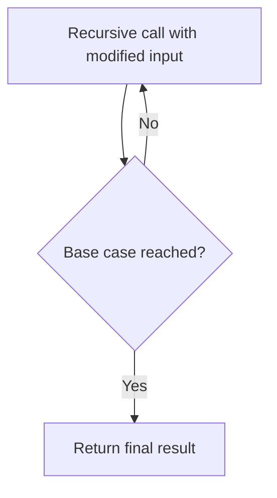

# Advanced C - Section 1: Functions and Recursion

## Functions

A **function** is a block of code that runs only when called. Functions accept **parameters** (input data) and can **return** a value, enabling code reuse.

```c
returnType functionName(parameters) {
  // body
}
```

- **`void` function**: returns nothing; may take input arguments.
- **`int` function**: returns an integer value.

### Example revision programs

- Read a student's name, age, and marks in 3 subjects; print total and average.
- Find the largest of three numbers.
- Find the maximum and minimum in an array.

### Try: odd/even printing

Print numbers 1–10 such that odd numbers have 1 added and even numbers have 1 subtracted -> `2 1 4 3 6 5 8 7 10 9`.

```c
#include <stdio.h>

int main() {
  for (int i = 1; i <= 10; i++) {
    if (i % 2 != 0)
      printf("%d ", i + 1);   // odd -> add 1
    else
      printf("%d ", i - 1);   // even -> subtract 1
  }
  return 0;
}
```

Output:

```text
2 1 4 3 6 5 8 7 10 9
```

## Recursion

**Recursion** is when a function calls itself to solve a problem. Every recursive function has two parts:

- **Base case**: condition that stops the recursion.
- **Recursive case**: logic that calls itself with a modified input.



### Example: sum of list

Base case: list size `<= 0`. Recursive case: `sum(list, n) = list[n-1] + sum(list, n-1)`.

### Types of Recursion

| Type                   | Definition                                              |
| ---------------------- | ------------------------------------------------------- |
| **Direct recursion**   | function calls itself directly                          |
| **Tail recursion**     | recursive call is the **last** action; no state to keep |
| **Non-tail recursion** | something remains to evaluate after the call returns    |
| **Indirect recursion** | `fun` calls `fun2`, which calls `fun`                   |

### Advantages

- More elegant; fewer lines of code.
- Every recursive program can be written iteratively, but recursion often reads better.

### Disadvantages

- Uses more space (call stack) than iteration.
- Risk of infinite loops if base case is wrong.

### Try: Fibonacci

Write a `fib(n)` function returning the nth Fibonacci number — once with a loop, once with recursion.

**Iterative version** — `O(n)` time, `O(1)` space:

```c
int fib(int n) {
  if (n <= 1) return n;       // fib(0)=0, fib(1)=1
  int a = 0, b = 1, next;
  for (int i = 2; i <= n; i++) {
    next = a + b;
    a = b;
    b = next;
  }
  return b;
}
```

**Recursive version** — direct translation of the definition, but `O(2^n)` time:

```c
int fib(int n) {
  if (n <= 1) return n;              // base case
  return fib(n - 1) + fib(n - 2);    // recursive case
}
```

---

_4 min read (source: 5 min)_
