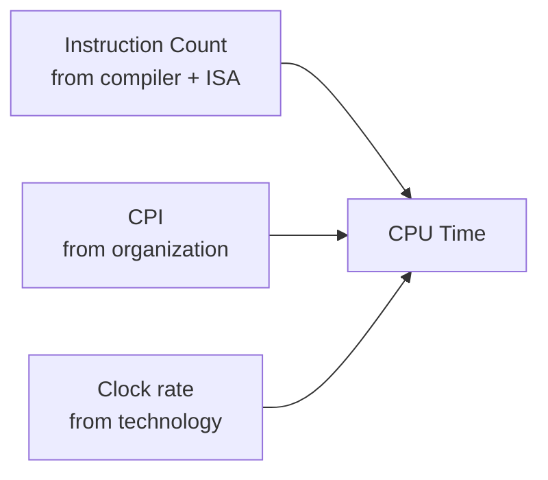

# Computer Architecture - Lecture 2: Computer Performance

## Why Quantify Performance

**Performance evaluation** is a key component of the **iterative architecture design process**: you propose a design, measure it, and revise. It matters whenever a decision depends on speed:

- Buying a computer.
- Evaluating a new technology.
- Writing software (which algorithm/compiler is faster).
- Implementing an instruction set.
- Designing a new architecture.

The lesson is methodological: _you cannot improve what you cannot measure_, and you cannot compare two designs without a single agreed metric.

## Response Time vs. Throughput

Two different questions, two different metrics:

| Metric                                          | Question it answers                                   |
| ----------------------------------------------- | ----------------------------------------------------- |
| **Response time** (**latency**, execution time) | How long until _my_ job finishes?                     |
| **Throughput**                                  | How many jobs per unit time can the machine complete? |

> [!NOTE] The airplane test
> "Which is fastest for 1 passenger?" and "which is fastest for 5000 passengers?" have different answers. A fast small plane wins the first; a large airliner wins the second. Latency and throughput are optimized by different changes.

- Upgrading to a **new processor** usually improves **both** (shorter time per job and more jobs per second).
- Adding **another machine** to the lab improves **throughput only**. Each individual job still takes the same time.

## Defining Performance and Speedup

$$\text{Performance}_X = \frac{1}{\text{Execution Time}_X}$$

$$\text{Speedup} = \frac{\text{Performance}_X}{\text{Performance}_Y} = \frac{\text{Execution Time}_Y}{\text{Execution Time}_X}$$

- "**X is $n$ times faster than Y**" means the ratio of execution times equals $n$; time is in the **denominator**, so smaller time = larger performance.
- **Hard real-time** systems must always meet a deadline (embedded control, **DVD playback** must never drop a frame). **Soft real-time** systems may occasionally miss one.

### Worked: speedup between two machines

Machine A runs a program in 20 s, machine B in 25 s.

```text
Speedup = Execution time B / Execution time A = 25 / 20 = 1.25
```

**A is 1.25× faster than B** (the speedup of A over B is 1.25).

## Time: Elapsed vs. CPU

| Measure                                      | Includes                                                 | Use                                        |
| -------------------------------------------- | -------------------------------------------------------- | ------------------------------------------ |
| **Elapsed time** (wall-clock, response time) | Everything: disk, memory, I/O, OS overhead, time-sharing | Real user experience; poor for comparisons |
| **CPU time** (CPU execution time)            | Only time the CPU spends on our program                  | The metric this course optimizes           |

- **CPU time** splits into **system CPU time** (kernel work such as I/O setup) and **user CPU time** (our own code).
- **Our focus: user CPU time**, the time spent executing the lines of code "in" our program.
- **CPU performance** vs. **system performance** is the same split applied to a whole machine.

> [!WARNING] Common Mistake
> Elapsed time is _not_ comparable across machines running different workloads. In a time-shared system the OS and other programs steal wall-clock time that has nothing to do with your code.

## Clock Cycles, Cycle Time, Clock Rate

Hardware runs on a **clock**; each **tick** marks the start of an activity. Instead of seconds we count **cycles**:

$$\text{seconds} = \text{cycles} \times \text{seconds per cycle}$$

| Term                       | Symbol / unit      | Definition                       |
| -------------------------- | ------------------ | -------------------------------- |
| **Cycle time**             | seconds per cycle  | Time between two clock ticks     |
| **Clock rate** (frequency) | Hz (cycles/second) | Cycles per second; $f = 1 / T_c$ |

A **2 GHz** clock has cycle time $1/(2 \times 10^9) = 0.5\ \text{ns}$.

## The CPU Performance Equation

$$\text{CPU time} = \text{Cycles} \times \text{Cycle time} = \frac{\text{Cycles}}{\text{Clock rate}}$$

$$\boxed{\text{CPU time} = \text{Instruction Count} \times \text{CPI} \times \text{Cycle time} = \frac{IC \times CPI}{f}}$$



To improve performance, with everything else equal, you can:

1. **Decrease** the number of required cycles for the program, or
2. **Decrease** the cycle time, which means **increasing** the clock rate.

### Worked: what clock rate must the designer target?

Program runs in **8 s on machine A at 4 GHz**. Machine B must run it in **4 s**, but its design needs **1.2× as many cycles** as A.

```text
Cycles_A = 8 s × 4 GHz = 32 × 10^9 cycles
Cycles_B = 1.2 × 32 × 10^9 = 38.4 × 10^9 cycles
Clock_B  = Cycles_B / Time_B = 38.4 × 10^9 / 4 s = 9.6 GHz
```

**Target: 9.6 GHz.** Note the trap: halving the time does _not_ mean doubling the clock, because the cycle count also grew by 1.2×: $4 \text{ GHz} \times 2 \times 1.2 = 9.6$ GHz.

## Cycles Are Not Instructions

You **cannot** assume `# cycles = # instructions`. Different instructions take different numbers of cycles, and on different machines:

- **Multiplication** takes more time than **addition**.
- **Floating-point** operations take longer than **integer** ones.
- **Memory access** takes longer than a **register** access.

## CPI: Cycles Per Instruction

$$\text{Clock cycles} = \text{Instruction Count} \times \text{CPI} \qquad\Rightarrow\qquad \text{Time} = IC \times CPI \times T_c$$

- **CPI** is an **average**, because cycles per instruction vary instruction by instruction.
- CPI depends on: the **number of cycles for each instruction** (organization), the **instruction mix** (frequency of each type), and **memory access time**.

### Worked: find CPI

A program of **1,000,000 instructions** runs in **1.2 ms** on a **2 GHz** machine.

```text
Cycles = Time × Clock rate = 1.2 × 10^-3 s × 2 × 10^9 = 2.4 × 10^6 cycles
CPI    = Cycles / Instructions = 2.4 × 10^6 / 1 × 10^6 = 2.4
```

### Worked: two implementations of the same ISA

Machine A: cycle time **1 ns**, CPI **2.0**. Machine B: cycle time **2 ns**, CPI **1.2**. Which is faster, and by how much?

| Machine | CPU time                                       |
| ------- | ---------------------------------------------- |
| A       | $IC \times 2.0 \times 1\ \text{ns} = 2IC$ ns   |
| B       | $IC \times 1.2 \times 2\ \text{ns} = 2.4IC$ ns |

$T_A < T_B$, so **A is faster by $2.4/2 = 1.2\times$**. The lower CPI of B does not pay for its doubled cycle time.

### Worked: two compiler code sequences

Three instruction classes need **1, 2, and 3 cycles**. Sequence 1 has 5 instructions (2×A, 1×B, 2×C); sequence 2 has 6 (4×A, 1×B, 1×C).

|                  | Sequence 1 | Sequence 2 |
| ---------------- | ---------- | ---------- |
| Class A (1 cyc)  | 2 × 1 = 2  | 4 × 1 = 4  |
| Class B (2 cyc)  | 1 × 2 = 2  | 1 × 2 = 2  |
| Class C (3 cyc)  | 2 × 3 = 6  | 1 × 3 = 3  |
| **Total cycles** | **10**     | **9**      |
| **Instructions** | **5**      | **6**      |
| **CPI**          | 10/5 = 2.0 | 9/6 = 1.5  |

**Sequence 2 is 1.11× faster** ($10/9$), which is **10% less execution time**. Sequence 2 has _more_ instructions but a _lower_ CPI: fewer instructions is not automatically faster.

### Weighted-average CPI

When CPI is reported per instruction class:

$$CPI = \frac{\sum_{i} CPI_i \times I_i}{IC} \qquad \text{where } IC = \sum_i I_i$$

$CPI_i$ is the cycles per instruction of class $i$ and $I_i$ is the count of instructions of class $i$. _Why it matters:_ it lets you predict the effect of changing the instruction mix before building anything.

## RISC vs. CISC Tradeoffs

Instruction count, CPI, and cycle time **trade off** against each other, which is why both styles survive.

|                              | **RISC** (reduced, e.g. MIPS) | **CISC** (complex, e.g. IA-32) |
| ---------------------------- | ----------------------------- | ------------------------------ |
| Instructions                 | Simple                        | Complex                        |
| Instruction count for an app | **Higher**                    | **Lower**                      |
| CPI                          | **Lower**                     | **Higher**                     |

The product $IC \times CPI$ is what decides the winner; neither column is "faster" on its own.

## MIPS and Why It Misleads

$$\text{MIPS} = \frac{\text{Instruction Count}}{\text{Execution time} \times 10^6}$$

**MIPS = millions of instructions per second.** It is **not** a valid performance measure across machines: it ignores instruction complexity, so a machine doing more (simpler) instructions looks better even when it takes longer.

### Worked: two compilers measured by MIPS

1 GHz machine; classes A, B, C need **1, 2, 3 cycles**. Compiler 1 emits 5B A, 1B B, 1B C; compiler 2 emits 10B A, 1B B, 1B C.

|                        | Compiler 1          | Compiler 2           |
| ---------------------- | ------------------- | -------------------- |
| A instructions         | 5B                  | 10B                  |
| B instructions         | 1B                  | 1B                   |
| C instructions         | 1B                  | 1B                   |
| **Total instructions** | 7B                  | 12B                  |
| **Total cycles**       | 5 + 2 + 3 = **10B** | 10 + 2 + 3 = **15B** |
| **Execution time**     | 10B/1G = **10 s**   | 15B/1G = **15 s**    |
| **MIPS**               | $7B/10s/10^6 = 700$ | $12B/15s/10^6 = 800$ |

- By **MIPS**: compiler 2 wins (800 > 700).
- By **execution time**: compiler 1 wins (10 s < 15 s).

> [!WARNING] The pitfall
> The two metrics **disagree**. Performance is determined by **execution time**; MIPS is only a rate of instruction issue. Never report MIPS as a performance claim across different instruction sets.

## Amdahl's Law

$$\text{Execution Time}_{\text{after}} = \text{Time}_{\text{unaffected}} + \frac{\text{Time}_{\text{affected}}}{\text{speedup}}$$

$$\text{Overall speedup} = \frac{1}{(1 - f) + f/S}$$

where $f$ is the **fraction of time affected** and $S$ is the **local speedup** of that fraction. The speedup from any enhancement is **bounded by the inverse of the fraction not enhanced**.

### Worked: 2× faster floating point, 10% of the time

```text
Speedup = 1 / (0.90 + 0.10/2) = 1 / 0.95 = 1.0526
```

The machine becomes about **1.05× faster (5.3%)**. Even an infinite $S$ would cap at $1/0.9 = 1.11\times$. This is why optimizing a small part of the runtime is rarely worth it.

## Performance Pitfalls

**Performance is specific to a particular program.** Only **execution time** is a consistent summary. None of these alone equals performance:

- \# of cycles to execute the program
- \# of instructions in the program
- \# of cycles per second (clock rate)
- Average # of cycles per instruction (CPI)
- Average # of instructions per second (MIPS)

For a **fixed architecture**, performance gains come from:

1. **Increases in clock rate** without adverse CPI effects,
2. **Better processor organization** that lowers CPI,
3. **Compiler enhancements** that lower CPI and/or instruction count.

_Pitfall:_ expecting an improvement in one aspect to significantly affect total performance (see Amdahl).

## Drill Problems (with answers)

**1.** A 3 GHz processor runs a program for 10 s. How many cycles?

```text
Cycles = 3 × 10^9 × 10 = 30 × 10^9 = 30 billion cycles
```

**2.** A program runs 2 billion cycles on a 1.5 GHz processor. Execution time?

```text
Time = 2 × 10^9 / (1.5 × 10^9) = 1.33 s
```

**3.** A 2 GHz processor completes one instruction every third cycle. Instructions in a 10 s program?

```text
Cycles = 2 × 10^9 × 10 = 20 × 10^9
CPI = 3  ->  Instructions = 20 × 10^9 / 3 ≈ 6.67 billion
```

**4.** Which system is better: 4B MIPS instructions at CPI 1.5 / 1 GHz, or 2B x86 instructions at CPI 6 / 1.5 GHz?

```text
MIPS: (4 × 10^9 × 1.5) / 10^9 = 6 s
x86 : (2 × 10^9 × 6)   / (1.5 × 10^9) = 12 × 10^9 / 1.5 × 10^9 = 8 s
```

**MIPS is 8/6 ≈ 1.33× faster**, despite executing twice as many instructions.

**5.** P1: 3 GHz, CPI 1.5. P2: 2.5 GHz, CPI 1.0. P3: 4 GHz, CPI 2.2. Same ISA.

a. Highest performance in **instructions per second** = $f/CPI$:

| CPU | IPS                 |
| --- | ------------------- |
| P1  | 3/1.5 = **2.0 G**   |
| P2  | 2.5/1.0 = **2.5 G** |
| P3  | 4/2.2 = **1.82 G**  |

**P2 has the highest performance.**

b. For a **10 s** program on each:

| CPU | Cycles   | Instructions        |
| --- | -------- | ------------------- |
| P1  | 30 × 10⁹ | 30/1.5 = 20 × 10⁹   |
| P2  | 25 × 10⁹ | 25/1.0 = 25 × 10⁹   |
| P3  | 40 × 10⁹ | 40/2.2 ≈ 18.2 × 10⁹ |

c. Cut execution time by **30%** (10 s -> **7 s**) while CPI rises **20%**. Required clock = $IC \times CPI_{\text{new}} / T_{\text{new}}$:

| CPU | Cycles needed at new CPI | Clock rate          |
| --- | ------------------------ | ------------------- |
| P1  | 20 × 1.8 = 36 × 10⁹      | 36/7 ≈ **5.14 GHz** |
| P2  | 25 × 1.2 = 30 × 10⁹      | 30/7 ≈ **4.29 GHz** |
| P3  | 18.2 × 2.64 ≈ 48 × 10⁹   | 48/7 ≈ **6.86 GHz** |

## Where Past Speedups Came From

| Source of improvement                  | Historical contribution |
| -------------------------------------- | ----------------------- |
| Better **process** (faster devices)    | ~**20%**                |
| Better **circuits / pipelines**        | ~**15%**                |
| Better **organization / architecture** | ~**15%**                |

The forecast on the slide: **circuits/pipelines will help little** in the future, and **process improvements will eventually disappear**. That is why architecture-level ideas (parallelism, memory hierarchy) carry the load today.

### Moore's Law in Action: Intel Generations

| Year | Chip      | Transistors | Clock    |
| ---- | --------- | ----------- | -------- |
| 1993 | Pentium   | 3.1 M       | 60 MHz   |
| 1995 | P-Pro     | 5.5 M       | 200 MHz  |
| 1997 | P-II      | 7.5 M       | 300 MHz  |
| 1999 | P-III     | 9.5 M       | 500 MHz  |
| 2000 | P-4       | 42 M        | 1500 MHz |
| 2002 | Itanium   | 300 M       | 800 MHz  |
| 2005 | Montecito | 1720 M      | 1800 MHz |

> [!NOTE] The turning point
> Transistor count keeps climbing, but clock rate stops tracking it. **Adding transistors to a core yields little benefit** after this point. Extra transistors must buy parallelism or cache instead of clock speed.

## Lecture Summary

- **Performance depends on instruction count, CPI, clock rate, and memory behavior.**
- **Execution time** is the only consistent summary of performance; MIPS, CPI, and clock rate are partial views.
- **Amdahl's law** caps every local optimization by the fraction it does not touch.
- **RISC-V** will be used for the assembly and processor-design activities in this course.

_15 min read (source: 16 min)_
