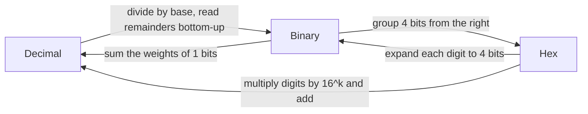
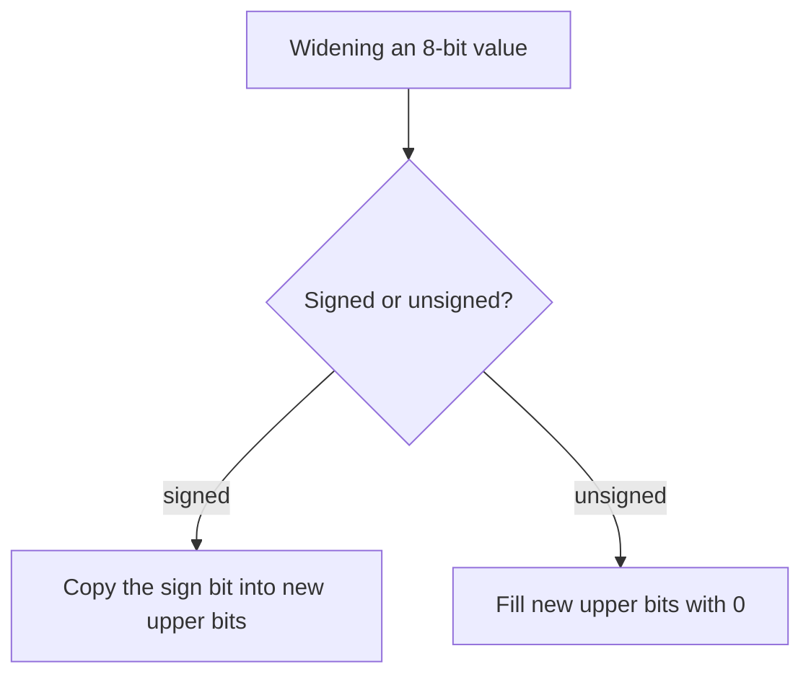

# Computer Architecture - Lecture 3: Number Systems and Data Representation

## Why Binary Representation

A digital circuit reliably distinguishes **two** voltage or logical states, and only two. Everything else is built on that:

- The states are written **0** and **1**, one **bit** each.
- Bits combine to represent numbers, characters, instructions, images, audio, and sensor data.
- A group of **8 bits** is a **byte**.
- Computer arithmetic operates on **fixed-width bit patterns**, never on "as many digits as needed".

_Why two states and not ten:_ with two widely separated voltage levels a circuit still reads the correct value under noise, voltage droop, and manufacturing variation. Ten levels would sit close together and misread. Reliability buys correctness, and the cost is that numbers need more digits.

> [!NOTE] The fixed-width rule
> Every value in this lecture lives in a declared width (8, 16, 32, 64 bits). The width, not the number, decides the range and the meaning of the top bit. Most exam mistakes come from forgetting the width.

## Positional Number Systems

In a **positional** system the value of a digit depends on its **position** and on the **base** $b$. Each position carries weight $b^k$:

$$(d_{n-1}\dots d_1 d_0)_b = \sum_{k=0}^{n-1} d_k \times b^k$$

- The rightmost position has weight $b^0 = 1$.
- Moving left multiplies the weight by the base: $b^1$, $b^2$, and so on.

$$(1011)_2 = 1 \times 2^3 + 0 \times 2^2 + 1 \times 2^1 + 1 \times 2^0 = 8 + 2 + 1 = 11_{10}$$

## Common Number Systems

| System          | Base | Digits   | Typical use                            |
| --------------- | ---- | -------- | -------------------------------------- |
| **Decimal**     | 10   | 0–9      | Human-readable arithmetic              |
| **Binary**      | 2    | 0–1      | Digital hardware                       |
| **Octal**       | 8    | 0–7      | Compact binary notation                |
| **Hexadecimal** | 16   | 0–9, A–F | Compact representation of bit patterns |

Hexadecimal matters because **one hex digit is exactly four bits** (one **nibble**), so binary and hex convert by grouping, with no arithmetic:

| Hex | Bin  | Dec | Hex | Bin  | Dec |
| --- | ---- | --- | --- | ---- | --- |
| 0   | 0000 | 0   | 8   | 1000 | 8   |
| 1   | 0001 | 1   | 9   | 1001 | 9   |
| 2   | 0010 | 2   | A   | 1010 | 10  |
| 3   | 0011 | 3   | B   | 1011 | 11  |
| 4   | 0100 | 4   | C   | 1100 | 12  |
| 5   | 0101 | 5   | D   | 1101 | 13  |
| 6   | 0110 | 6   | E   | 1110 | 14  |
| 7   | 0111 | 7   | F   | 1111 | 15  |

_Why hex is used everywhere:_ a 32-bit instruction or address is 8 hex digits instead of 32 bits, and you can read it without counting.

## Conversions



### Decimal to binary: repeated division by 2

Divide by 2, record the **remainder**, continue until the quotient is **0**, then read remainders **bottom to top**.

```text
25 / 2 = 12 remainder 1   <- least significant bit
12 / 2 =  6 remainder 0
 6 / 2 =  3 remainder 0
 3 / 2 =  1 remainder 1
 1 / 2 =  0 remainder 1   <- most significant bit
```

$$25_{10} = 11001_2$$

### Binary to decimal: sum the weights

Write the weights above the bits, then add where the bit is 1:

```text
bits     1  0  1  1  0  1
weights 32 16  8  4  2  1
       32 +  8 + 4     + 1 = 45
```

$$(101101)_2 = 32 + 8 + 4 + 1 = 45_{10}$$

### Binary to hex: group four bits from the right

Pad the left with zeros so the last group is complete:

```text
1011 0100 1110
  B    4    E
```

$$(101101001110)_2 = (B4E)_{16}$$

### Decimal to hex: repeated division by 16

```text
200 / 16 = 12 remainder 8   ->  8
 12 / 16 =  0 remainder 12  ->  C
```

$$200_{10} = C8_{16} = 1100\,1000_2$$

### Worked conversions

| Task                 | Work                                    | Result      |
| -------------------- | --------------------------------------- | ----------- |
| $37_{10}$ to binary  | 37 = 32 + 4 + 1 -> `0010 0101`          | `100101`₂   |
| $37_{10}$ to hex     | `0010 0101` -> `2` and `5`              | `25`₁₆      |
| $45_{10}$ to hex     | 45 = 2 × 16 + 13                        | `2D`₁₆      |
| `B4E`₁₆ to decimal   | 11 × 256 + 4 × 16 + 14 = 2816 + 64 + 14 | $2894_{10}$ |
| $100_{10}$ to binary | 64 + 32 + 4                             | `1100100`₂  |
| `1101`₂ to octal     | group in 3s: `001 101` -> 1 and 5       | `15`₈       |

## Unsigned Integers

In an **unsigned** representation every bit contributes a **positive** power of two. For $n$ bits:

$$0 \le x \le 2^n - 1$$

| Width   | Range                             |
| ------- | --------------------------------- |
| 8 bits  | 0 to **255**                      |
| 16 bits | 0 to 65 535                       |
| 32 bits | 0 to $2^{32} - 1$ = 4 294 967 295 |

Example: $11111111_2 = 255_{10}$.

> [!WARNING] Same bits, different meaning
> The bit pattern `11111111` is **255** as unsigned and **−1** as signed. A bit pattern has no intrinsic value until you name its interpretation. The hardware keeps the bits; the instruction decides the meaning.

## Signed Integer Representations

Computers must store negative values too. Three historical approaches:

| Scheme               | Rule for negatives                            | Zero representations | Status                        |
| -------------------- | --------------------------------------------- | -------------------- | ----------------------------- |
| **Sign-magnitude**   | Top bit is the sign, rest is magnitude        | **Two** (+0, −0)     | Historical                    |
| **One's complement** | Invert every bit of the magnitude             | **Two** (+0, −0)     | Historical                    |
| **Two's complement** | Invert every bit of the magnitude, then add 1 | **One**              | **Used by modern processors** |

Two's complement wins for two concrete reasons: it has a **single zero**, and **addition and subtraction need no special case for sign**. The same adder circuit handles both.

## Two's Complement: Weights and Range

The **most significant bit (sign bit)** has **negative** weight $-2^{n-1}$; every other bit keeps a positive weight.

$$\text{8-bit weights: } -128 \quad 64 \quad 32 \quad 16 \quad 8 \quad 4 \quad 2 \quad 1$$

| Bit pattern | Decoding                            | Value    |
| ----------- | ----------------------------------- | -------- |
| `10000000`  | −128                                | **−128** |
| `11111111`  | −128 + 64 + 32 + 16 + 8 + 4 + 2 + 1 | **−1**   |
| `10000001`  | −128 + 1                            | **−127** |
| `01111111`  | 64 + 32 + 16 + 8 + 4 + 2 + 1        | **+127** |

For $n$ bits:

$$-2^{n-1} \le x \le 2^{n-1} - 1$$

The range is **asymmetric**: one more negative value than positive, because zero uses the pattern `000...0` and has no negative twin.

> [!NOTE] Reading the sign bit
> A leading **1** means the value is **negative when interpreted as signed**; a leading **0** means **non-negative**. That test says nothing about the value as unsigned.

### Encoding a negative number

Three steps, then ignore any carry beyond the fixed width.

```text
Represent -5 in 8 bits:
  +5       00000101
  invert   11111010
  add 1    11111011
```

$$-5 = 11111011_2$$

A faster shortcut for exam speed: encode the magnitude, then **subtract from $2^n$**. For −5 in 8 bits: $256 - 5 = 251 = 11111011_2$.

### Decoding a negative value

Reverse the process: invert, add 1, read the magnitude, restore the sign.

```text
11111011  sign bit = 1, so negative
invert    00000100
add 1     00000101  magnitude = 5
```

$$11111011_2 = -5_{10}$$

The shortcut in reverse: if the sign bit is 1, the value is **pattern − $2^n$**, so $251 - 256 = -5$.

## Two's-Complement Addition

Add the bit patterns exactly as unsigned binary. Any carry out of the top bit is **discarded**, because the width is fixed.

```text
  5    00000101
+ (-3) 11111101
----------------
1 00000010   carry out of bit 7 is dropped
```

$$00000010_2 = 2_{10} \quad \checkmark$$

**Subtraction** is addition of the negated operand: $a - b = a + (-b)$, where $-b$ is formed by invert-and-add-one. This is why one adder serves both operations.

## Signed Overflow

**Overflow** occurs when the mathematical result cannot be represented in the available bits. For signed values the rules are exact:

| Operand signs   | Result sign | Overflow? |
| --------------- | ----------- | --------- |
| **+** and **+** | **−**       | **Yes**   |
| **−** and **−** | **+**       | **Yes**   |
| Mixed (+ and −) | either      | **Never** |

```text
  01111111  (+127)
+ 00000001  (+1)
----------------
  10000000  reads as -128
```

$+127 + 1 = +128$, which is outside the 8-bit signed range $[-128, +127]$, so the stored pattern `10000000` is **−128**: the answer is wrong, and the overflow flag is what tells you so.

> [!WARNING] Overflow is interpretation-dependent
> `11111111 + 00000001` gives `00000000` with a carry out. As **unsigned** that is $255 + 1 = 256$, which does not fit in 8 bits, so it is **unsigned overflow** (carry). As **signed** it is $-1 + 1 = 0$, perfectly correct. The same addition overflows under one interpretation and not the other, which is exactly why the processor keeps **both** a carry flag and an overflow flag.

## Sign Extension and Zero Extension

Widening a value (8 -> 16 or 32 bits) must preserve its value. The fill rule depends on the interpretation:

- **Sign extension** (signed): copy the **sign bit** into all new upper bits.
- **Zero extension** (unsigned): fill all new upper bits with **zeros**.

```text
signed  -5 : 11111011 -> 11111111 11111011   (still -5)
unsigned 251: 11111011 -> 00000000 11111011   (still 251)
```

_Why it matters:_ the same 8-bit pattern needs **different** widening depending on its declared type. Sign-extending an unsigned value turns 251 into −5; zero-extending a signed value turns −5 into 251. The hardware offers both, and the instruction picks one.



## Integer Representation in RISC-V

- RISC-V integer arithmetic uses **fixed-width two's-complement** values.
- **RV32I** uses **32-bit** integer registers; **RV64I** uses **64-bit** integer registers.
- The **same bit pattern** may be interpreted as signed or unsigned, depending on the **instruction** and operation.
- **Sign extension** preserves signed values when a narrower value is used in a wider context.
- Signed and unsigned comparisons use **different instructions**:

| Comparison   | Instruction |
| ------------ | ----------- |
| **Signed**   | `slt`       |
| **Unsigned** | `sltu`      |

> [!NOTE] Why two comparison instructions exist
> With signed interpretation `11111111` is −1, which is **less than** `00000001`. With unsigned interpretation it is 255, which is **greater**. One comparator cannot answer both questions, so the ISA provides one instruction per interpretation.

## Practice Problems (worked)

**1. Convert $37\_{10}$ to binary and hex.**

```text
37 / 2 = 18 r 1
18 / 2 =  9 r 0
 9 / 2 =  4 r 1
 4 / 2 =  2 r 0
 2 / 2 =  1 r 0
 1 / 2 =  0 r 1
```

Read bottom-up: $37_{10} = 100101_2$. Group as `0010 0101` -> $25_{16}$.

**2. $11010110_2$ as unsigned.**

$$128 + 64 + 16 + 4 + 2 = 214_{10}$$

**3. $11010110_2$ as an 8-bit two's-complement number.**

Sign bit is 1, so negative. Invert -> `00101001`, add 1 -> `00101010` = 42, so the value is **−42**. Check with the shortcut: $214 - 256 = -42$.

**4. Represent −18 in 8-bit two's complement.**

```text
+18      00010010
invert   11101101
add 1    11101110
```

**−18 = `11101110`**. Check: $238 - 256 = -18$.

**5. $01111100_2 + 00000101_2$: does overflow occur?**

```text
  01111100  (+124)
+ 00000101  (+5)
----------------
  10000001
```

As unsigned: $124 + 5 = 129$, fits in 8 bits, **no unsigned overflow**. As signed: $+124 + 5 = +129$, outside $[-128, +127]$, so **signed overflow occurs**. The result pattern `10000001` reads as −127, which is wrong for the signed interpretation. Two positive operands producing a negative-looking result is the tell.

**6. Sign extension vs. zero extension.**

Both widen a value without changing it. **Sign extension** copies the **sign bit** into the new upper bits and preserves a **signed** value. **Zero extension** fills the new upper bits with **0** and preserves an **unsigned** value. Using the wrong one silently changes the value: sign-extending the unsigned `11111011` gives −5 instead of 251, and zero-extending the signed `11111011` gives 251 instead of −5.

## In-Class Activity (worked)

Given $A = 11110110_2$ and $B = 00001101_2$, 8-bit arithmetic.

| Question                           | Work                                                    | Answer             |
| ---------------------------------- | ------------------------------------------------------- | ------------------ |
| Unsigned value of A                | 128 + 64 + 32 + 16 + 4 + 2                              | **246**            |
| Signed two's-complement value of A | sign = 1 -> invert `00001001`, add 1 -> `00001010` = 10 | **−10**            |
| Unsigned value of B                | 8 + 4 + 1                                               | **13**             |
| A + B in 8-bit arithmetic          | see below                                               | `00000011` = **3** |
| Does the signed result overflow?   | −10 + 13 = +3, inside $[-128, +127]$                    | **No**             |

```text
  11110110   (-10)
+ 00001101   (+13)
----------------
1 00000011   carry dropped
```

The operands have **different signs**, so signed overflow is impossible by the rule table. The carry out of bit 7 is discarded because the width is fixed, and the stored result `00000011` is **+3**, which matches $-10 + 13 = 3$.

## Lecture Summary

- **Binary** is the number system of digital computers; a **byte** is 8 bits, and arithmetic runs on **fixed-width** patterns.
- **Hexadecimal** is a compact view of binary: one hex digit = four bits.
- **Unsigned** $n$-bit range: $0$ to $2^n - 1$.
- **Signed** two's-complement $n$-bit range: $-2^{n-1}$ to $2^{n-1} - 1$.
- Negate by **invert and add one**; add bit patterns directly and **drop the carry out**.
- **Overflow** depends on the interpretation and the width: same-sign operands giving the opposite sign means signed overflow; carry out of the top bit means unsigned overflow.
- **Sign extension** preserves signed values, **zero extension** preserves unsigned values.

_15 min read (source: 8 min)_
