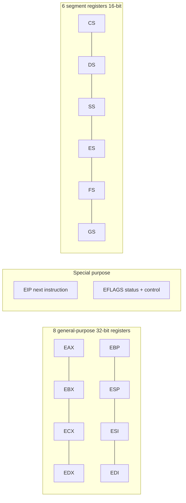
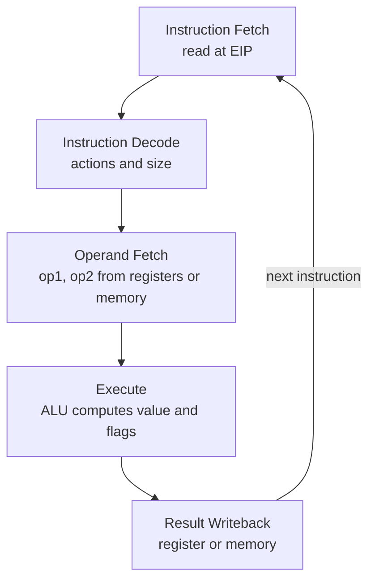
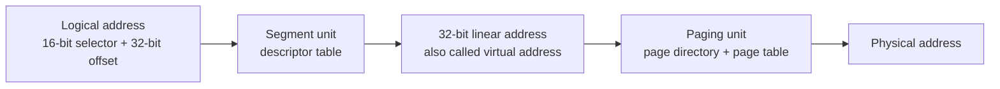

# Computer Architecture - Lecture 4: Intel Microprocessors and IA-32 Registers

> [!NOTE] Scope of this summary
> The slide file stops after the registers, but its agenda announces five topics. The two it skips, the **instruction execution cycle** and **IA-32 memory management**, are reconstructed below from the full source deck (KFUPM COE 205, Dr. Muhamed Mudawar, slides 33–51), so nothing testable is missing. The local file also drops the deck's opening **basic computer organization** section, which Lecture 1 already covers.

## The 8086 Family: 16-bit Era

Intel introduced the **8086** microprocessor in 1979, together with the **8087**, **8088**, and **80186**.

| Feature                | Value                                       |
| ---------------------- | ------------------------------------------- |
| Registers              | **16-bit**                                  |
| Data bus               | **16-bit**                                  |
| Address bus            | **20-bit**                                  |
| Physical address space | $2^{20}$ bytes = **1 MB**                   |
| Memory model           | **Segmentation** with **real-address mode** |
| Segment size           | $2^{16}$ bytes = **64 KB** each             |

- **8087** is a **floating-point co-processor**: separate chip for FP math, because the 8086 had none.
- **8088** is the cheaper 8086 with an **8-bit data bus** (the chip used in the original IBM PC).
- **80186** is a **faster 8086** with extra integrated peripherals.

_Why the 20-bit address bus with 16-bit registers:_ a 16-bit register can only name 64 KB. Pairing a **segment** register with a 16-bit **offset** gives $16 \times 64\text{ KB}$ windows overlapping into a 1 MB space. That is what "segmentation" means here.

## 80286 and 80386: 16 MB and 4 GB

**80286** (1982):

- **24-bit** address bus -> $2^{24}$ = **16 MB** address space.
- Introduced **protected mode**.
- Segmentation in **protected mode differs** from segmentation in real mode.

**80386** (1985) is the architectural turning point:

- First **32-bit** processor with 32-bit **general-purpose registers**.
- **First processor to define the IA-32 architecture** (the name is literally "Intel Architecture, 32-bit").
- **32-bit** data bus and **32-bit** address bus -> $2^{32}$ = **4 GB** address space.
- Introduced **paging**, **virtual memory**, and the **flat memory model**.
- **Segmentation can be turned off**, so a program can see one flat 4 GB address space.

> [!NOTE] Why the 386 matters for exams
> Everything called "IA-32" starts here: 32-bit registers, 32-bit addresses, flat model, paging. Earlier chips are 16-bit x86 with different addressing rules.

## 80486 and Pentium: Pipelining and Superscalar

**80486** (1989):

- Improved 80386.
- **On-chip floating-point unit** (DX versions).
- **On-chip unified** instruction/data **cache, 8 KB**.
- Uses **pipelining**: can execute up to **1 instruction per clock cycle**.

**Pentium** (80586, 1993):

- **64-bit data bus**, but the **address bus stays 32 bits** (so still 4 GB of address space).
- **Two execution pipelines**, the **U-pipe** and **V-pipe**.
- **Superscalar**: can execute up to **2 instructions per clock cycle**.
- **Separate 8 KB instruction and 8 KB data caches** (Harvard-style split, so a fetch and a load never fight over one port).
- Later models added **MMX** instructions for multimedia.

| Term            | Meaning                                                          |
| --------------- | ---------------------------------------------------------------- |
| **Pipelining**  | Overlapping stages of different instructions to raise throughput |
| **Superscalar** | Several parallel execution pipelines issuing in one cycle        |

## P6 Family: Dynamic Execution

**Pentium Pro** (1995):

- **Three-way superscalar**: up to **3 instructions per clock cycle**.
- **36-bit** address bus -> up to **64 GB** physical address space.
- Introduced **dynamic execution**: **out-of-order** and **speculative** execution.
- **256 KB L2 cache on-chip**.

**Pentium II** (1997): added **MMX** (already present on Pentium MMX).

**Pentium III** (1999): added **SSE** and **eight new 128-bit XMM registers**.

> [!NOTE] What "dynamic execution" buys
> The processor reorders independent instructions to keep its pipelines full and guesses branch outcomes to avoid waiting. Correctness is preserved by retiring results in program order. This is why CPI can drop below the pipeline depth without changing the ISA.

## Pentium 4, Xeon, Pentium M, EM64T

**Pentium 4** (2000), seventh-generation x86:

- New microarchitecture called **Intel NetBurst**.
- **Very deep instruction pipeline**, built to scale to very high frequencies.
- Introduced **SSE2**, an extension of SSE operating on the 128-bit **XMM** registers, tuned for multimedia.
- **2002: Hyper-Threading** allowed **2 programs to run simultaneously, sharing resources**.

**Xeon** is Intel's name for **server-class** microprocessors: generally **more cache** and support for **larger multiprocessor configurations**.

**Pentium M** (2003, mobile):

- Designed for **low-power laptops**.
- A modified **Pentium III**, optimized for **power efficiency**.
- Large **L2 cache (2 MB** on later models).
- Runs at a **lower clock than Pentium 4 but with better performance**.

**EM64T** (Extended Memory 64-bit Technology, 2004):

- **64-bit superset of IA-32**.
- **64-bit** general-purpose registers and integer support.
- General-purpose registers increased from **8 to 16**.
- **64-bit pointers** and a **flat virtual address space**.
- Large physical address space: up to $2^{40}$ = **1 TB**.

> [!WARNING] Clock rate is not performance
> The Pentium M is the exam-ready counterexample: **lower clock, better performance**, because its CPI and power profile are better. This is the Amdahl/performance-equation lesson from Lecture 2 applied to real chips.

### Summary of the progression

| Chip        | Year | Address bus | Address space | Landmark feature                      |
| ----------- | ---- | ----------- | ------------- | ------------------------------------- |
| 8086        | 1979 | 20-bit      | 1 MB          | 16-bit registers, segmentation        |
| 80286       | 1982 | 24-bit      | 16 MB         | Protected mode                        |
| 80386       | 1985 | 32-bit      | 4 GB          | **Defines IA-32**, paging, flat model |
| 80486       | 1989 | 32-bit      | 4 GB          | On-chip cache, pipelining             |
| Pentium     | 1993 | 32-bit      | 4 GB          | Superscalar, 2 pipelines              |
| Pentium Pro | 1995 | 36-bit      | 64 GB         | Out-of-order, speculative execution   |
| Pentium III | 1999 | 36-bit      | 64 GB         | SSE, 128-bit XMM registers            |
| Pentium 4   | 2000 | 36-bit      | 64 GB         | NetBurst, deep pipeline, SSE2         |
| Pentium M   | 2003 | 36-bit      | 64 GB         | Low power, lower clock, faster        |
| EM64T       | 2004 | 40-bit      | 1 TB          | 64-bit registers, 16 GPRs             |

## CISC vs. RISC

| Aspect            | **CISC** (Complex Instruction Set Computer)                      | **RISC** (Reduced Instruction Set Computer)   |
| ----------------- | ---------------------------------------------------------------- | --------------------------------------------- |
| Instruction set   | Large and **complex**                                            | Small and **simple**                          |
| Instruction width | **Variable**                                                     | **All the same width**                        |
| Decoding          | Requires a **microcode interpreter**                             | Decoded and executed **directly by hardware** |
| Execution         | Each instruction expands into a sequence of **micro-operations** | One instruction, one simple action            |
| Examples          | **Intel x86 family**                                             | **ARM, MIPS, PowerPC, SPARC**                 |

_Why the split exists:_ CISC spends hardware on decoding so programs stay short; RISC spends hardware on pipelines so instructions stay fast. Lecture 2 showed the two are trading instruction count against CPI, and the product decides the winner.

## Basic Program Execution Registers

Registers are **high-speed memory inside the CPU**. The IA-32 programmer-visible set:

| Group                   | Count | Width       | Members                                    |
| ----------------------- | ----- | ----------- | ------------------------------------------ |
| **General-purpose**     | 8     | **32-bit**  | **EAX, EBX, ECX, EDX, EBP, ESP, ESI, EDI** |
| **Segment**             | 6     | **16-bit**  | **CS, DS, SS, ES, FS, GS**                 |
| **Instruction pointer** | 1     | 32-bit      | **EIP**                                    |
| **Flags**               | 1     | 32-bit      | **EFLAGS**                                 |
| Floating-point (x87)    | 8     | **80-bit**  | **ST(0) … ST(7)**                          |
| **MMX**                 | 8     | **64-bit**  | MM0 … MM7                                  |
| **XMM** (SSE/SSE2)      | 8     | **128-bit** | XMM0 … XMM7                                |



## General-Purpose Registers

Primarily used for **arithmetic and data movement**:

```asm
mov eax, 10    ; move the constant 10 into register eax
```

Each register also has a **specialized role**, which is why the ISA still has eight of them instead of a uniform file:

| Register      | Specialized use                                                              |
| ------------- | ---------------------------------------------------------------------------- |
| **EAX**       | **Accumulator**: used automatically by **multiplication and division**       |
| **ECX**       | **Counter**: used automatically by the **LOOP** instruction                  |
| **ESP**       | **Stack pointer**: used by **PUSH and POP**, points to the top of stack      |
| **ESI / EDI** | **Source index / destination index**: used by **string instructions**        |
| **EBP**       | **Base pointer**: references **parameters and local variables** on the stack |
| **EBX**       | No dedicated role in the slides; general data register                       |

> [!WARNING] Implicit operands are the exam trap
> `mul`, `div`, `loop`, `push`, `pop`, and the string instructions read or write these registers **without naming them in the operand list**. If you clobber ECX before `loop`, the loop counter is wrong, and the assembler will not warn you.

## Accessing Parts of Registers

**EAX, EBX, ECX, and EDX** are **32-bit extended** registers whose lower halves can be addressed directly:

- The **lower 16 bits** of EAX are named **AX**.
- AX splits into **AL** (lower 8 bits) and **AH** (upper 8 bits of AX).

```text
        EAX  (32 bits)
  --------------------------------
  |            AX (16)   |         |
  --------------------------------
  |   AH (8)   |   AL (8)          |
  --------------------------------
```

| Full 32-bit | Lower 16-bit | 8-bit halves   |
| ----------- | ------------ | -------------- |
| EAX         | AX           | **AH**, **AL** |
| EBX         | BX           | BH, BL         |
| ECX         | CX           | CH, CL         |
| EDX         | DX           | DH, DL         |

**ESI, EDI, EBP, and ESP** expose **only 16-bit names** for their lower half: **SI, DI, BP, SP**. There is no 8-bit access to them.

> [!NOTE] Why partial access matters
> Writing **AL** changes only the low byte of EAX; the upper 24 bits keep their old values. Writing **AX** changes the low 16 bits and leaves the top 16 alone. Code that mixes widths can therefore keep stale bits in a register, and that is a classic debugging bug.

```asm
mov eax, 0x12345678   ; EAX = 12345678, AX = 5678, AL = 78, AH = 56
mov al,  0xFF         ; EAX = 123456FF  (upper bits unchanged)
mov ax,  0x0000       ; EAX = 12340000  (low 16 cleared, upper 16 kept)
```

## Special-Purpose and Segment Registers

- **EIP** (**Extended Instruction Pointer**) holds the **address of the next instruction** to execute. You cannot `mov` into it directly; jumps and branches change it.
- **EFLAGS** (**Extended Flags Register**) holds **status and control flags**, **each flag a single bit**. Programs can **set and clear individual bits**.
- **Six 16-bit segment registers** support **segmented memory**: **six segments accessible at a time**, each holding distinct content:
  - **Code** segment
  - **Data** segment
  - **Stack** segment

## EFLAGS Register

Two groups of flags:

| Group                      | Purpose                                                    |
| -------------------------- | ---------------------------------------------------------- |
| **Status flags**           | Record the status of **arithmetic and logical** operations |
| **Control / system flags** | **Control CPU operation** (interrupts, direction, etc.)    |

### Status flags

| Flag                     | Symbol | Set when                                                                                       |
| ------------------------ | ------ | ---------------------------------------------------------------------------------------------- |
| **Carry flag**           | CF     | **Unsigned** arithmetic result is **out of range**                                             |
| **Overflow flag**        | OF     | **Signed** arithmetic result is **out of range**                                               |
| **Sign flag**            | SF     | Copy of the **sign bit**; set when the result is **negative**                                  |
| **Zero flag**            | ZF     | Result is **zero**                                                                             |
| **Auxiliary carry flag** | AF     | Carry from **bit 3 to bit 4** (used by BCD arithmetic)                                         |
| **Parity flag**          | PF     | **Parity is even**: the least-significant byte of the result contains an **even number of 1s** |

> [!NOTE] CF vs. OF is the Lecture 3 split in hardware
> CF answers "did the **unsigned** value overflow?" and OF answers "did the **signed** value overflow?". One addition sets both, and each is meaningful only under its own interpretation. This is exactly the two's-complement overflow rule table from Lecture 3.

### Worked: flags after `add al, 1`

**Case 1: AL = `0xFF` (255 unsigned, −1 signed), add 1**

```text
  1111 1111
+ 0000 0001
-----------
1 0000 0000   result byte = 00
```

| Flag | Value | Reason                                          |
| ---- | ----- | ----------------------------------------------- |
| CF   | **1** | unsigned $255 + 1 = 256$ exceeds 255            |
| OF   | **0** | signed $-1 + 1 = 0$, in range                   |
| SF   | **0** | bit 7 of the result is 0                        |
| ZF   | **1** | result is zero                                  |
| AF   | **1** | carry out of bit 3 (low nibble `F` + 1 wraps)   |
| PF   | **1** | result byte `00` has **zero** 1s, which is even |

**Case 2: AL = `0x7F` (127), add 1**

```text
  0111 1111
+ 0000 0001
-----------
  1000 0000   result byte = 80
```

| Flag | Value | Reason                                  |
| ---- | ----- | --------------------------------------- |
| CF   | **0** | unsigned $127 + 1 = 128$, still ≤ 255   |
| OF   | **1** | signed $127 + 1 = 128$ exceeds +127     |
| SF   | **1** | bit 7 is 1                              |
| ZF   | **0** | result is not zero                      |
| AF   | **1** | carry out of bit 3                      |
| PF   | **0** | `1000 0000` has **one** 1, which is odd |

The two cases are the cleanest demonstration of why **CF and OF are separate bits**: the same instruction, the same `+1`, and the two flags disagree.

## Floating-Point, MMX, and XMM Registers

- The **floating-point unit** performs high-speed FP operations.
- **Eight 80-bit floating-point data registers**, **ST(0) … ST(7)**, arranged as a **stack** and used for floating-point arithmetic.
- **Eight 64-bit MMX registers**, used with **MMX** instructions.
- **Eight 128-bit XMM registers**, used with **SSE** instructions.

> [!NOTE] The x87 stack is a stack, not a register file
> `ST(0)` is always the top. Push moves values up, pop moves them down, so x87 code must track depth. Getting the depth wrong produces the classic "FPU stack overflow" even when the math is right.

## Instruction Execution Cycle

The cycle is an **infinite loop** of five stages, each with one defined job:

| Stage                  | What it does                                            |
| ---------------------- | ------------------------------------------------------- |
| **Instruction Fetch**  | Obtain the instruction from program storage             |
| **Instruction Decode** | Determine the required actions and the instruction size |
| **Operand Fetch**      | Locate and obtain the operand data                      |
| **Execute**            | Compute the result value and status                     |
| **Result Writeback**   | Deposit the results in storage for later use            |

IA-32 splits the cycle differently from the generic version in Lecture 1. **Operand Fetch** is its own stage because CISC instructions may read operands straight from memory, and **Result Writeback** can target memory as well as a register. Same cycle, finer split.

One pass moves data like this: the **PC** addresses program memory, the fetched instruction lands in the **instruction register**, the **registers** supply `op1` and `op2`, the **ALU** computes the result and sets the **flags**, and the result is written back to a register.



### Pipelined Execution

Instruction execution divides into **stages**, and **pipelining** starts an instruction before the previous one finishes: while I-1 executes, I-2 decodes and I-3 is fetched. For $k$ stages and $n$ instructions:

$$\text{cycles} = k + n - 1$$

Ten instructions through five stages take $5 + 10 - 1 = 14$ cycles instead of 50. As $n$ grows, throughput approaches **one instruction per cycle** while the latency of a single instruction stays at $k$ cycles.

> [!NOTE] Wasted cycles
> When one stage needs **two or more** clock cycles, bubbles appear in the pipeline. For $k$ stages where one stage takes 2 cycles, $n$ instructions need $k + 2n - 1$ cycles, so the same ten instructions cost $5 + 20 - 1 = 24$ cycles rather than 14. The slowest stage sets the pace.

### Superscalar Architecture

A **superscalar** processor has **multiple execution pipelines**. The Pentium has two, the **U-pipe** and the **V-pipe**. Duplicating the slow stage lets the second pipeline fill the bubbles, and $n$ instructions then need

$$\text{cycles} = k + n$$

so the same ten instructions cost $5 + 10 = 15$ cycles instead of 24. This is the hardware behind the "2 instructions per clock" (Pentium) and "3 instructions per clock" (Pentium Pro) claims in the history above.

> [!WARNING] Do not mix the three formulas
> $k + n - 1$ assumes every stage takes exactly one cycle. $k + 2n - 1$ is one slow stage with a single pipeline. $k + n$ is that slow stage with a second pipeline. Picking the wrong one is the standard way to lose marks on a pipeline question.

## IA-32 Memory Management

### Modes of Operation

| Mode                  | Address space            | Protection                                                                         | Used by                                              |
| --------------------- | ------------------------ | ---------------------------------------------------------------------------------- | ---------------------------------------------------- |
| **Real-address mode** | **1 MB**, `0` to `FFFFF` | **None**: programs can access any part of main memory                              | MS-DOS; the mode the CPU starts in                   |
| **Protected mode**    | **4 GB** per program     | The OS assigns memory and **prevents programs from accessing each other's memory** | Windows NT/2000/XP and Linux (native mode)           |
| **Virtual 8086 mode** | 1 MB per program         | Protected mode underneath                                                          | Running real-mode programs under a protected-mode OS |

Real-address mode is the original 8086 mode. Protected mode arrived with the **80386**. Virtual 8086 mode runs the processor in protected mode while presenting each program with a virtual 8086 machine.

### Real-Address Mode

- A program can access **up to six segments** at any time: **code**, **stack**, **data**, and up to **three extra** segments (ES, FS, GS).
- **Each segment is 64 KB.**
- A **logical address** is a **16-bit segment** plus a **16-bit offset**.
- The **linear (physical) address** is **20 bits**, which is what limits the space to 1 MB.

$$\text{Linear address} = (\text{Segment} \times 10_{16}) + \text{Offset}$$

Multiplying the segment by `10` hex (16 decimal) shifts it one hex digit, four bits, which is how a 16-bit register reaches a 20-bit address.

#### Worked: logical to linear in real-address mode

**Segment `A1F0`, offset `04C0`:**

```text
  A1F00    segment x 10h
+  04C0    offset
--------
  A23C0    20-bit linear address
```

**Segment `028F`, offset `0030`:**

```text
  028F0
+  0030
--------
  02920
```

> [!NOTE] Many logical addresses, one linear address
> `28F30` is reachable as `28F3:0000`, `28F2:0010`, `28F0:0030`, `28B0:0430`, and many more. The 16-byte granularity of the segment shift makes segments overlap, so one byte has many names. That is a property of real mode, not a defect.

> [!WARNING] Wrap-around at 1 MB
> The address bus is 20 bits, so `FFFF:0010` computes `100000`, which the 8086 wraps to `00000`. The 286 and later added the **A20 gate** to keep the 21st bit. The deck does not cover this, but it is a standard follow-up question.

### Flat Memory Model

Modern operating systems **turn segmentation off** and give each program one **32-bit linear address space** of up to $2^{32}$ = **4 GB**:

- The **segment registers are defined by the operating system**, and all segments map to the **same linear address space**.
- Assembly code declares the model with the **`.MODEL flat`** directive.
- A **linear address is also called a virtual address**; the OS maps virtual addresses onto physical ones with **paging**.

In the programmer's view every segment has **base address 0**, so the offset is the address:

| Register           | Role in the flat model                                |
| ------------------ | ----------------------------------------------------- |
| **EIP**            | Points at the next instruction                        |
| **ESI, EDI**       | Hold data addresses, also used to index arrays        |
| **ESP**            | Points at the top of the stack                        |
| **EBP**            | Addresses parameters and local variables on the stack |
| **CS, DS, SS, ES** | Present but unused: all map to the same 4 GB space    |

### Protected Mode Architecture

A logical address is a **16-bit segment selector** plus a **32-bit offset**, and translation happens in two steps:



- The **segment unit** translates logical to linear using a **segment descriptor table**.
- The **paging unit** translates linear to physical using a **page directory** and a **page table**.

### Segment Selectors and Descriptor Tables

The **upper 13 bits of the selector index the descriptor table**, and the **TI (Table Indicator)** bit picks which table:

- **TI = 0** -> **Global Descriptor Table (GDT)**
- **TI = 1** -> **Local Descriptor Table (LDT)**

| Table   | Scope               | Register | Contents                                                                                                |
| ------- | ------------------- | -------- | ------------------------------------------------------------------------------------------------------- |
| **GDT** | **One per system**  | **GDTR** | Descriptors for **all programs** plus the OS itself; initialized at boot. Windows XP uses a single GDT. |
| **LDT** | **One per program** | **LDTR** | Descriptors for **only one program**.                                                                   |

A **segment descriptor** carries three fields:

- **Base address** (32-bit): where the segment starts. **Base + offset = linear address.**
- **Segment limit** (20-bit): the size in bytes or in multiples of **4 KB pages**, so a segment spans **4 KB to 4 GB**.
- **Access rights**: code or data, read-only or read/write, and the **privilege level** that protects access.

> [!NOTE] Visible and invisible halves
> The **16-bit segment register** (CS, SS, DS, ES, FS, GS) is the **visible** part the programmer sees. The **64-bit descriptor** is the **invisible** part, loaded automatically from the descriptor table whenever the selector is loaded. Changing the selector therefore changes base, limit, and rights without any explicit instruction.

### Paging

**Paging** divides the linear address space into fixed-size blocks called **pages**; IA-32 uses **4 KB pages**.

- The OS allocates main memory for pages, and pages can be **spread all over main memory**.
- Pages in main memory can belong to **different programs** at once.
- When main memory is full, pages are **stored on the hard disk**.
- The OS **Virtual Memory Manager (VMM)** uses **page tables** to map each running program's pages and manages loading and unloading.
- The CPU performs **address translation while the program runs**.
- A **page fault** is issued by the CPU when the needed page is not in memory.

Each running program has its **own page table**, and the OS **swaps pages between memory and disk**. The processor translates linear virtual addresses into real (physical) addresses on every access.

### Splitting a Linear Address for Paging

With 4 KB pages, a 32-bit linear address splits into three fields:

```text
 31            22 21            12 11              0
+----------------+----------------+----------------+
| directory (10) |  page (10)     |  offset (12)   |
+----------------+----------------+----------------+
```

- **10 bits** select an entry in the **page directory** (1024 entries).
- **10 bits** select an entry in the **page table** (1024 entries). Together $1024 \times 1024 \times 4\text{ KB} = 4\text{ GB}$.
- **12 bits** are the **page offset**, passed through unchanged because a page is $2^{12}$ bytes.

**Worked example:** linear address `00403ABC`.

```text
00403ABC = 0000 0000 01 | 00 0000 0011 | 1010 1011 1100
directory index = 1
page index      = 3
offset          = ABC
```

Two lookups precede the data access, one for the page directory entry and one for the page table entry, which is why real processors cache recent translations in a **TLB**.

## Lecture Summary

- Intel's line moved from **16-bit** (8086) to **32-bit IA-32** (80386) to **64-bit** (EM64T), with the address bus growing faster than the register width at several steps.
- Architectural landmarks to memorize: **protected mode** (286), **IA-32 + paging + flat model** (386), **pipelining** (486), **superscalar** (Pentium), **out-of-order** (Pentium Pro), **SSE/XMM** (Pentium III), **Hyper-Threading** (Pentium 4), **64-bit** (EM64T).
- **CISC** uses microcode and variable-width instructions; **RISC** uses fixed-width instructions decoded directly in hardware.
- IA-32 exposes **8 general-purpose**, **6 segment**, **EIP**, and **EFLAGS** registers, plus x87, MMX, and XMM sets.
- **EAX/EBX/ECX/EDX** can be accessed as 32-, 16-, and 8-bit parts; **ESI/EDI/EBP/ESP** only down to 16 bits.
- **CF** reports unsigned overflow, **OF** reports signed overflow, **SF/ZF** report sign and zero, **AF** is the bit-3 carry, **PF** is even parity of the low byte.
- The **execution cycle** is Fetch, Decode, **Operand Fetch**, Execute, **Result Writeback**; pipelining costs $k + n - 1$ cycles, one 2-cycle stage costs $k + 2n - 1$, and a second pipeline brings it to $k + n$.
- IA-32 runs in **real-address**, **protected**, or **virtual 8086** mode. Real mode computes **segment × 10h + offset** in 20 bits; protected mode walks **selector -> descriptor -> linear -> page directory -> page table -> physical**.

_25 min read (source: 9 min)_
