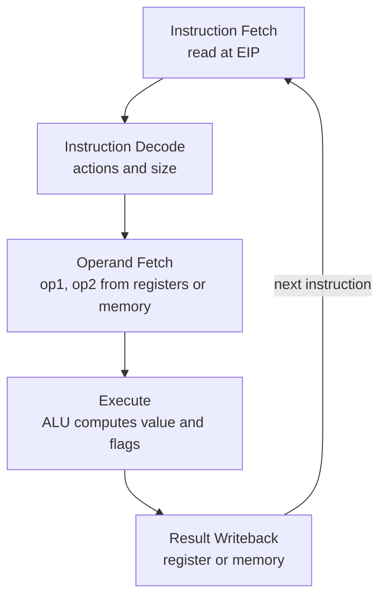
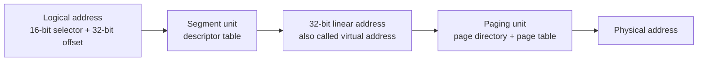

# Computer Architecture - Lecture 5: Instruction Execution Cycle and IA-32 Memory Management

## Instruction Execution Cycle

The cycle is an **infinite loop** of five stages, each with one defined job:

| Stage                  | What it does                                            |
| ---------------------- | ------------------------------------------------------- |
| **Instruction Fetch**  | Obtain the instruction from program storage             |
| **Instruction Decode** | Determine the required actions and the instruction size |
| **Operand Fetch**      | Locate and obtain the operand data                      |
| **Execute**            | Compute the result value and status                     |
| **Result Writeback**   | Deposit the results in storage for later use            |

IA-32 splits the cycle differently from the generic version in Lecture 1. **Operand Fetch** is its own stage because CISC instructions may read operands straight from memory, and **Result Writeback** can target memory as well as a register. Same cycle, finer split.

One pass moves data like this: the **PC** addresses program memory, the fetched instruction lands in the **instruction register**, the **registers** supply `op1` and `op2`, the **ALU** computes the result and sets the **flags**, and the result is written back to a register.



### Pipelined Execution

Instruction execution divides into **stages**, and **pipelining** starts an instruction before the previous one finishes: while I-1 executes, I-2 decodes and I-3 is fetched. For $k$ stages and $n$ instructions:

$$\text{cycles} = k + n - 1$$

Ten instructions through five stages take $5 + 10 - 1 = 14$ cycles instead of 50. As $n$ grows, throughput approaches **one instruction per cycle** while the latency of a single instruction stays at $k$ cycles.

> [!NOTE] Wasted cycles
> When one stage needs **two or more** clock cycles, bubbles appear in the pipeline. For $k$ stages where one stage takes 2 cycles, $n$ instructions need $k + 2n - 1$ cycles, so the same ten instructions cost $5 + 20 - 1 = 24$ cycles rather than 14. The slowest stage sets the pace.

### Superscalar Architecture

A **superscalar** processor has **multiple execution pipelines**. The Pentium has two, the **U-pipe** and the **V-pipe**. Duplicating the slow stage lets the second pipeline fill the bubbles, and $n$ instructions then need

$$\text{cycles} = k + n$$

so the same ten instructions cost $5 + 10 = 15$ cycles instead of 24. This is the hardware behind the "2 instructions per clock" (Pentium) and "3 instructions per clock" (Pentium Pro) claims from the Intel history in Lecture 4.

> [!WARNING] Do not mix the three formulas
> $k + n - 1$ assumes every stage takes exactly one cycle. $k + 2n - 1$ is one slow stage with a single pipeline. $k + n$ is that slow stage with a second pipeline. Picking the wrong one is the standard way to lose marks on a pipeline question.

## IA-32 Memory Management

### Modes of Operation

| Mode                  | Address space            | Protection                                                                         | Used by                                              |
| --------------------- | ------------------------ | ---------------------------------------------------------------------------------- | ---------------------------------------------------- |
| **Real-address mode** | **1 MB**, `0` to `FFFFF` | **None**: programs can access any part of main memory                              | MS-DOS; the mode the CPU starts in                   |
| **Protected mode**    | **4 GB** per program     | The OS assigns memory and **prevents programs from accessing each other's memory** | Windows NT/2000/XP and Linux (native mode)           |
| **Virtual 8086 mode** | 1 MB per program         | Protected mode underneath                                                          | Running real-mode programs under a protected-mode OS |

Real-address mode is the original 8086 mode. Protected mode arrived with the **80386**. Virtual 8086 mode runs the processor in protected mode while presenting each program with a virtual 8086 machine.

### Real-Address Mode

- A program can access **up to six segments** at any time: **code**, **stack**, **data**, and up to **three extra** segments (ES, FS, GS).
- **Each segment is 64 KB.**
- A **logical address** is a **16-bit segment** plus a **16-bit offset**.
- The **linear (physical) address** is **20 bits**, which is what limits the space to 1 MB.

$$\text{Linear address} = (\text{Segment} \times 10_{16}) + \text{Offset}$$

Multiplying the segment by `10` hex (16 decimal) shifts it one hex digit, four bits, which is how a 16-bit register reaches a 20-bit address.

#### Worked: logical to linear in real-address mode

**Segment `A1F0`, offset `04C0`:**

```text
  A1F00    segment x 10h
+  04C0    offset
--------
  A23C0    20-bit linear address
```

**Segment `028F`, offset `0030`:**

```text
  028F0
+  0030
--------
  02920
```

> [!NOTE] Many logical addresses, one linear address
> `28F30` is reachable as `28F3:0000`, `28F2:0010`, `28F0:0030`, `28B0:0430`, and many more. The 16-byte granularity of the segment shift makes segments overlap, so one byte has many names. That is a property of real mode, not a defect.

> [!WARNING] Wrap-around at 1 MB
> The address bus is 20 bits, so `FFFF:0010` computes `100000`, which the 8086 wraps to `00000`. The 286 and later added the **A20 gate** to keep the 21st bit. The deck does not cover this, but it is a standard follow-up question.

### Flat Memory Model

Modern operating systems **turn segmentation off** and give each program one **32-bit linear address space** of up to $2^{32}$ = **4 GB**:

- The **segment registers are defined by the operating system**, and all segments map to the **same linear address space**.
- Assembly code declares the model with the **`.MODEL flat`** directive.
- A **linear address is also called a virtual address**; the OS maps virtual addresses onto physical ones with **paging**.

In the programmer's view every segment has **base address 0**, so the offset is the address:

| Register           | Role in the flat model                                |
| ------------------ | ----------------------------------------------------- |
| **EIP**            | Points at the next instruction                        |
| **ESI, EDI**       | Hold data addresses, also used to index arrays        |
| **ESP**            | Points at the top of the stack                        |
| **EBP**            | Addresses parameters and local variables on the stack |
| **CS, DS, SS, ES** | Present but unused: all map to the same 4 GB space    |

### Protected Mode Architecture

A logical address is a **16-bit segment selector** plus a **32-bit offset**, and translation happens in two steps:



- The **segment unit** translates logical to linear using a **segment descriptor table**.
- The **paging unit** translates linear to physical using a **page directory** and a **page table**.

### Segment Selectors and Descriptor Tables

The **upper 13 bits of the selector index the descriptor table**, and the **TI (Table Indicator)** bit picks which table:

- **TI = 0** -> **Global Descriptor Table (GDT)**
- **TI = 1** -> **Local Descriptor Table (LDT)**

| Table   | Scope               | Register | Contents                                                                                                |
| ------- | ------------------- | -------- | ------------------------------------------------------------------------------------------------------- |
| **GDT** | **One per system**  | **GDTR** | Descriptors for **all programs** plus the OS itself; initialized at boot. Windows XP uses a single GDT. |
| **LDT** | **One per program** | **LDTR** | Descriptors for **only one program**.                                                                   |

A **segment descriptor** carries three fields:

- **Base address** (32-bit): where the segment starts. **Base + offset = linear address.**
- **Segment limit** (20-bit): the size in bytes or in multiples of **4 KB pages**, so a segment spans **4 KB to 4 GB**.
- **Access rights**: code or data, read-only or read/write, and the **privilege level** that protects access.

> [!NOTE] Visible and invisible halves
> The **16-bit segment register** (CS, SS, DS, ES, FS, GS) is the **visible** part the programmer sees. The **64-bit descriptor** is the **invisible** part, loaded automatically from the descriptor table whenever the selector is loaded. Changing the selector therefore changes base, limit, and rights without any explicit instruction.

### Paging

**Paging** divides the linear address space into fixed-size blocks called **pages**; IA-32 uses **4 KB pages**.

- The OS allocates main memory for pages, and pages can be **spread all over main memory**.
- Pages in main memory can belong to **different programs** at once.
- When main memory is full, pages are **stored on the hard disk**.
- The OS **Virtual Memory Manager (VMM)** uses **page tables** to map each running program's pages and manages loading and unloading.
- The CPU performs **address translation while the program runs**.
- A **page fault** is issued by the CPU when the needed page is not in memory.

Each running program has its **own page table**, and the OS **swaps pages between memory and disk**. The processor translates linear virtual addresses into real (physical) addresses on every access.

### Splitting a Linear Address for Paging

With 4 KB pages, a 32-bit linear address splits into three fields:

```text
 31            22 21            12 11              0
+----------------+----------------+----------------+
| directory (10) |  page (10)     |  offset (12)   |
+----------------+----------------+----------------+
```

- **10 bits** select an entry in the **page directory** (1024 entries).
- **10 bits** select an entry in the **page table** (1024 entries). Together $1024 \times 1024 \times 4\text{ KB} = 4\text{ GB}$.
- **12 bits** are the **page offset**, passed through unchanged because a page is $2^{12}$ bytes.

**Worked example:** linear address `00403ABC`.

```text
00403ABC = 0000 0000 01 | 00 0000 0011 | 1010 1011 1100
directory index = 1
page index      = 3
offset          = ABC
```

Two lookups precede the data access, one for the page directory entry and one for the page table entry, which is why real processors cache recent translations in a **TLB**.

## Lecture Summary

- The IA-32 cycle is **Fetch, Decode, Operand Fetch, Execute, Result Writeback**, repeated forever.
- Pipelining costs $k + n - 1$ cycles; one 2-cycle stage costs $k + 2n - 1$; a second pipeline on that stage brings it back to $k + n$.
- IA-32 runs in **real-address**, **protected**, or **virtual 8086** mode, differing in address space and protection.
- Real mode: **segment × 10h + offset**, 20-bit linear address, 64 KB segments, 1 MB total, no protection.
- The **flat model** maps every segment to base 0, so the 32-bit offset is the virtual address.
- Protected mode translates **selector -> descriptor -> linear**, then **page directory -> page table -> physical**.
- **Paging** uses 4 KB pages, gives each program its own page table, and raises a **page fault** when a page is not in memory.

_12 min read (source: 11 min)_
