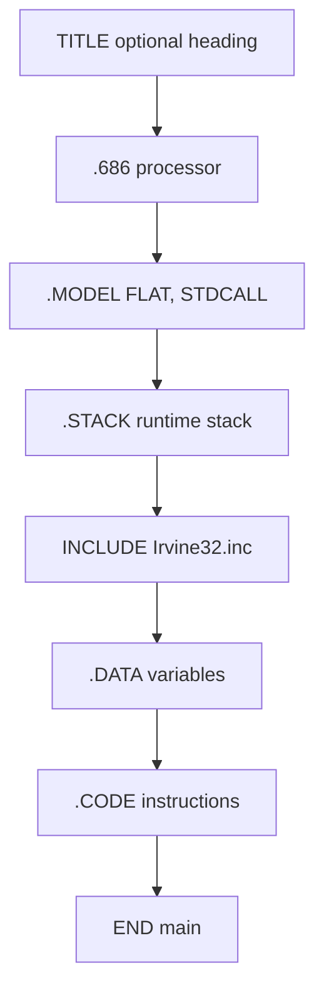

# Computer Architecture - Lecture 6: Introduction to Assembly Language

## Constants

### Integer Constants

```asm
-10          ; decimal, sign allowed
42d          ; explicit decimal
10001101b    ; binary
0FF3Ah       ; hexadecimal, leading 0 required
777o         ; octal
```

| Suffix | Radix   |
| ------ | ------- |
| `b`    | binary  |
| `d`    | decimal |
| `h`    | hex     |
| `o`    | octal   |

- With **no suffix**, the constant is **decimal**.
- A **hexadecimal constant that begins with a letter must start with `0`**, so `0FF3Ah` rather than `FF3Ah`.

> [!WARNING] Why the leading zero is not optional
> `FF3Ah` would be read as an identifier, because it starts with a letter. The assembler cannot tell a hex constant from a label without the `0`. This is the single most common syntax error in the first assembly assignment.

### Character and String Constants

- Enclose a character or string in **single or double quotes**: `'A'`, `"d"`, `'ABC'`, `"ABC"`, `'4096'`.
- **Embedded quotes** use the other quote type: `"single quote ' inside"` and `'double quote " inside'`.
- **Each ASCII character occupies one byte**, so `'ABC'` is three bytes, while `'4096'` is four bytes of text and not the number 4096.

## Assembly Language Statements

Three kinds of statement, and typically **one statement per line**:

| Type                        | Purpose                                                                                          | Executed at runtime?                    |
| --------------------------- | ------------------------------------------------------------------------------------------------ | --------------------------------------- |
| **Executable instructions** | Generate machine code for the processor to execute                                               | **Yes**                                 |
| **Assembler directives**    | Tell the assembler what to do while translating: define data, select the memory model, and so on | **No**; not part of the instruction set |
| **Macros**                  | Shorthand for a group of statements: instructions, directives, or other macros                   | Only through what they expand into      |

The distinction is the exam point: a **directive** shapes the translation, an **instruction** shapes the running program.

## Instruction Format

```text
[label:] mnemonic [operands] [;comment]
```

| Part         | Rule                                                                                                  |
| ------------ | ----------------------------------------------------------------------------------------------------- |
| **Label**    | Optional, **must end with a colon**, marks the address of the instruction, and is the target of jumps |
| **Mnemonic** | Names the operation: `MOV`, `ADD`, `SUB`, `JMP`, `CALL`                                               |
| **Operands** | Supply the data; **zero to three** operands; each is a **register, memory variable, or constant**     |
| **Comment**  | Starts at `;` and runs to the end of the line                                                         |

### Operand counts

| Operands | Example            | Meaning                             |
| -------- | ------------------ | ----------------------------------- |
| **0**    | `stc`              | Set the carry flag                  |
| **1**    | `inc eax`          | Increment register eax              |
|          | `call Clrscr`      | Call procedure Clrscr               |
|          | `jmp L1`           | Jump to the instruction labelled L1 |
| **2**    | `add ebx, ecx`     | `ebx = ebx + ecx`                   |
|          | `sub var1, 25`     | `var1 = var1 - 25`                  |
| **3**    | `imul eax, ebx, 5` | `eax = ebx * 5`                     |

> [!NOTE] Three-operand `imul` is the odd one
> Two-operand forms overwrite the destination. `imul eax, ebx, 5` writes the product into **eax** while reading **ebx**, so the source survives. That is why the three-operand form exists.

## Comments

Comments explain the program's purpose, when it was written and revised and by whom, the data, the instruction sequences and algorithms, and anything application-specific.

| Style           | Syntax                                                                                                 |
| --------------- | ------------------------------------------------------------------------------------------------------ |
| **Single-line** | Begins with `;`, terminates at end of line                                                             |
| **Multi-line**  | Begins with the **`COMMENT` directive** and a chosen delimiter character, ends with the same character |

## Flat Memory Program Template

```asm
TITLE Flat Memory Program Template (Template.asm)
; Program Description:
; Author:            Creation Date:
; Modified by:       Modification Date:

.686
.MODEL FLAT, STDCALL
.STACK
INCLUDE Irvine32.inc

.DATA
; (insert variables here)

.CODE
main PROC
    ; (insert executable instructions here)
    exit
main ENDP
; (insert additional procedures here)

END main
```

### What each directive does

| Directive                  | Role                                                                                                                                                                      |
| -------------------------- | ------------------------------------------------------------------------------------------------------------------------------------------------------------------------- |
| **`TITLE`**                | Optional brief heading with the program name and disk file name                                                                                                           |
| **`.686`**                 | Processor directive, placed **before** `.MODEL`; allows Pentium P6 instructions. **At least `.386` is required** with the flat model                                      |
| **`.MODEL FLAT, STDCALL`** | Selects the memory configuration. **FLAT** means one linear 32-bit address space with no segmentation. **STDCALL** selects standard naming and procedure-call conventions |
| **`.STACK`**               | Defines the **runtime stack**, required for procedure calls; the size may be given (`.STACK 4096`)                                                                        |
| **`.DATA`**                | Defines the memory area for variables; the assembler allocates and initializes their storage                                                                              |
| **`.CODE`**                | Defines the code section; the assembler places the instructions there                                                                                                     |
| **`INCLUDE`**              | Pulls in code from another file; here **`Irvine32.inc`**, which declares the procedures implemented in **`Irvine32.lib`** (link that library to use them)                 |
| **`PROC` / `ENDP`**        | Open and close a procedure; by convention **`main`** is the first procedure and others follow                                                                             |
| **`END`**                  | Marks the end of the program and names the **startup procedure**, here `main`                                                                                             |



## Example: Adding and Subtracting Integers

```asm
TITLE Add and Subtract (AddSub.asm)
; This program adds and subtracts 32-bit integers.

.686
.MODEL FLAT, STDCALL
.STACK
INCLUDE Irvine32.inc

.CODE
main PROC
    mov eax, 10000h      ; EAX = 10000h
    add eax, 40000h      ; EAX = 50000h
    sub eax, 20000h      ; EAX = 30000h
    call DumpRegs        ; display registers
    exit
main ENDP
END main
```

The arithmetic in hexadecimal:

```text
  10000h
+ 40000h
--------
  50000h
- 20000h
--------
  30000h
```

### Console output from `DumpRegs`

`DumpRegs` is defined in **`Irvine32.lib`** and prints the registers and flags:

```text
EAX=00030000  EBX=7FFDF000  ECX=00000101  EDX=FFFFFFFF
ESI=00000000  EDI=00000000  EBP=0012FFF0  ESP=0012FFC4
EIP=00401024  EFL=00000206  CF=0  SF=0  ZF=0  OF=0
```

Only **EAX** comes from our code. `EBX`, `ECX`, `EDX`, `ESP`, `EBP`, and `EIP` hold whatever the runtime left there, which is why they look random.

**Decoding `EFL=00000206`:**

```text
00000206h = 0010 0000 0110b
bit 1  = 1  reserved, always 1
bit 2  = 1  PF  parity even (low byte 00h has zero 1s, which is even)
bit 9  = 1  IF  interrupts enabled
all other flags 0: CF, AF, ZF, SF, TF, DF, OF
```

The `DumpRegs` line prints only CF, SF, ZF, and OF, so `PF` and `IF` are visible only if you decode the hex value.

## Suggested Coding Standards

- **Capitalization:** MASM is **not case sensitive**, so any of these work: capitalize nothing, capitalize everything, capitalize reserved words, mnemonics and register names, or capitalize only directives and operators. Pick one and stay with it.
- Use **meaningful identifier names**.
- Put **blank lines between procedures**.
- Use **indentation and spacing** to align instructions and comments.
- **Tabs indent instructions; labels are not indented.** That convention is what makes labels easy to scan.
- **Align the comments** that follow instructions.

## Understanding Program Termination

The **`exit`** at the end of `main` is a **macro** defined in `Irvine32.inc`. It expands into a call to **`ExitProcess`**, which lives in **`kernel32`** and terminates the program.

Equivalent replacements:

```asm
; Replacement 1: explicit stack parameter and call
push 0                  ; push parameter 0 on the stack
call ExitProcess        ; terminate the program

; Replacement 2: INVOKE form
INVOKE ExitProcess, 0
```

The **`PROTO`** directive **declares a procedure defined elsewhere**, giving its parameters and types:

```asm
ExitProcess PROTO, ExitCode:DWORD
```

### Modified program without `Irvine32.inc`

```asm
TITLE Add and Subtract (AddSubAlt.asm)
; This program adds and subtracts 32-bit integers

.686
.MODEL flat, stdcall
.STACK 4096

; No need to include Irvine32.inc
ExitProcess PROTO, dwExitCode:DWORD

.code
main PROC
    mov eax, 10000h      ; EAX = 10000h
    add eax, 40000h      ; EAX = 50000h
    sub eax, 20000h      ; EAX = 30000h

    push 0
    call ExitProcess     ; terminate the program
main ENDP
END main
```

Dropping `Irvine32.inc` also drops `DumpRegs`, so this version produces no console output. It terminates through `ExitProcess` directly.

## Homework

**HW-3 (Register Arithmetic)** closes this lecture: load `2000h` into AX, add `3000h`, load `1500h` into BX, subtract BX from AX, add `0500h`, and end. The worked program, the instruction-by-instruction explanation, and the optional variant are in [Task 3](/College/yearThree/firstTerm/ComputerArchitecture/Tasks/Task-3).

> [!NOTE] Two different assemblers in this course
> This lecture uses **32-bit MASM** with the Irvine library (`.MODEL FLAT`, `EAX`). HW-3 asks for **emu8086**, a 16-bit 8086 emulator (`AX`, `BX`, `INT 21h`). The syntax overlaps, but the register widths, the memory model, and the exit mechanism do not. Do not paste a MASM template into emu8086.

## Lecture Summary

- Integer constants take a radix suffix (`b`, `d`, `h`, `o`), default to decimal, and need a **leading `0`** when a hex value starts with a letter.
- Strings sit in quotes, one **byte per character**, and embedded quotes use the other quote type.
- Statements are **instructions** (executed), **directives** (assembler only), or **macros** (expanded).
- Instruction format: **`[label:] mnemonic [operands] [;comment]`**, with zero to three operands.
- The flat template needs `.686`, `.MODEL FLAT, STDCALL`, `.STACK`, `INCLUDE Irvine32.inc`, `.DATA`, `.CODE`, `main PROC`, and `END main`.
- **`exit`** is a macro that calls **`ExitProcess`**; `push 0` + `call ExitProcess`, `INVOKE ExitProcess, 0`, and a `PROTO` declaration all replace it.
- **MASM is case insensitive**; indentation and comment alignment are the conventions that matter.

_10 min read (source: 9 min)_
