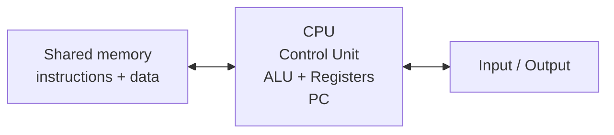

# Computer Architecture - Sheet 1: Computer Architecture

Covers **Lectures 1 and 2**: architecture vs. organization, abstraction levels, Von Neumann, the instruction cycle, the performance equation, and power trends.

> [!NOTE] What the sheet contains
> **Part A** has 47 MCQs (the header claims 50). **Part B** has 20 short questions. **Part C** announces **7** long questions but only **6** appear, and questions 1 and 2 are prompts with no printed answer, so their model answers below are built from Lecture 1.

## Part A: MCQ Answer Key

| #   | Ans | Tested point                                                    |
| --- | --- | --------------------------------------------------------------- |
| 1   | B   | Architecture = **programmer-visible features**                  |
| 2   | C   | Organization = **hardware implementation**                      |
| 3   | C   | **Instruction-set architecture** is architectural               |
| 4   | D   | **Datapath and control unit** are organizational                |
| 5   | B   | `add x5, x6, x7` is an **architectural** instruction            |
| 6   | B   | **ALU** performs arithmetic and logical operations              |
| 7   | C   | **Control unit** controls CPU operation                         |
| 8   | A   | **Transistors and circuits** is an abstraction level            |
| 9   | C   | **Datapath and control** sits directly above digital logic      |
| 10  | C   | **Application programs** are closest to the user                |
| 11  | B   | Compiler translates high-level programs toward lower levels     |
| 12  | B   | ISA sits between **assembly language** and **datapath/control** |
| 13  | B   | **Von Neumann** stores instructions and data in one memory      |
| 14  | B   | Stored-program = **instructions and data in memory**            |
| 15  | B   | **Program Counter** holds the address of the next instruction   |
| 16  | B   | **Instruction memory** supplies the instruction                 |
| 17  | B   | **Data memory** stores operands and results                     |
| 18  | D   | **Compile** is not an instruction-cycle stage                   |
| 19  | C   | First stage is **Fetch**                                        |
| 20  | A   | Fetch reads the instruction using the **PC**                    |
| 21  | B   | Decode identifies **operation, operands, control signals**      |
| 22  | A   | Execute performs an **ALU operation** (or address calculation)  |
| 23  | A   | Memory access = **read or write data when required**            |
| 24  | B   | Write back stores the **result in the destination register**    |
| 25  | B   | Order: **Fetch -> Decode -> Execute -> Memory -> Write back**   |
| 26  | A   | CPU time = **IC × CPI × clock cycle time**                      |
| 27  | B   | CPI = **Cycles Per Instruction**                                |
| 28  | A   | Instruction count = **instructions executed**                   |
| 29  | B   | Clock rate = **cycles per second**                              |
| 30  | B   | CPU time = **IC × CPI / clock rate**                            |
| 31  | D   | Cache misses, branches, memory latency all affect performance   |
| 32  | B   | CPI up (others fixed) -> execution time **increases**           |
| 33  | B   | Clock rate up (IC, CPI fixed) -> execution time **decreases**   |
| 34  | A   | CPU = **control unit, ALU, registers**                          |
| 35  | C   | **Addressing mode** is programmer-visible                       |
| 36  | A   | **Datapath** is hardware implementation                         |
| 37  | A   | **ALU and register file** are organization                      |
| 38  | B   | RISC-V is an **instruction-set architecture**                   |
| 39  | A   | **ALU** is hardware (compiler, OS, app are not)                 |
| 40  | A   | Firmware = **software stored to control hardware**              |
| 41  | B   | Below assembly language sits the **ISA**                        |
| 42  | A   | Below datapath and control sits **digital logic**               |
| 43  | B   | Rising frequency contributed to the **power wall**              |
| 44  | A   | $P \propto$ **activity × capacitance × voltage² × frequency**   |
| 45  | C   | **Voltage** is squared in the dynamic-power relation            |
| 46  | A   | Leakage power relates to **transistor count and voltage**       |
| 47  | A   | Von Neumann = **memory, CPU, input/output**                     |

## Part B: Short Questions

| #   | Question                                 | Answer                                                                                                                                      |
| --- | ---------------------------------------- | ------------------------------------------------------------------------------------------------------------------------------------------- |
| 1   | What is computer architecture?           | The **programmer-visible features**: ISA, registers, data types, addressing modes, and the memory/I/O model.                                |
| 2   | What is computer organization?           | **How the architecture is implemented** in hardware: datapath, control unit, ALU, register file, pipeline, cache, buses, memory technology. |
| 3   | Architecture vs. organization?           | Architecture is **what the programmer sees**; organization is **how the hardware delivers it**.                                             |
| 4   | What is an instruction-set architecture? | The **interface between software and hardware** that defines the instructions and programmer-visible aspects of a processor.                |
| 5   | What is the stored-program concept?      | **Instructions and data are stored in memory** and accessed by the processor.                                                               |
| 6   | What is Von Neumann architecture?        | Instructions and data share one memory, processed by a CPU holding the **control unit, ALU, and registers**.                                |
| 7   | Function of the Program Counter?         | Holds the **address of the next instruction** to be executed.                                                                               |
| 8   | Five instruction-execution stages?       | **Fetch, Decode, Execute, Memory Access, Write Back.**                                                                                      |
| 9   | What happens during fetch?               | The processor reads the instruction using the address in the **Program Counter**.                                                           |
| 10  | What happens during decode?              | The processor identifies the **operation, operands, and required control signals**.                                                         |
| 11  | What happens during execute?             | The processor performs an **ALU operation** or **calculates an address**.                                                                   |
| 12  | What is CPI?                             | **Cycles Per Instruction**: the average number of clock cycles per instruction.                                                             |
| 13  | CPU execution-time formula?              | $IC \times CPI \times \text{cycle time}$, equivalently $(IC \times CPI) / \text{clock rate}$.                                               |
| 14  | What is clock rate?                      | The number of **clock cycles per second**.                                                                                                  |
| 15  | Three factors affecting performance?     | **Instruction count, CPI, clock rate**; cache misses, branches, and memory latency also matter.                                             |
| 16  | What is RISC-V?                          | The **instruction-set architecture** used throughout this course.                                                                           |
| 17  | What is dynamic power?                   | Power from **switching activity**, proportional to **activity × capacitance × V² × frequency**.                                             |
| 18  | What is the power wall?                  | The limit hit when **raising frequency caused excessive power consumption**.                                                                |
| 19  | Main CPU components?                     | **Control unit, ALU, registers.**                                                                                                           |
| 20  | Instruction memory vs. data memory?      | **Instruction memory** provides instructions; **data memory** stores operands and results.                                                  |

## Part C: Long Questions

### 1. Explain computer architecture and computer organization

**Computer architecture** is the set of features a programmer can see: the **instruction-set architecture**, registers and data types, **addressing modes**, and the memory and I/O model. A program compiled against an architecture runs on any processor that implements it.

**Computer organization** is the hardware that implements those features: the **datapath**, **control unit**, **ALU**, register file, **pipeline**, **cache**, buses, and memory technology.

| Computer architecture            | Computer organization         |
| -------------------------------- | ----------------------------- |
| Programmer-visible features      | Hardware implementation       |
| **Instruction-set architecture** | **Datapath and control unit** |
| Registers and data types         | ALU and register file         |
| Addressing modes                 | Pipeline and cache design     |
| Memory and I/O model             | Buses and memory technology   |

The two are independent: several organizations can implement one architecture, and a new organization that keeps the ISA leaves every existing binary running. That is exactly why `add x5, x6, x7` is architecture while the ALU that executes it is organization.

### 2. Explain the levels of abstraction in a computer system

Each level hides the level below it, so a programmer never needs the hardware to write correct code, and a hardware designer never needs the application.

1. **Application programs**
2. **High-level language**
3. **Compiler / operating system**
4. **Assembly language**
5. **Instruction-set architecture**
6. **Datapath and control**
7. **Digital logic**
8. **Transistors and circuits**

Read the list in both directions. Downward, each step **translates or decomposes** the one above: the compiler lowers high-level code to assembly, the assembler to machine code, the ISA is realized by datapath and control, which are built from logic gates, which are built from transistors. Upward, each step **hides detail**: the ISA hides whether an add takes one cycle or three, and the high-level language hides the register allocation.

The **ISA** is the boundary the course studies, because it is the lowest level that software can still see and the highest level that hardware must still honor.

### 3. Explain Von Neumann architecture and the stored-program concept

**The stored-program concept** states that program **instructions and the data they operate on are stored together in the same physical memory**. Instead of rewiring hardware for each new task, the processor treats instructions as encoded numbers that it can load, modify, and execute in sequence.

**Three subsystems:**

- **CPU**
  - **Control unit (CU)**: fetches instructions, decodes them, and generates the control signals for the other components.
  - **ALU**: performs arithmetic (addition, subtraction) and logical operations.
  - **Registers**: high-speed storage inside the CPU, including the **Program Counter (PC)** that tracks the address of the next instruction.
- **Shared memory**: holds both instructions and data operands.
- **I/O system**: connects the computer to external devices, accepting input and outputting results.

**The Von Neumann bottleneck:** instructions and data travel over the **same shared bus**, so they cannot move at the same time. Processor clock rates rose far faster than memory transfer rates, which made **memory throughput** the limiting factor for overall performance. Modern designs push back with **multi-level caches** and **separate instruction and data caches** close to the CPU, which is a modified Harvard arrangement.

### 4. Explain the complete instruction-execution cycle

1. **Fetch**: read the instruction using the **Program Counter**.
2. **Decode**: identify the operation, identify the operands, and generate or identify the **control signals**.
3. **Execute**: perform an **ALU operation** or **calculate an address**.
4. **Memory access**: **read or write data** when required.
5. **Write back**: store the **result in the destination register**.

The order is fixed because each stage consumes the previous stage's output: the address computed in Execute is what Memory access uses, and the value read there is what Write back stores. A full answer names the components doing the work: the PC and instruction memory in Fetch, the control unit in Decode, the ALU in Execute, data memory in Memory access, and the register file in Write back.

### 5. Discuss power consumption trends in modern processors

**Dynamic power** comes from switching:

$$P_{\text{dynamic}} \propto \text{activity} \times \text{capacitance} \times V^2 \times f$$

| Trend                      | What happened                                                                                                                     |
| -------------------------- | --------------------------------------------------------------------------------------------------------------------------------- |
| **Dynamic power**          | Surged as clock rates rose, because frequency appears directly in the formula                                                     |
| **Static leakage**         | Escalated with transistor density and shrinking geometries (subthreshold leakage)                                                 |
| **Power wall**             | Early 2000s: frequency increases stalled around **3–4 GHz** from heat-dissipation limits                                          |
| **End of Dennard scaling** | Early 2010s: supply voltage could no longer scale down with transistor size                                                       |
| **Modern solutions**       | Multicore parallelism, dynamic throttling, and **dark/dim silicon** (powering down unused circuits) to stay within thermal limits |

The voltage term is **squared**, which is why voltage scaling was the most powerful lever and why losing it mattered so much: frequency could not keep rising once voltage had to stay put.

### 6. Compare RISC and CISC and relate them to computer architecture

| Feature                       | **RISC** (ARM, RISC-V, MIPS)                                           | **CISC** (x86, Motorola 68000)                                            |
| ----------------------------- | ---------------------------------------------------------------------- | ------------------------------------------------------------------------- |
| **Philosophy**                | Shift complexity to the **compiler**; keep hardware simple and uniform | Shift complexity to **hardware**; put high-level abstractions in silicon  |
| **Instruction size**          | **Fixed** length (typically 32-bit words)                              | **Variable** length (1 to 15 bytes in modern x86)                         |
| **Execution model**           | **Load/store only**: ALU operations are register-to-register           | **Memory-to-register / memory-to-memory**: ALU can reference RAM directly |
| **Instruction count vs. CPI** | **Higher** instruction count, **CPI ≈ 1**                              | **Lower** instruction count, **variable CPI > 1**                         |
| **Registers**                 | Large register file (often **32+**)                                    | Historically small (**8–16**)                                             |
| **Control unit**              | **Hardwired** control (combinational logic, faster decode)             | **Microprogrammed** control (internal microcode ROM)                      |
| **Addressing modes**          | Few and simple (**base + offset**)                                     | Many and complex (indexed, scaled, indirect)                              |
| **Code density**              | Lower (more instructions per task)                                     | **High** (compact binaries, originally to save memory)                    |

The relation to architecture is direct: **RISC and CISC are organization choices about how much work one instruction does**, and Lecture 2 showed the trade is instruction count against CPI. CISC wins on instruction count, RISC wins on CPI and decode simplicity, and only the product $IC \times CPI \times \text{cycle time}$ decides which is faster for a given program.
