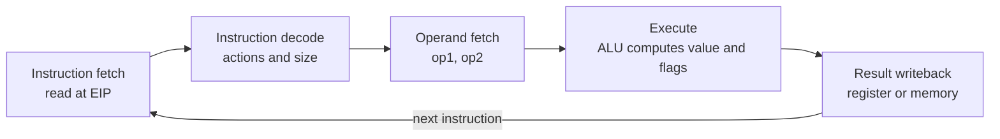
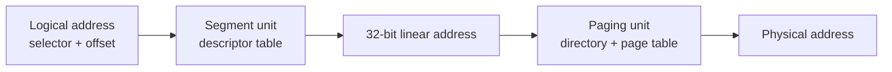

# Computer Architecture - Sheet 3: Number Systems, Intel Microprocessors, Memory Management

Covers **Lectures 3, 4 and 5**: binary/octal/hex, unsigned and two's-complement integers, Intel generations, CISC vs. RISC, IA-32 registers and EFLAGS, the execution cycle, pipelining, operating modes, segmentation and paging.

> [!NOTE] What the sheet contains
> **Part A** has **51** MCQs although the header says 50, and the printed answer key stops at Q50, so Q51's answer is taken from the question itself. **Part B** has 20 short questions with model answers. **Part C** has 7 long questions, all with model answers.
>
> The sheet is a revision bank over three lectures, so each Part C answer below is expanded into the working the exam will actually ask for: the arithmetic, the tables, and the address splits. Source lectures: [Lecture 3](/College/yearThree/firstTerm/ComputerArchitecture/Lectures/Lecture-3), [Lecture 4](/College/yearThree/firstTerm/ComputerArchitecture/Lectures/Lecture-4), [Lecture 5](/College/yearThree/firstTerm/ComputerArchitecture/Lectures/Lecture-5).

## Part A: MCQ Answer Key

| #   | Ans | Tested point                                                  |
| --- | --- | ------------------------------------------------------------- |
| 1   | A   | Digital circuits use two stable states, **0 and 1**           |
| 2   | B   | One byte = **8 bits**                                         |
| 3   | D   | Hexadecimal is **base 16**                                    |
| 4   | C   | $(1011)_2 = 8 + 2 + 1 = 11$                                   |
| 5   | A   | Decimal to binary by **repeated division by 2**               |
| 6   | A   | $25 = 16 + 8 + 1 = 11001_2$                                   |
| 7   | C   | $(101101)_2 = 32 + 8 + 4 + 1 = 45$                            |
| 8   | C   | One hex digit = **4 bits**                                    |
| 9   | A   | `1011 0100 1110` = **B4E**                                    |
| 10  | B   | $n$-bit unsigned range is $0$ to $2^n - 1$                    |
| 11  | C   | 8-bit unsigned range is **0 to 255**                          |
| 12  | B   | 8-bit two's-complement range is **−128 to 127**               |
| 13  | B   | MSB weight is **$-2^{n-1}$**                                  |
| 14  | C   | Negate by **invert all bits, then add 1**                     |
| 15  | C   | $-5$ = `11111011`                                             |
| 16  | C   | Overflow: **same-sign operands, opposite-sign result**        |
| 17  | C   | **80386** is the first 32-bit processor with 32-bit GPRs      |
| 18  | B   | 20-bit address bus = **1 MB**                                 |
| 19  | B   | **80286** introduced protected mode                           |
| 20  | C   | **80386** introduced paging and virtual memory                |
| 21  | B   | **80486**: on-chip FPU in DX versions, on-chip cache          |
| 22  | B   | Pentium has **two** execution pipelines                       |
| 23  | A   | **Pentium Pro** introduced dynamic execution                  |
| 24  | B   | CISC = **Complex Instruction Set Computer**                   |
| 25  | C   | RISC: **same-width instructions**, simpler formats            |
| 26  | B   | EAX is the **accumulator**                                    |
| 27  | B   | **ECX** is the LOOP counter                                   |
| 28  | C   | **ESP** points to the top of the stack                        |
| 29  | B   | **ESI and EDI** index string instructions                     |
| 30  | A   | EIP holds the **address of the next instruction**             |
| 31  | B   | EFLAGS holds **status and control flags**                     |
| 32  | B   | **CF** flags unsigned out-of-range or carry                   |
| 33  | C   | **OF** flags signed overflow                                  |
| 34  | B   | **ZF** is set when the result is zero                         |
| 35  | B   | **PF** is set for an even number of 1s in the low byte        |
| 36  | C   | x87 has **8** registers, ST(0) to ST(7)                       |
| 37  | B   | Fetch, decode, **operand fetch**, execute, writeback          |
| 38  | B   | Pipelining starts an instruction **before** the previous ends |
| 39  | C   | Ideal cycles = **$k + n - 1$**                                |
| 40  | A   | 6 stages, 4 instructions: $6 + 4 - 1 = 9$                     |
| 41  | B   | One 2-cycle stage: **$k + 2n - 1$**                           |
| 42  | B   | Superscalar = **multiple execution pipelines**                |
| 43  | B   | Pentium pipelines are **U and V**                             |
| 44  | B   | Real-address mode addresses **1 MB**                          |
| 45  | B   | **Protected mode** isolates programs from each other          |
| 46  | C   | Real-mode segment size is **64 KB**                           |
| 47  | B   | Linear address = **Segment × 10h + Offset**                   |
| 48  | B   | `028F0h + 0030h` = **02920h**                                 |
| 49  | B   | Paging translates **linear to physical**                      |
| 50  | C   | IA-32 page size is **4 KB**                                   |
| 51  | B   | Page fault = **required page is not in memory**               |

## Part B: Short Questions

| #   | Question                           | Answer                                                                                                                              |
| --- | ---------------------------------- | ----------------------------------------------------------------------------------------------------------------------------------- |
| 1   | Why binary?                        | Digital circuits reliably distinguish **two stable states**, 0 and 1; bit groups encode numbers, text, instructions, media.         |
| 2   | Define a positional number system. | Each digit's value depends on its **position and the base**; weights from the right are $b^0, b^1, b^2, \dots$                      |
| 3   | $(110101)_2$ in decimal?           | $32 + 16 + 4 + 1 = \mathbf{53}$                                                                                                     |
| 4   | $37$ in binary?                    | $37 = 32 + 4 + 1 = \mathbf{100101_2}$                                                                                               |
| 5   | $n$-bit unsigned range?            | $0 \le x \le 2^n - 1$                                                                                                               |
| 6   | $n$-bit two's-complement range?    | $-2^{n-1} \le x \le 2^{n-1} - 1$                                                                                                    |
| 7   | $-18$ in 8-bit two's complement?   | $+18$ = `00010010` -> invert `11101101` -> add 1 = **`11101110`**                                                                   |
| 8   | What is signed overflow?           | The mathematical result is **outside the signed range**; same-sign operands giving the opposite sign is the test.                   |
| 9   | Sign vs. zero extension?           | **Sign extension** copies the sign bit into the new upper bits; **zero extension** fills them with 0s.                              |
| 10  | CISC vs. RISC architecturally?     | CISC: large complex set, **variable-width** instructions, often microcoded. RISC: small simple set, **same-width**, simple formats. |
| 11  | Two features of the 80386?         | First **32-bit GPRs**, and **paging, virtual memory, flat model** with a 4 GB space.                                                |
| 12  | Roles of EAX, ECX, ESP?            | EAX **accumulator** for multiply/divide, ECX **loop counter**, ESP **top of stack** for PUSH/POP.                                   |
| 13  | What are ESI and EDI for?          | **Source and destination index** registers for string instructions.                                                                 |
| 14  | CF vs. OF?                         | CF = **unsigned** out-of-range/carry; OF = **signed** result out of range.                                                          |
| 15  | Five execution-cycle stages?       | **Fetch, decode, operand fetch, execute, result writeback.**                                                                        |
| 16  | What is pipelining, ideal formula? | Overlap stages of different instructions; ideal cycles = **$k + n - 1$**.                                                           |
| 17  | Define superscalar.                | A processor with **multiple execution pipelines**, issuing more than one instruction per cycle.                                     |
| 18  | Real vs. protected mode?           | Real: **1 MB**, no protection. Protected: OS-assigned memory, **4 GB** per program, programs isolated.                              |
| 19  | Linear address of `1234:0010`?     | `12340h + 0010h` = **`12350h`**                                                                                                     |
| 20  | Paging and page fault?             | Linear space split into **4 KB pages** mapped to physical memory; a **page fault** fires when the page is not in memory.            |

## Part C: Long Questions

### 1. Common number systems and conversions between them

Computers use **binary** because a digital circuit distinguishes two voltage states, 0 and 1. Every other base is a shorthand for the same bit pattern.

| System      | Base | Digits   | One digit in bits |
| ----------- | ---- | -------- | ----------------- |
| **Binary**  | 2    | 0–1      | 1                 |
| **Octal**   | 8    | 0–7      | 3                 |
| **Decimal** | 10   | 0–9      | not a bit group   |
| **Hex**     | 16   | 0–9, A–F | **4**             |

In a positional system the value is $\sum d_i \times b^i$. For $(1011)_2$:

$$1 \times 2^3 + 0 \times 2^2 + 1 \times 2^1 + 1 \times 2^0 = 8 + 0 + 2 + 1 = 11$$

**Decimal to binary: repeated division by 2.** Divide, keep the remainder, repeat until the quotient is 0, then read remainders **bottom to top**.

| Step | Division | Quotient | Remainder |
| ---- | -------- | -------- | --------- |
| 1    | 25 ÷ 2   | 12       | **1**     |
| 2    | 12 ÷ 2   | 6        | **0**     |
| 3    | 6 ÷ 2    | 3        | **0**     |
| 4    | 3 ÷ 2    | 1        | **1**     |
| 5    | 1 ÷ 2    | 0        | **1**     |

Reading upward: $25 = 11001_2$. Check: $16 + 8 + 1 = 25$.

**Binary to hex: group four bits from the right.** Pad the left group with zeros if needed.

```text
1011 0100 1110
  B    4    E   ->  B4E
```

Going back, expand each hex digit to four bits: `B4E` -> `1011 0100 1110`. Octal works the same way with **three-bit** groups: `101 101 010` -> `552` in octal, which is another way to write $45_{10}$.

> [!TIP] Choosing the shortcut
> Hex is used for memory addresses and machine code because **four bits per digit** lines up with a nibble. Octal survives mostly in file permissions and older machines. Decimal is only for humans.

### 2. Unsigned and two's-complement integers, negatives and overflow

| Representation       | $n$-bit range             | 8-bit range  | MSB weight |
| -------------------- | ------------------------- | ------------ | ---------- |
| **Unsigned**         | $0$ to $2^n - 1$          | 0 to 255     | $+2^{n-1}$ |
| **Two's complement** | $-2^{n-1}$ to $2^{n-1}-1$ | −128 to +127 | $-2^{n-1}$ |

The only difference between the two is the **weight of the most significant bit**. Everything else is identical, which is why the same adder hardware serves both.

**Encoding $-5$ in 8 bits:** write $+5$ = `00000101`, invert every bit to get `11111010`, add 1 to get **`11111011`**. Verify by decoding with weights: $-128 + 64 + 32 + 16 + 8 + 2 + 1 = -5$.

**Encoding $-18$:** $+18$ = `00010010` -> invert `11101101` -> add 1 -> **`11101110`**.

**Signed overflow** happens when the true result does not fit:

```text
 01111111   (+127)        10000000   (-128)
+00000001   (+1)         +11111111   (-1)
---------                ---------
 10000000   (-128)        01111111   (+127)
```

Both results are **the wrong sign**, so OF = 1. Adding operands of **different** signs can never overflow, because the magnitude of the result cannot exceed the larger operand.

The carry flag tells a different story: `11111111 + 00000001` produces CF = 1 and the correct signed result 0, so unsigned overflow and signed overflow are **independent** events.

**Extension** is how a narrow value widens:

```text
8-bit        16-bit, sign extension    16-bit, zero extension
11111011  -> 1111 1111 1111 1011       0000 0000 1111 1011
(-5)         = -5                       = 251
```

Copy the sign bit for a signed value, fill with zeros for an unsigned one. Using the wrong one silently changes the number.

### 3. Intel evolution from the 8086 through the P6 family

| Chip            | Year | Registers  | Data bus   | Address bus | Space | Landmark                                                |
| --------------- | ---- | ---------- | ---------- | ----------- | ----- | ------------------------------------------------------- |
| **8086**        | 1979 | 16-bit     | 16-bit     | 20-bit      | 1 MB  | Segmentation, the original x86                          |
| **8088**        | 1979 | 16-bit     | **8-bit**  | 20-bit      | 1 MB  | Same core, cheaper bus (IBM PC)                         |
| **80186**       | 1982 | 16-bit     | 16-bit     | 20-bit      | 1 MB  | Faster 8086 with integrated peripherals                 |
| **80286**       | 1982 | 16-bit     | 16-bit     | **24-bit**  | 16 MB | **Protected mode**                                      |
| **80386**       | 1985 | **32-bit** | 32-bit     | 32-bit      | 4 GB  | **Defines IA-32**: paging, virtual memory, flat model   |
| **80486**       | 1989 | 32-bit     | 32-bit     | 32-bit      | 4 GB  | On-chip FPU (DX), 8 KB unified cache, **pipelining**    |
| **Pentium**     | 1993 | 32-bit     | **64-bit** | 32-bit      | 4 GB  | **Superscalar**, U and V pipes, split 8 KB caches       |
| **Pentium Pro** | 1995 | 32-bit     | 64-bit     | **36-bit**  | 64 GB | Three-way superscalar, **dynamic execution**, 256 KB L2 |
| **Pentium II**  | 1997 | 32-bit     | 64-bit     | 36-bit      | 64 GB | MMX                                                     |
| **Pentium III** | 1999 | 32-bit     | 64-bit     | 36-bit      | 64 GB | **SSE**, eight 128-bit XMM registers                    |

Three patterns run through the table:

- **The address bus grows first.** 8086 (20), 286 (24), 386 (32), Pentium Pro (36). Physical memory expands before the register width does, because more address bits are cheaper than wider ALUs.
- **Each generation attacks a different bottleneck.** 286 added protection, 386 added a 32-bit flat model, 486 added cache and pipelining, Pentium added a second pipe, P6 added out-of-order and speculative execution.
- **The 80386 is the dividing line.** Everything called IA-32 begins there; anything earlier is 16-bit x86 with different addressing rules.

> [!NOTE] Bus width is not the same as register width
> The Pentium has a **64-bit data bus** but **32-bit registers and addresses**, so it still addresses 4 GB. The 8088 has **16-bit registers** but an **8-bit data bus**, which cost it two bus cycles per word. Read the table by column, not by generation number.

### 4. IA-32 registers and the EFLAGS status flags

IA-32 exposes **eight 32-bit general-purpose registers**, six 16-bit segment registers, **EIP**, and **EFLAGS**.

| Register                   | Name                | Primary job                                                    |
| -------------------------- | ------------------- | -------------------------------------------------------------- |
| **EAX**                    | Accumulator         | **Multiply and divide** use it implicitly; fast for arithmetic |
| **EBX**                    | Base                | General purpose; historically a base pointer for data          |
| **ECX**                    | Counter             | **LOOP**, and shift/rotate counts with `CL`                    |
| **EDX**                    | Data                | High half of a 64-bit multiply or divide result                |
| **ESP**                    | Stack Pointer       | **Top of stack**; updated by PUSH and POP                      |
| **EBP**                    | Base Pointer        | **Parameters and locals** in a stack frame                     |
| **ESI**                    | Source Index        | Source for **string** instructions                             |
| **EDI**                    | Destination Index   | Destination for **string** instructions                        |
| **EIP**                    | Instruction Pointer | **Address of the next instruction**; not writable by `MOV`     |
| **CS, SS, DS, ES, FS, GS** | Segment registers   | Select the code, stack, data, and extra segments               |

Each 32-bit register can be split: **EAX** into **AX** (low 16), then **AH** and **AL** (high and low bytes). Writing AL leaves AH and the upper 16 bits untouched, which is the source of many bugs when a program mixes widths.

**EFLAGS** is one 32-bit register where each flag is one bit:

| Flag   | Name            | Set when                                                      |
| ------ | --------------- | ------------------------------------------------------------- |
| **CF** | Carry           | **Unsigned** result needs a bit beyond the register width     |
| **PF** | Parity          | The **low byte** of the result has an **even** number of 1s   |
| **AF** | Auxiliary Carry | Carry out of **bit 3** to bit 4; used by BCD arithmetic       |
| **ZF** | Zero            | The result is **zero**                                        |
| **SF** | Sign            | **Bit 15/31** of the result, i.e. the sign bit                |
| **OF** | Overflow        | **Signed** result is outside the representable range          |
| **DF** | Direction       | String instructions walk **downward** (set) or upward (clear) |
| **IF** | Interrupt       | Maskable interrupts are enabled                               |
| **TF** | Trap            | Single-step mode for debugging                                |

CF and OF are the pair that gets tested. A carry out of bit 31 does **not** mean signed overflow, and signed overflow does not require a carry.

### 5. Execution cycle, pipelining and superscalar execution

The IA-32 cycle has **five stages**:



| Stage                  | Work                                                 |
| ---------------------- | ---------------------------------------------------- |
| **Instruction fetch**  | Read the instruction from memory at **EIP**          |
| **Instruction decode** | Determine the operation and the instruction **size** |
| **Operand fetch**      | Obtain `op1` and `op2` from registers or memory      |
| **Execute**            | Compute the result and the **flags**                 |
| **Result writeback**   | Store the result in a register or memory             |

**Pipelining** overlaps stages of different instructions: while I-1 executes, I-2 fetches operands and I-3 decodes. With $k$ stages and $n$ instructions, one instruction per stage per cycle:

$$T = k + n - 1$$

| Case                                | Formula      | $k = 6$, $n = 4$ |
| ----------------------------------- | ------------ | ---------------- |
| No pipeline                         | $k \times n$ | 24               |
| Ideal pipeline                      | $k + n - 1$  | **9**            |
| One stage needs 2 cycles            | $k + 2n - 1$ | **13**           |
| That stage duplicated (superscalar) | $k + n$      | **10**           |

The 13 comes from the slow stage becoming a bottleneck that inserts a bubble per instruction: $6 + 2(4) - 1 = 13$. A **superscalar** processor removes the bubbles by duplicating the slow stage, giving $6 + 4 = 10$.

**Superscalar** means **multiple execution pipelines**. The Pentium has two, the **U-pipe** and **V-pipe**, and can retire up to two instructions per clock. Pentium Pro raised this to three-way superscalar.

> [!WARNING] Three formulas, three assumptions
> $k + n - 1$ requires **every stage to take one cycle**. $k + 2n - 1$ is **one slow stage with a single pipe**. $k + n$ is that same slow stage with a **second pipe**. Mixing them is the standard way to lose marks.

### 6. Real-address, protected and virtual 8086 modes

| Mode             | Address space            | Protection                                  | Typical use                            |
| ---------------- | ------------------------ | ------------------------------------------- | -------------------------------------- |
| **Real-address** | **1 MB** (00000h–FFFFFh) | **None**; any program can write any address | MS-DOS; the state after reset          |
| **Protected**    | **4 GB** per program     | OS assigns memory and **isolates programs** | Windows NT/2000/XP, Linux              |
| **Virtual 8086** | 1 MB per program         | Protected mode underneath                   | Running DOS programs under a modern OS |

**Real-address mode** gives a program up to **six 64 KB segments**: code, stack, data, plus ES, FS, GS. A logical address is a **16-bit segment** and a **16-bit offset**, and the hardware computes

$$\text{Linear address} = \text{Segment} \times 10_{16} + \text{Offset}$$

Multiplying by `10h` shifts the segment one hex digit left, four bits, so a 16-bit register reaches a 20-bit address.

```text
  A1F0:04C0
    A1F00     segment x 10h
  +  04C0     offset
  --------
    A23C0     20-bit linear address

  1234:0010  ->  12340h + 0010h = 12350h
  028F:0030  ->  028F0h + 0030h = 02920h
```

Because the shift is only **four bits**, segments overlap: `28F30` is also `28F3:0000`, `28F2:0010`, and `28F0:0030`. One byte has many logical names, which is a property of real mode, not an error.

The 20-bit bus wraps at 1 MB: `FFFF:0010` computes `100000h`, which the 8086 truncates to `00000h`. The 286 added the **A20 gate** to stop that wrap.

**Protected mode** (80386) replaces the shift with a **descriptor lookup**: the selector picks a descriptor whose **base** is added to the 32-bit offset, so segments can be any size from 4 KB to 4 GB and carry access rights. **Virtual 8086 mode** runs the CPU in protected mode while presenting each task with a 1 MB real-mode machine.

### 7. Protected-mode segmentation, descriptor tables and paging

A protected-mode logical address is a **16-bit selector** plus a **32-bit offset**, and translation happens in two stages:



**The selector.** Bits 15–3 index the descriptor table, bit 2 is the **TI** (table indicator), and bits 1–0 are the requested privilege level.

- **TI = 0** -> **Global Descriptor Table (GDT)**, one per system, its base in **GDTR**; holds descriptors for the OS and all programs.
- **TI = 1** -> **Local Descriptor Table (LDT)**, one per program, its base in **LDTR**.

**The descriptor** holds three things:

| Field             | Size   | Meaning                                                      |
| ----------------- | ------ | ------------------------------------------------------------ |
| **Base address**  | 32-bit | Start of the segment; **base + offset = linear address**     |
| **Limit**         | 20-bit | Size in bytes or in 4 KB pages, so 4 KB to 4 GB              |
| **Access rights** | varies | Code or data, read/write permission, and **privilege level** |

The **16-bit segment register** is the visible half; the **64-bit descriptor** is the invisible half, cached when the selector is loaded. Changing the selector changes base, limit and rights with no explicit instruction.

**Paging** then maps the linear address to physical memory in **4 KB pages**, so a 32-bit address splits **10 / 10 / 12**:

```text
 31            22 21            12 11              0
+----------------+----------------+----------------+
| directory (10) |  page (10)     |  offset (12)   |
+----------------+----------------+----------------+
```

- 10 bits index one of 1024 **page directory** entries.
- 10 bits index one of 1024 **page table** entries; $1024 \times 1024 \times 4\text{ KB} = 4\text{ GB}$.
- 12 bits are the offset inside the page, passed through unchanged because $2^{12} = 4096$.

**Worked split:** linear address `00403ABC`.

```text
00403ABC = 0000 0000 01 | 00 0000 0011 | 1010 1011 1100
directory index = 1
page index      = 3
offset          = ABC
```

Each program has its **own page table**, so the same linear address maps to different physical frames in different processes. The **Virtual Memory Manager** loads and evicts pages, storing nonresident ones on disk, and the CPU raises a **page fault** when the needed page is absent. Two table lookups per access is expensive, which is why processors cache recent translations in a **TLB**.
