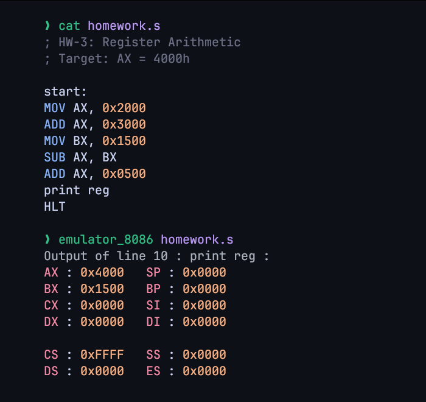

| Data    | Details                  |
| :------ | :----------------------- |
| Name    | ‎أحمد علي أحمد علي عثمان |
| Code    | 20241807                 |
| Section | 1                        |

# Computer Architecture - Home Work 3

## Register Arithmetic

1. Load `2000h` into AX.
2. Add `3000h` to AX.
3. Load `1500h` into BX.
4. Subtract BX from AX.
5. Add `0500h` to AX.
6. End the program.

## Program

```asm
; HW-3: Register Arithmetic
; Target: AX = 4000h

ORG 100h

MOV AX, 2000H
ADD AX, 3000H
MOV BX, 1500H
SUB AX, BX
ADD AX, 0500H

RET
```

## Explanation of Instructions

| Instruction     | Effect                                                               |
| --------------- | -------------------------------------------------------------------- |
| `MOV AX, 2000H` | Loads `2000h` into AX.                                               |
| `ADD AX, 3000H` | AX = `2000h + 3000h` = `5000h`.                                      |
| `MOV BX, 1500H` | Loads `1500h` into BX.                                               |
| `SUB AX, BX`    | AX = `5000h - 1500h` = `3B00h`.                                      |
| `ADD AX, 0500H` | AX = `3B00h + 0500h` = `4000h`.                                      |
| `RET`           | Returns control to DOS. No register is changed, so AX stays `4000h`. |

## Result

Final register values: **AX = 4000h**, **BX = 1500h**.

Screenshot after execution:



_Executed in an online 8086 emulator, which requires `0x` hex literals and a `start` label; the instructions and the result are identical._

## Optional Task

The final value must become `6000h`, which is `2000h` more than `4000h`. Changing the last constant from `0500h` to `2500h` produces it:

```asm
ADD AX, 2500H
```

`3B00h + 2500h = 6000h`, so the final value is **AX = 6000h**.
