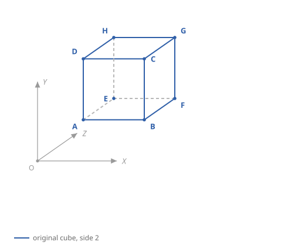
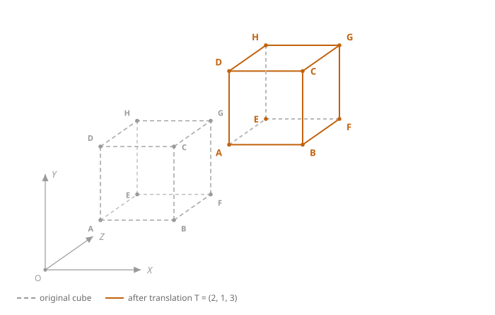
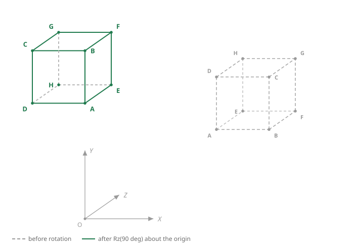
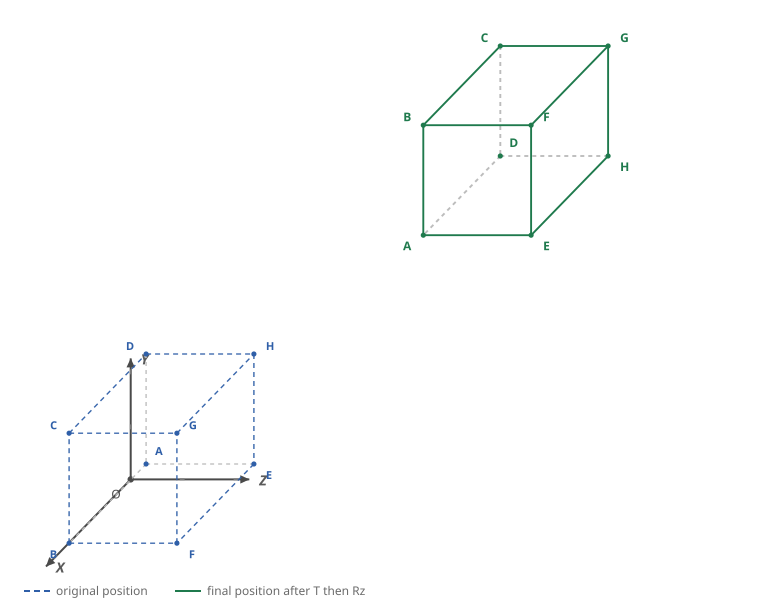
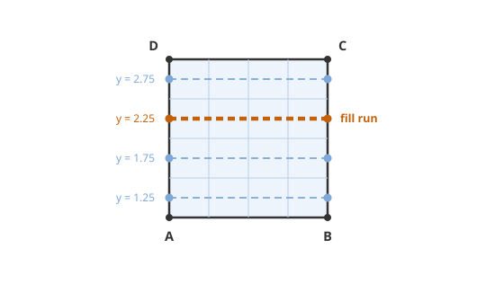
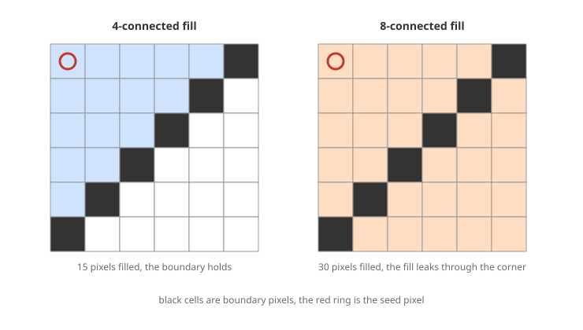
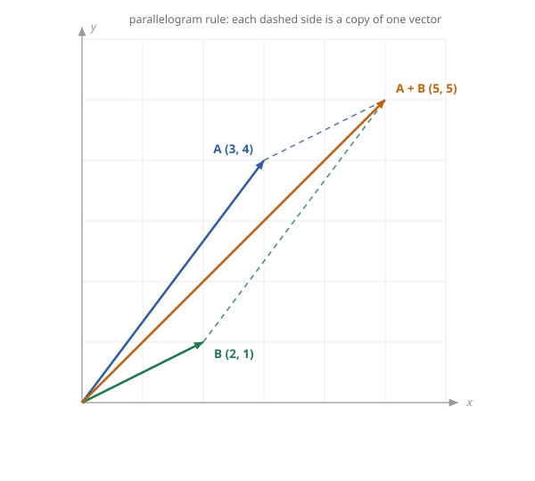

# Computer Graphics - Assignment 1: Transforming A Cube

## Task 1: 3D Transformations Of A Cube

### 1. The Original Cube

The sheet gives the eight vertices of the cube:

$$A(1,1,1),\; B(3,1,1),\; C(3,3,1),\; D(1,3,1),\; E(1,1,3),\; F(3,1,3),\; G(3,3,3),\; H(1,3,3)$$

$ABCD$ lies in the plane $z = 1$ and $EFGH$ lies in the plane $z = 3$. Both are squares of side 2.

| Vertex | Coordinates |     | Vertex | Coordinates |
| ------ | ----------- | --- | ------ | ----------- |
| A      | (1, 1, 1)   |     | E      | (1, 1, 3)   |
| B      | (3, 1, 1)   |     | F      | (3, 1, 3)   |
| C      | (3, 3, 1)   |     | G      | (3, 3, 3)   |
| D      | (1, 3, 1)   |     | H      | (1, 3, 3)   |

The twelve edges are $AB, BC, CD, DA$ on the bottom, $EF, FG, GH, HE$ on the top, and the four vertical edges $AE, BF, CG, DH$.

### 2. Translation By T = (2,1,3)

$$x' = x + 2, \qquad y' = y + 1, \qquad z' = z + 3$$

In homogeneous coordinates this is

$$T = \begin{bmatrix} 1 & 0 & 0 & 2 \\ 0 & 1 & 0 & 1 \\ 0 & 0 & 1 & 3 \\ 0 & 0 & 0 & 1 \end{bmatrix}$$

Vertex A as an example:

$$T\begin{bmatrix} 1 \\ 1 \\ 1 \\ 1 \end{bmatrix} = \begin{bmatrix} 3 \\ 2 \\ 4 \\ 1 \end{bmatrix} \Rightarrow A'(3,2,4)$$

The same for the rest:

| Vertex | Original  | Translated    |
| ------ | --------- | ------------- |
| A      | (1, 1, 1) | **(3, 2, 4)** |
| B      | (3, 1, 1) | **(5, 2, 4)** |
| C      | (3, 3, 1) | **(5, 4, 4)** |
| D      | (1, 3, 1) | **(3, 4, 4)** |
| E      | (1, 1, 3) | **(3, 2, 6)** |
| F      | (3, 1, 3) | **(5, 2, 6)** |
| G      | (3, 3, 3) | **(5, 4, 6)** |
| H      | (1, 3, 3) | **(3, 4, 6)** |

Each vertex moved by the same vector. The translated cube is still a cube of side 2, with its faces parallel to the coordinate planes.

### 3. Rotation Of 90° About The Z Axis

A rotation about the $z$ axis leaves $z$ alone and turns the $xy$ part:

$$R_z(90°) = \begin{bmatrix} 0 & -1 & 0 & 0 \\ 1 & 0 & 0 & 0 \\ 0 & 0 & 1 & 0 \\ 0 & 0 & 0 & 1 \end{bmatrix} \qquad \Rightarrow \qquad x' = -y, \quad y' = x, \quad z' = z$$

The rotation is applied to the translated cube. The axis of rotation is the $z$ axis through the origin, not the centre of the cube.

Vertex A of the translated cube: $A'(3,2,4) \Rightarrow x' = -2, y' = 3, z' = 4 \Rightarrow A''(-2,3,4)$.

| Vertex | Translated | $x'=-y$ | $y'=x$ | $z'=z$ | Rotated        |
| ------ | ---------- | ------- | ------ | ------ | -------------- |
| A      | (3, 2, 4)  | -2      | 3      | 4      | **(-2, 3, 4)** |
| B      | (5, 2, 4)  | -2      | 5      | 4      | **(-2, 5, 4)** |
| C      | (5, 4, 4)  | -4      | 5      | 4      | **(-4, 5, 4)** |
| D      | (3, 4, 4)  | -4      | 3      | 4      | **(-4, 3, 4)** |
| E      | (3, 2, 6)  | -2      | 3      | 6      | **(-2, 3, 6)** |
| F      | (5, 2, 6)  | -2      | 5      | 6      | **(-2, 5, 6)** |
| G      | (5, 4, 6)  | -4      | 5      | 6      | **(-4, 5, 6)** |
| H      | (3, 4, 6)  | -4      | 3      | 6      | **(-4, 3, 6)** |

The two transformations can be put into one matrix, translation first:

$$M = R_z(90°) \cdot T = \begin{bmatrix} 0 & -1 & 0 & -1 \\ 1 & 0 & 0 & 2 \\ 0 & 0 & 1 & 3 \\ 0 & 0 & 0 & 1 \end{bmatrix}$$

Check with vertex B. $x' = -1 - 1 = -2$, $y' = 3 + 2 = 5$, $z' = 1 + 3 = 4$, which gives $(-2,5,4)$, the same as the two separate steps. The order matters: rotated first, then translated, A would finish at $(1,2,4)$ instead of $(-2,3,4)$.

### 4. Comparing The Original Cube With The Final Cube

| Property     | Original cube | Final cube           |
| ------------ | ------------- | -------------------- |
| Corner A     | (1, 1, 1)     | (-2, 3, 4)           |
| Centre       | (2, 2, 2)     | (-3, 4, 5)           |
| Range of $x$ | 1 to 3        | -4 to -2             |
| Range of $y$ | 1 to 3        | 3 to 5               |
| Range of $z$ | 1 to 3        | 4 to 6               |
| Side length  | 2             | 2                    |
| Orientation  | as drawn      | turned 90° about $z$ |

Effect of the translation. It changes position only. The cube slid 2 along $+x$, 1 along $+y$ and 3 along $+z$. Every edge kept its length and direction, and every face stayed parallel to the coordinate planes.

Effect of the rotation. A 90° turn about the $z$ axis swaps the $x$ and $y$ directions. A point at 3 along $+x$ and 2 along $+y$ becomes 2 along $-x$ and 3 along $+y$, which is why the cube ends on the negative side of the $x$ axis. It is a rotation, not a reflection, so the order of the vertices around every face is unchanged. The height is untouched, so only the four vertical faces have turned. The rotation changes position as well, because the cube is not on the axis of rotation.

Together. The translation moves the region $x = 3 \dots 5$, $y = 2 \dots 4$, $z = 4 \dots 6$. The rotation turns that region into $x = -4 \dots -2$, $y = 3 \dots 5$, $z = 4 \dots 6$. Both are rigid motions, so volume, side length and angles are preserved.

### 5. Polygon Filling

#### a. The Polygonal Faces Of The Cube

A cube has six faces, and each face is a planar convex polygon. Each face is filled as one polygon at a time. From one viewpoint, three faces face the viewer and three face away. A hidden-surface program would fill only the three facing faces, because the other three are covered. For this question I list all six, since each is a valid polygon to fill.

| Face   | Vertices (in order) | Plane | Outward normal |
| ------ | ------------------- | ----- | -------------- |
| bottom | A, B, C, D          | $z=1$ | $-z$           |
| top    | E, F, G, H          | $z=3$ | $+z$           |
| front  | A, B, F, E          | $y=1$ | $-y$           |
| back   | D, C, G, H          | $y=3$ | $+y$           |
| left   | A, D, H, E          | $x=1$ | $-x$           |
| right  | B, C, G, F          | $x=3$ | $+x$           |

The vertices of a face go in order around the edge, otherwise the polygon self-intersects and the fill comes out wrong.

#### b. How The Scan-Line Polygon Filling Algorithm Works

The algorithm works row by row on the screen. It never looks at the inside of the polygon; it only looks at where the edges cross each scan line.

1. Find the lowest and highest $y$ of the polygon. These are the first and last scan lines.
2. For the current scan line, find where it meets every edge.
3. Sort the intersection points by $x$, from smallest to largest.
4. Fill the pixels between the first and second point, then between the third and fourth, and so on.
5. Move to the next scan line and repeat until the top vertex.

Two special cases: a horizontal edge is parallel to the scan line, so the algorithm skips it. A scan line that passes through a vertex counts that vertex twice if the two edges at it both go up or both go down, and once otherwise.

Example on the bottom face ABCD. In the plane $z = 1$ the face is the square $A(1,1)$, $B(3,1)$, $C(3,3)$, $D(1,3)$. Divide it into a $4 \times 4$ grid of pixels, $0.5$ units each. The pixel centres are at $x = 1.25, 1.75, 2.25, 2.75$. $AB$ and $DC$ are horizontal and skipped. Every scan line meets $AD$ at $(1,y)$ and $BC$ at $(3,y)$, so the span is $x = 1$ to $3$ and the four pixels 1.25, 1.75, 2.25, 2.75 are filled on each row. That is 16 pixels, the same as the area of the face in this grid.

#### c. Flood Fill Compared With Boundary Fill

Both algorithms start from a seed pixel inside the area and spread to neighbours. What stops them is different.

| Point of comparison      | Flood fill                               | Boundary fill                         |
| ------------------------ | ---------------------------------------- | ------------------------------------- |
| Seed pixel               | has the old interior colour              | is inside a closed boundary           |
| Stops when               | a neighbour no longer has the old colour | a neighbour has the boundary colour   |
| Needs                    | the interior to be one uniform colour    | the outline to be closed, with no gap |
| If the outline has a gap | the fill stays inside                    | the fill leaks outside                |

On the bottom face, both algorithms fill the same 16 pixels. Flood fill seeds at a white pixel and paints white pixels until the stack empties. Boundary fill paints only pixels other than the black border colour. Flood fill is the safer choice when the colour of the interior is known; boundary fill suits a shape whose outline was just drawn.

#### d. 4-Connected And 8-Connected Filling

The two differ in which neighbours they look at.

| Neighbours considered | 4-connected              | 8-connected                        |
| --------------------- | ------------------------ | ---------------------------------- |
| Directions            | up, down, left, right    | the four above plus the diagonals  |
| Diagonal step         | not allowed              | allowed                            |
| At a diagonal wall    | the wall blocks the fill | the fill passes through the corner |

On the same 6 by 6 grid, the seed is in the top-left corner and six boundary pixels form a diagonal wall. The 4-connected fill cannot cross the wall, because it would have to pass between two black pixels that only touch at a corner. It fills the 15 pixels above the wall and stops. The 8-connected fill steps diagonally through the wall and ends with the 30 pixels that are not boundary. 8-connected is faster, but it leaks through a one-pixel diagonal gap; 4-connected does not.

## Task 2: Displays, Input Devices And Vectors

### 1. Input Devices And How They Help The User Interact With Graphical Objects

An input device transfers data such as text, coordinates or sound from the user into the computer.

| Device    | How it works                                                    | How it helps the user                                                |
| --------- | --------------------------------------------------------------- | -------------------------------------------------------------------- |
| Mouse     | Reports movement in two directions and controls a screen cursor | Points at an object, selects it, and drags it on screen              |
| Spaceball | Reports six values, three translations and three rotations      | Moves and turns a 3D object in one gesture                           |
| Digitizer | A stylus on a tablet converts strokes into coordinates          | Traces a paper drawing or a freehand curve into exact digital points |

Other input devices include the keyboard, trackball, joystick, light pen, touch panel, data glove, image scanner and voice system. A mouse reports two values, so it can move a cursor or drag a 2D object. It cannot describe the rotation of a 3D object; a spaceball reports six, which it can.

### 2. CRT, LCD And LED Displays Compared

| Point             | CRT                                                          | LCD                                          | LED                                                   |
| ----------------- | ------------------------------------------------------------ | -------------------------------------------- | ----------------------------------------------------- |
| Working principle | Electron beams strike a phosphor screen inside a vacuum tube | Liquid crystals control a backlight          | Light-emitting diodes produce the light directly      |
| Emissive?         | Yes                                                          | No, it controls a backlight                  | Yes                                                   |
| Size and weight   | Deep and heavy                                               | Thin and light                               | Thin and light, can be tiled into large screens       |
| Power consumption | High                                                         | Lower                                        | Lowest for the same brightness                        |
| Resolution        | Good, soft at the edges                                      | Fixed native resolution, others interpolated | Fixed native resolution; walls are built from modules |
| Weak points       | Flicker, burn-in, high voltage                               | Dead pixels, limited viewing angle           | Higher cost; heat in very large installations         |

CRT is the oldest and is mostly replaced now, but the raster-scan idea it introduced is still how every modern display works. The screen is a grid of pixels refreshed line by line. LCD keeps the grid and replaces the beam with a light valve, which is why it can be made thin. LED replaces the light source itself, giving the highest brightness per unit of power.

### 3. The Role Of Vectors In Computer Graphics

A vector is a quantity with both a magnitude and a direction.

$$\vec{v} = (x, y) \qquad \text{or} \qquad \vec{v} = x\hat{i} + y\hat{j}$$

| Quantity        | Formula                                            |
| --------------- | -------------------------------------------------- |
| Magnitude in 2D | $\lvert \vec{v} \rvert = \sqrt{x^2 + y^2}$         |
| Magnitude in 3D | $\lvert \vec{v} \rvert = \sqrt{x^2 + y^2 + z^2}$   |
| Unit vector     | $\hat{v} = \dfrac{\vec{v}}{\lvert \vec{v} \rvert}$ |
| Sum             | $(x_1 + x_2,\; y_1 + y_2)$                         |
| Difference      | $(x_1 - x_2,\; y_1 - y_2)$                         |
| Dot product     | $\vec{a} \cdot \vec{b} = x_1x_2 + y_1y_2$          |

Vectors are used for positions and displacements of vertices, for directions not tied to a point such as a light direction, a view direction or a surface normal, for angles between surfaces (the dot product of two unit vectors is the cosine of the angle, and shading uses it to decide how bright a face is) and for transformations, since a matrix acting on a vector produces a new vector.

### 4. Calculations For A = (3,4) And B = (2,1)

Magnitude of A.

$$\lvert A \rvert = \sqrt{3^2 + 4^2} = \sqrt{9 + 16} = \sqrt{25} = 5$$

Sum of A and B.

$$A + B = (3 + 2,\; 4 + 1) = (5,5)$$

Difference of A and B.

$$A - B = (3 - 2,\; 4 - 1) = (1,3)$$

The sum is longer than either vector because the two point in roughly the same direction.

$$\lvert A + B \rvert = \sqrt{5^2 + 5^2} = \sqrt{50} \approx 7.07, \qquad \lvert A - B \rvert = \sqrt{1^2 + 3^2} = \sqrt{10} \approx 3.16$$

The unit vector of A is $\left(\tfrac{3}{5}, \tfrac{4}{5}\right) = (0.6, 0.8)$, and it has length 1.

### 5. Drawing A, B And Their Sum

Both vectors start at the origin. A ends at $(3,4)$, B ends at $(2,1)$, and the sum ends at $(5,5)$. The sum is drawn with the parallelogram rule. From the tip of A, draw a copy of B; from the tip of B, draw a copy of A. The two copies meet at $(5,5)$. The triangle rule gives the same answer: place B at the tip of A and join the origin to the new tip. The dashed sides in the figure are those copies.

The difference $A - B = (1,3)$ is the other diagonal of the same parallelogram, running from the tip of B to the tip of A.

### 6. Why Vectors Matter For Representing And Transforming Graphical Objects

- Each corner of an object is one vector. A scene with a million corners is a million vectors.
- Translation adds a vector, scaling multiplies one, and rotation multiplies by a matrix. The same operation applies to every vertex, so an object can be moved, turned or resized without changing its stored shape.
- A face normal stays the same vector no matter where the face is. That is what makes lighting and back-face removal possible.
- The dot product between a normal and a light direction gives the brightness of a face. Its sign shows whether the face points towards the camera.
- A camera position, view direction and up direction are all vectors, and the projection matrix is built from them.

In this assignment, the translation is one vector added to eight vertices and the rotation is one matrix multiplied by the same eight vertices.
