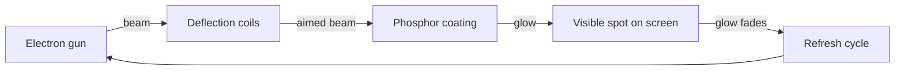

# Computer Graphics - Lecture 3: Displays and Inputs

## Refresh Cathode-Ray Tubes (CRT)

A **CRT** (cathode-ray tube) draws with an **electron beam** that sweeps the inside of a glass screen.

- An **electron gun** emits and focuses the beam.
- A **deflection system** steers the beam to a chosen point on the screen.
- The inside of the screen is coated with **phosphor**, a material that glows when high-energy electrons strike it.
- The glow **fades** after the beam moves away, so the picture must be **refreshed** repeatedly.

> [!NOTE] Why refreshing is necessary
> The phosphor keeps glowing for only a short time after the beam leaves a point, so a single pass leaves a bright spot that fades to darkness. Refresh repeats the whole pattern 50 to 70 times per second. The eye averages the repeated flashes, so a steady image appears. If the refresh rate is too low the picture is seen to **flicker**.

## Raster-Scan Displays

A **raster-scan display** sweeps the beam across the screen **row by row**, from top to bottom and left to right.

| Element               | Role                                                          |
| --------------------- | ------------------------------------------------------------- |
| **Scan line**         | One horizontal row of pixels drawn left to right              |
| **Full frame**        | One complete top-to-bottom scan of every row                  |
| **Intensity control** | The beam current sets the **brightness** of each pixel        |
| **Frame buffer**      | Memory that holds the intensity or color value of every pixel |

The picture shown on screen is whatever the frame buffer holds. The controller reads the buffer in scan order and converts each value into a beam intensity, so the image is redrawn from memory on every refresh.

> [!NOTE] Why refreshing is necessary here too
> The frame buffer is not the screen. The screen holds light for milliseconds only, so the controller must re-read the buffer and redraw every row at the refresh rate. Without refresh the buffer would still hold the image but the screen would go dark.

### Interlaced vs. Non-Interlaced Scanning

| Feature       | **Interlaced scanning**                                      | **Non-interlaced scanning**           |
| ------------- | ------------------------------------------------------------ | ------------------------------------- |
| Line order    | Odd lines first (1, 3, 5 ...), then even lines (2, 4, 6 ...) | Every line in order, 1, 2, 3 ...      |
| Frame build   | Two passes make one frame                                    | One pass makes one frame              |
| Refresh rate  | Appears higher at the same signal bandwidth                  | Needs a full pass per frame           |
| Flicker       | Reduced for the same bandwidth                               | Low when the refresh rate is high     |
| Typical use   | Older televisions and broadcast video                        | Computer monitors and modern displays |
| Image quality | Fine detail can shimmer on fast motion                       | More stable and clearer               |

The interlaced trick halves the bandwidth needed for a given perceived frame rate, which is why broadcast television used it. The cost is that each field shows only half the lines, so a single frame is never fully on screen at one instant.

### Advantages and Disadvantages of Raster Displays

| Advantages                                            | Disadvantages                               |
| ----------------------------------------------------- | ------------------------------------------- |
| Realistic images                                      | Lower resolution than vector displays       |
| Millions of colors                                    | Needs a large frame buffer                  |
| Shaded scenes and hidden-surface removal are possible | Scan conversion is more complex             |
| Cheap, mass-produced hardware                         | Aliasing on near-horizontal lines and edges |

> [!NOTE] Source quality
> The advantages and disadvantages slide in the PDF has its two columns interleaved by the text layer, so the wording above is reconstructed from the readable fragments: "realistic image", "million different colors", "shadow scenes are possible", "low resolution", "expensive". The pairing is the standard one for the topic.

## Random-Scan Displays

A **random-scan display** is also called a **vector display**, **stroke-writing display**, or **calligraphic display**.

The beam acts like a pencil. It moves **directly** to the start of each line segment, draws to the end point, then jumps to the next segment. The picture is a **display list** of straight-line segments in $(x, y)$ coordinates, and the system redraws the whole list repeatedly to refresh.

| Advantages                         | Disadvantages                              |
| ---------------------------------- | ------------------------------------------ |
| Beam visits only the drawn lines   | Cannot show realistic shaded scenes easily |
| Smooth, sharp line drawings        | Limited to line-based graphics             |
| High resolution for lines          | Fewer colors and no filled areas           |
| Fast for simple wireframe pictures | Costly hardware, obsolete for general use  |

The key difference from raster scan is where the beam spends its time. A raster display visits **every** pixel of the screen, drawn or not. A random-scan display visits only the pixels that belong to a line.

## Color CRT Monitors

A **color CRT** mixes **red**, **green**, and **blue** light to produce millions of colors.

| Part                    | Function                                                                    |
| ----------------------- | --------------------------------------------------------------------------- |
| **Three electron guns** | One gun per primary color (R, G, B)                                         |
| **Shadow mask**         | Metal plate with tiny holes, placed just before the phosphor screen         |
| **Phosphor triads**     | Three phosphor dots (R, G, B) arranged in a triangle at each pixel position |
| **Alignment**           | The mask lets each beam strike only its own color of dot                    |

The mask is what keeps the colors pure. Without it, the red beam would also excite green and blue dots and every pixel would wash out to white.

| Advantages                        | Disadvantages                                    |
| --------------------------------- | ------------------------------------------------ |
| Displays a wide range of colors   | Hard to keep all three beams aligned on one hole |
| Displays realistic images         | Poor resolution compared with a monochrome tube  |
| In-line RGB arrangement is simple | Converging three beams costs power and precision |

## Flat-Panel Displays

A **flat-panel display** (FPD) is a video device with less **volume**, **weight**, and **power** demand than a CRT.

Common applications: laptop computers, small TV monitors, pocket video games, calculators, advertisement boards, and elevator displays.

### Emissive vs. Non-Emissive Displays

| Comparison point  | **Emissive displays**                        | **Non-emissive displays**                          |
| ----------------- | -------------------------------------------- | -------------------------------------------------- |
| Definition        | Produce light directly from the panel itself | Do not produce light, they control external light  |
| Working principle | Convert electrical energy into light         | Control, transmit, or reflect light                |
| Light source      | Generate their own light                     | Need a backlight or ambient light                  |
| Examples          | LED, OLED, plasma, TFEL                      | LCD, e-paper, reflective displays                  |
| Brightness        | High brightness and strong contrast          | Depends on the backlight or the room light         |
| Power consumption | Varies with technology and content           | Reflective types can use very little power         |
| Image quality     | Vivid colors, deep blacks on OLED            | Depends on backlight and panel design              |
| Applications      | TVs, phones, digital signage, large screens  | Laptops, calculators, e-readers, low-power devices |

> [!WARNING] Common mistake
> An LCD is **non-emissive** even though the laptop screen looks bright. The light comes from a **backlight** behind the liquid crystal layer; the crystals only control how much of that light passes through.

### Advantages and Disadvantages of Flat Panels

| Advantages                              | Disadvantages                                   |
| --------------------------------------- | ----------------------------------------------- |
| Thin and lightweight, saves desk space  | Higher cost for some panel types                |
| Low power consumption compared with CRT | **Dead pixels** can appear and stay stuck       |
| Available in large screen sizes         | Limited viewing angle on some panels            |
| Clear and sharp image quality           | Response time can cause motion blur             |
| Produces less heat                      | Repair or replacement of the panel is expensive |

## Virtual Reality and Augmented Reality

**Virtual Reality (VR)** uses computers to simulate a real or imagined environment that appears as a **3D space**. It **replaces** the real world with an artificial environment, usually seen through a headset.

**Augmented Reality (AR)** integrates digital information with the real environment of the user **in real time**. It **adds** digital content while the user stays connected to reality.

| Comparison          | **VR**                                              | **AR**                                                         |
| ------------------- | --------------------------------------------------- | -------------------------------------------------------------- |
| Relation to reality | Replaces the real world                             | Enhances the real world                                        |
| User position       | Immersed in a virtual world, separated from reality | Connected to reality while viewing digital content             |
| Image source        | Entire environment generated by the computer        | Digital images, graphics, and sound overlaid on the real world |
| Display device      | Head-mounted display (HMD)                          | Phone, tablet, smart glasses, wearable device                  |
| Typical uses        | Games, simulation, training, virtual tours          | Navigation, location information, camera apps                  |

## Input Devices

An **input device** is hardware that transfers data such as text, graphics, or sound into the computer.

| Device            | How it works                                                        | Typical use                                       |
| ----------------- | ------------------------------------------------------------------- | ------------------------------------------------- |
| **Keyboard**      | About 101 keys, sends character and command codes                   | Text, numbers, commands in graphics programs      |
| **Mouse**         | Moves in two directions (X, Y) and controls the cursor              | Most common pointing device in graphics           |
| **Trackball**     | Stationary base, the user rotates a ball to move the pointer        | Small desks, CAD, industrial consoles             |
| **Spaceball**     | Six degrees of freedom (6 DOF)                                      | 3D object manipulation, CAD, virtual environments |
| **Joystick**      | Moves in four main directions, simple and responsive                | Games, simulators, control systems                |
| **Data glove**    | Worn on the hand, senses finger and hand movement                   | VR, gesture-based control                         |
| **Digitizer**     | Stylus on a flat tablet converts a drawing into digital coordinates | Art, design, precise tracing                      |
| **Image scanner** | Captures a physical photo or document as digital data               | Importing artwork and documents                   |
| **Touch panel**   | Direct finger or stylus contact with the screen                     | Tablets, phones, interactive kiosks               |
| **Light pen**     | Detects light from the CRT at the pointed spot                      | Selecting and drawing on the screen               |
| **Voice system**  | Converts spoken words into commands or text                         | Hands-free use, accessibility                     |

> [!NOTE] Degrees of freedom
> A mouse reports **2** values, which is why it cannot describe rotation of a 3D object. A **spaceball** reports 6, three translations and three rotations, so one device can move and turn an object in space.

## Computer Graphics Software

| Type                            | What it provides                                                                   | Examples                                                                  |
| ------------------------------- | ---------------------------------------------------------------------------------- | ------------------------------------------------------------------------- |
| **Special-purpose package**     | Menus built for one application domain                                             | Architectural CAD, business graphics, medical imaging, engineering design |
| **General programming package** | Graphics library functions called from a language such as C, C++, Java, or Fortran | GL, OpenGL, Java 3D, VRML                                                 |

A general package supplies functions to specify picture components (lines, polygons, spheres), set colors, select views, and apply **rotation**, **scaling**, and **translation**.

_11 min read (source: 12 min)_
