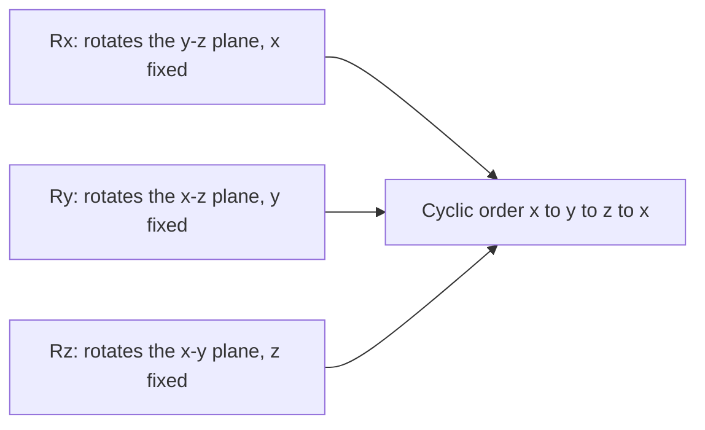
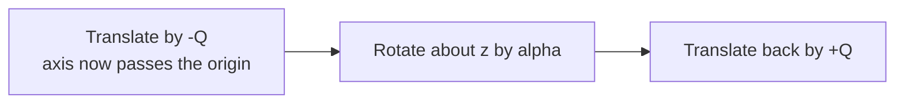
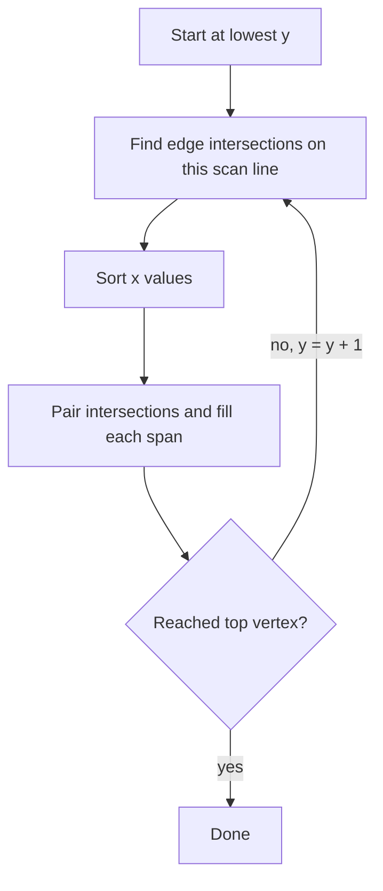

# Computer Graphics - Lecture 4: 3D Transformations and Polygon Filling

## 3D Transformations in One Sentence

A 3D transformation is the 2D transformation with **one extra coordinate**. Translation adds $t_z$, scaling multiplies by $s_z$, and rotation becomes three separate matrices, one per axis.

| Transformation  | 2D form                | 3D form                            | Extra work                     |
| --------------- | ---------------------- | ---------------------------------- | ------------------------------ |
| **Translation** | $(x+t_x,\;y+t_y)$      | $(x+t_x,\;y+t_y,\;z+t_z)$          | Add the third offset           |
| **Scaling**     | $(s_x x,\;s_y y)$      | $(s_x x,\;s_y y,\;s_z z)$          | Multiply the third coordinate  |
| **Rotation**    | One angle about origin | Three matrices $R_x$, $R_y$, $R_z$ | Choose the axis, then the sign |

## 3D Translation

A point $P=(x,y,z)$ is translated by the vector $T=(t_x,t_y,t_z)$:

$$x' = x + t_x, \qquad y' = y + t_y, \qquad z' = z + t_z$$

$$P' = P + T$$

**Example.** $P=(2,5,1)$ and $T=(3,-1,4)$:

$$P' = (2+3,\;5-1,\;1+4) = (5,\;4,\;5)$$

### Homogeneous Coordinates

In **homogeneous coordinates** every point carries a fourth value, so translation becomes a **matrix multiplication** instead of an addition:

$$P = \begin{bmatrix} x \\ y \\ z \\ 1 \end{bmatrix}, \qquad P' = M\,P$$

$$M_T = \begin{bmatrix} 1 & 0 & 0 & t_x \\ 0 & 1 & 0 & t_y \\ 0 & 0 & 1 & t_z \\ 0 & 0 & 0 & 1 \end{bmatrix}$$

Scaling uses the same shape with the factors on the diagonal:

$$M_S = \begin{bmatrix} s_x & 0 & 0 & 0 \\ 0 & s_y & 0 & 0 \\ 0 & 0 & s_z & 0 \\ 0 & 0 & 0 & 1 \end{bmatrix}$$

> [!NOTE] Why the fourth coordinate exists
> Matrices can express scaling and rotation but not addition. Adding the extra $1$ lets one $4\times4$ matrix do both, so any sequence of transformations becomes a single matrix product. The renderer then applies one multiplication per vertex instead of a chain of additions.

## 3D Rotation

Rotation is **counter-clockwise when viewed from the positive rotation axis**, looking back toward the origin.

### Rotation About the Z-Axis

$$x' = x\cos\alpha - y\sin\alpha, \qquad y' = x\sin\alpha + y\cos\alpha, \qquad z' = z$$

$$R_z(\alpha) = \begin{bmatrix} \cos\alpha & -\sin\alpha & 0 & 0 \\ \sin\alpha & \cos\alpha & 0 & 0 \\ 0 & 0 & 1 & 0 \\ 0 & 0 & 0 & 1 \end{bmatrix}$$

The $z$ coordinate does not change. Only the $x$-$y$ plane rotates, exactly as in 2D.

### Rotation About the X-Axis

$$x' = x, \qquad y' = y\cos\alpha - z\sin\alpha, \qquad z' = y\sin\alpha + z\cos\alpha$$

$$R_x(\alpha) = \begin{bmatrix} 1 & 0 & 0 & 0 \\ 0 & \cos\alpha & -\sin\alpha & 0 \\ 0 & \sin\alpha & \cos\alpha & 0 \\ 0 & 0 & 0 & 1 \end{bmatrix}$$

### Rotation About the Y-Axis

$$x' = x\cos\alpha + z\sin\alpha, \qquad y' = y, \qquad z' = -x\sin\alpha + z\cos\alpha$$

$$R_y(\alpha) = \begin{bmatrix} \cos\alpha & 0 & \sin\alpha & 0 \\ 0 & 1 & 0 & 0 \\ -\sin\alpha & 0 & \cos\alpha & 0 \\ 0 & 0 & 0 & 1 \end{bmatrix}$$

> [!WARNING] The Y matrix is the odd one
> In $R_x$ and $R_z$ the pattern is $+\sin$ below the diagonal. $R_y$ has $+\sin$ **above** the diagonal and $-\sin$ below it. Writing $R_y$ by copying the $R_z$ pattern rotates the wrong way.

### Worked Example: Rotate One Point About Each Axis

Rotate $P=(2,3,4)$ by $\alpha=90^\circ$, where $\cos 90^\circ=0$ and $\sin 90^\circ=1$.

| Axis | Formula applied                              | Result         |
| ---- | -------------------------------------------- | -------------- |
| $Z$  | $x'=2(0)-3(1)=-3$, $y'=2(1)+3(0)=2$, $z'=4$  | $(-3,\;2,\;4)$ |
| $X$  | $x'=2$, $y'=3(0)-4(1)=-4$, $z'=3(1)+4(0)=3$  | $(2,\;-4,\;3)$ |
| $Y$  | $x'=2(0)+4(1)=4$, $y'=3$, $z'=-2(1)+4(0)=-2$ | $(4,\;3,\;-2)$ |

> [!NOTE] Which axis does the slide mean?
> The example slide prints only "rotate $P=(2,3,4)$ with angle $\alpha=90^\circ$" and the rotation-axis label is lost in the exported image. All three results are above, so any wording of the question is covered.

## Rotation About an Axis Parallel to a Coordinate Axis

When the axis is parallel to $z$ but passes through a point $Q$ instead of the origin, the rotation must happen **around $Q$**. Move the axis to the origin, rotate, then move it back:

$$P' = T(Q)\;R_z(\alpha)\;T(-Q)\;P$$

**Example.** Rotate $P=(4,1,3)$ by $90^\circ$ about the axis through $Q=(2,1,0)$ parallel to $z$.

1. **Translate:** $P-Q=(4-2,\;1-1,\;3-0)=(2,0,3)$
2. **Rotate about $z$:** $x'=2(0)-0(1)=0$, $y'=2(1)+0(0)=2$, $z'=3$, giving $(0,2,3)$
3. **Translate back:** $P'+Q=(0+2,\;2+1,\;3+0)=(2,3,3)$

$$P' = (2,\;3,\;3)$$

This is the 3D version of rotating a 2D object about a point other than the origin.

## Rotation About an Arbitrary Axis Through Two Points

The general case rotates about the line through $P_1$ and $P_2$. Five steps:

1. **Translate** by $-P_1$ so the axis passes through the origin.
2. **Rotate** the axis onto the $z$-axis with a matrix $R$.
3. **Rotate** by the wanted angle $\alpha$ about $z$.
4. **Undo** the alignment with $R^{-1}$.
5. **Translate back** by $+P_1$.

$$M = T(P_1)\;R^{-1}\;R_z(\alpha)\;R\;T(-P_1)$$

| Matrix        | Job                                       |
| ------------- | ----------------------------------------- |
| $T(-P_1)$     | Move $P_1$ to the origin                  |
| $R$           | Align the axis direction with $+z$        |
| $R_z(\alpha)$ | Perform the requested rotation            |
| $R^{-1}$      | Return the axis to its original direction |
| $T(P_1)$      | Move $P_1$ back                           |

> [!WARNING] Sign error in the slide
> The formula slide labels $T(P_1)$ as "translate origin to $P_1$" and $T(-P_1)$ as "translate back". The matrices are in the correct order in the formula; the two captions are swapped. $T(-P_1)$ comes first and $T(P_1)$ comes last.

### Worked Example: Axis Through a Point With a Direction Vector

Rotate $P=(4,2,1)$ by $90^\circ$ about the axis through $A=(2,1,1)$ with direction $u=(0,1,1)$.

**Step 0, build the alignment matrix.** The direction is already in the $y$-$z$ plane, so one rotation about $x$ is enough. With $|u|=\sqrt{0^2+1^2+1^2}=\sqrt{2}$:

$$u=\left(0,\;\tfrac{1}{\sqrt2},\;\tfrac{1}{\sqrt2}\right)$$

Choose $\phi=45^\circ$ so that $R_x(45^\circ)$ sends $u$ to $(0,0,1)$:

$$R = \begin{bmatrix} 1 & 0 & 0 & 0 \\ 0 & \tfrac{\sqrt2}{2} & -\tfrac{\sqrt2}{2} & 0 \\ 0 & \tfrac{\sqrt2}{2} & \tfrac{\sqrt2}{2} & 0 \\ 0 & 0 & 0 & 1 \end{bmatrix}$$

Check: $y'=\tfrac{1}{\sqrt2}\cdot\tfrac{\sqrt2}{2}-\tfrac{1}{\sqrt2}\cdot\tfrac{\sqrt2}{2}=0$ and $z'=\tfrac{1}{\sqrt2}\cdot\tfrac{\sqrt2}{2}+\tfrac{1}{\sqrt2}\cdot\tfrac{\sqrt2}{2}=1$. The axis now points along $+z$.

**Step 1, translate:** $P-A=(4-2,\;2-1,\;1-1)=(2,\;1,\;0)$

**Step 2, align:** apply $R_x(45^\circ)$ to $(2,1,0)$:

$$y' = 1\cdot\tfrac{\sqrt2}{2} - 0 = \tfrac{\sqrt2}{2} \approx 0.7071, \qquad z' = 1\cdot\tfrac{\sqrt2}{2} + 0 = \tfrac{\sqrt2}{2} \approx 0.7071$$

Result: $(2,\;0.7071,\;0.7071)$

**Step 3, rotate $90^\circ$ about $z$:** $x'=-y$, $y'=x$, $z'=z$

$$(-0.7071,\;2,\;0.7071)$$

**Step 4, undo the alignment** with $R_x(-45^\circ)$:

$$y' = 2\cdot\tfrac{\sqrt2}{2} - 0.7071\left(-\tfrac{\sqrt2}{2}\right) = 1.4142 + 0.5 = 1.9142$$
$$z' = 2\left(-\tfrac{\sqrt2}{2}\right) + 0.7071\cdot\tfrac{\sqrt2}{2} = -1.4142 + 0.5 = -0.9142$$

Result: $(-0.7071,\;1.9142,\;-0.9142)$

**Step 5, translate back:**

$$P' = (-0.7071+2,\;1.9142+1,\;-0.9142+1) = (1.2929,\;2.9142,\;0.0858)$$

Exact form:

$$P' = \left(2-\tfrac{\sqrt2}{2},\;\tfrac{3}{2}+\sqrt2,\;\tfrac{3}{2}-\sqrt2\right) \approx (1.293,\;2.914,\;0.086)$$

**Check with Rodrigues' formula.** For a unit axis $k$ and angle $\theta$:

$$v' = v\cos\theta + (k\times v)\sin\theta + k(k\cdot v)(1-\cos\theta)$$

With $v=P-A=(2,1,0)$, $k=(0,\tfrac{1}{\sqrt2},\tfrac{1}{\sqrt2})$, $\theta=90^\circ$:

$$k\times v = \left(-\tfrac{1}{\sqrt2},\;\sqrt2,\;-\sqrt2\right), \qquad k\cdot v = \tfrac{1}{\sqrt2}, \qquad k(k\cdot v) = \left(0,\;\tfrac12,\;\tfrac12\right)$$

$$v' = \left(-\tfrac{\sqrt2}{2},\;1.9142,\;-0.9142\right)$$

Adding $A$ gives the same answer, so the five-step result is correct.

> [!NOTE] Missing slide content
> The solution slide after this example (page 22) is an empty image in the PDF, so the worked steps above are computed from the printed question rather than copied from the deck.

## Polygon Filling

**Polygon filling** colours the interior of a closed polygon after its boundary is known. The boundary must stay intact; only pixels inside it change.

| Type             | Definition                                                                        |
| ---------------- | --------------------------------------------------------------------------------- |
| **Solid fill**   | Every interior pixel gets one single color                                        |
| **Pattern fill** | The interior is filled with a predefined pattern, such as lines, dots, or a hatch |

## Polygon Representation

A polygon with $n$ vertices is stored as an **ordered list** of coordinate pairs:

$$P = \{(x_1,y_1),\;(x_2,y_2),\;\dots,\;(x_n,y_n)\}$$

Consecutive entries define edges, and the last vertex connects back to the first. The **order matters**: the same points listed in a random order describe a different, usually self-crossing, shape.

**Example.** A quadrilateral with vertices $(2,2)$, $(8,2)$, $(8,6)$, $(4,9)$ is one ordered cycle of four edges. A triangle in the same coordinate system needs three pairs and three edges.

## Scan-Line Polygon Fill

The **scan-line algorithm** works in three steps:

1. Find the intersections between the current **horizontal scan line** and the polygon edges.
2. Sort the intersection $x$ values and pair them: first with second, third with fourth, and so on.
3. Fill each **span** between a pair with the chosen color, then move up one scan line.

The scan starts at the **lowermost vertex** and ends at the **topmost vertex**, so the loop runs over the vertical extent of the polygon.

> [!NOTE] Where the details live
> Lecture 5 covers the same algorithm with the vertex rules, the two special cases, and a full worked scan. This lecture only introduces the idea, so the complete treatment is in [Lecture 5](/College/yearThree/firstTerm/ComputerGraphics/Lectures/Lecture-5).

_12 min read (source: 7 min)_
