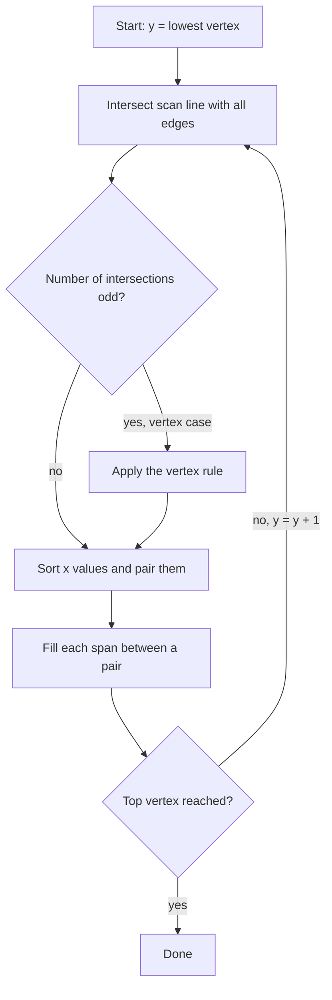
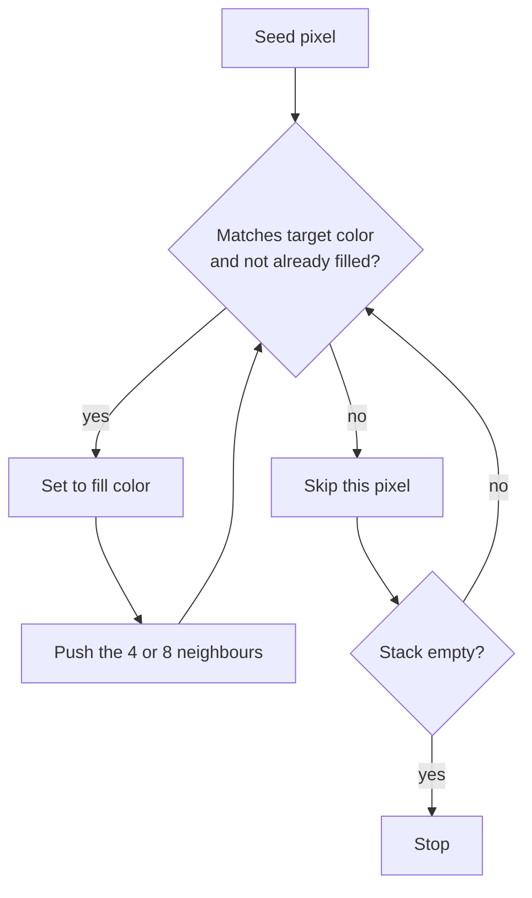

# Computer Graphics - Lecture 5: Polygon Filling

## What Polygon Filling Means

**Polygon filling** colours the interior of a polygon with a solid color, a pattern, or a texture while keeping the **boundary** intact.

| Algorithm                  | How it reaches the interior                                           | Starts from       |
| -------------------------- | --------------------------------------------------------------------- | ----------------- |
| **Scan-line polygon fill** | Scans horizontal lines and fills the spans between intersection pairs | The lowest vertex |
| **Flood fill**             | Spreads from a seed to neighbours that match the target color         | A **seed point**  |
| **Boundary fill**          | Spreads from a seed until it meets the boundary color                 | A **seed point**  |

The scan-line method works on the **geometry** of the polygon. Flood fill and boundary fill work on the **pixels** already on the screen, so they need a closed boundary to exist first.

## Types of Fill

| Type             | Definition                                                                                   |
| ---------------- | -------------------------------------------------------------------------------------------- |
| **Solid fill**   | Every interior pixel is illuminated with one solid color                                     |
| **Pattern fill** | The interior is filled with an arbitrary predefined pattern, such as lines, dots, or a hatch |

## Polygon Representation

A polygon with $n$ vertices is an **ordered list** of coordinate pairs:

$$P = \{(x_1,y_1),\;(x_2,y_2),\;\dots,\;(x_n,y_n)\}$$

| Property      | Consequence                                                      |
| ------------- | ---------------------------------------------------------------- |
| $n$ pairs     | The polygon has $n$ vertices and $n$ edges                       |
| Order matters | Consecutive pairs define edges; a random order changes the shape |
| Closed cycle  | The last vertex connects back to the first                       |
| 2D form       | Each vertex is one $(x,y)$ pair, not two separate coordinates    |

**Example.** The list $(2,2), (8,2), (8,6), (4,9)$ is a quadrilateral with four edges: bottom, right side, top-right slanted side, and left slanted side back to the start.

## The Scan-Line Polygon Fill Algorithm

The algorithm scans the polygon **horizontally** from its **lowermost vertex** to its **topmost vertex**.

1. Find the intersection between the scan line and every edge of the polygon.
2. Sort the intersection points by their $x$ value.
3. Draw a line from $(x_1,y_k)$ to $(x_2,y_k)$ with the required color, then from $(x_3,y_k)$ to $(x_4,y_k)$, and so on.
4. Move up one scan line and repeat until the top vertex is reached.



### The Vertex Problem

A scan line that passes exactly through a vertex can produce an **odd number of intersections**, and then the pairing breaks: one intersection is left without a partner, so the span it should close stays open.

The fix is to decide how many intersections the vertex counts as. Walk the two edges that meet at the vertex, in clockwise or anticlockwise order, and look at how $y$ changes.

### Special Case 1: Local Maximum or Minimum, Count Twice

If $y$ **increases to the vertex and then decreases** (a local maximum), or **decreases to the vertex and then increases** (a local minimum), the vertex counts as **two** intersection points at the same $x$.

The scan line touches the polygon at a single point, so the pair of intersections has zero length and draws nothing, while the parity of the remaining intersections stays correct.

**Example.** A diamond with a top vertex at $(6,12)$ and a scan line at $y=12$ counts the vertex twice: $x_1=x_2=6$. The span from 6 to 6 is empty, and the polygon is not filled above its top.

### Special Case 2: Monotonic Pass, Count Once

If $y$ is **monotonically increasing** or **monotonically decreasing** through the vertex, the two edges continue in the same direction and the vertex counts as **one** intersection point.

**Example.** A pentagon whose two right-side edges both rise through $(12,8)$ crosses that scan line once, so the span from $x=2$ to $x=12$ is filled normally.

> [!NOTE] The rule in one line
> Count the vertex **twice** when the two edges lie on the **same side** of the scan line, and **once** when they lie on **opposite sides**. This keeps the number of intersections even on every row.

### Worked Example: Scan-Line Fill of a Pentagon

Fill the polygon with vertices $(2,2)$, $(12,2)$, $(12,8)$, $(7,12)$, $(2,8)$.

**Edges.**

| Edge  | Endpoints            | Equation for $x$ on a scan line |
| ----- | -------------------- | ------------------------------- |
| $E_1$ | $(2,2)$ to $(12,2)$  | horizontal bottom, $y=2$        |
| $E_2$ | $(12,2)$ to $(12,8)$ | $x=12$                          |
| $E_3$ | $(12,8)$ to $(7,12)$ | $x=12-1.25(y-8)$                |
| $E_4$ | $(7,12)$ to $(2,8)$  | $x=7+1.25(y-12)$                |
| $E_5$ | $(2,8)$ to $(2,2)$   | $x=2$                           |

**Vertex checks.** At $(12,8)$ the $y$ value rises from 2 to 8 and then from 8 to 12, so the pass is monotonic and the vertex counts **once**. At $(2,8)$ the $y$ value falls from 12 to 8 and then from 8 to 2, also monotonic, so it counts **once**. At $(7,12)$ the two edges both descend, so it is a local maximum and counts **twice**.

**Scan by scan.**

| Scan line $y$ | Intersections $x$                       | Span filled   | Pixels ($\lceil x_{left}\rceil$ to $\lfloor x_{right}\rfloor$) |
| ------------- | --------------------------------------- | ------------- | -------------------------------------------------------------- |
| 3             | 2, 12                                   | 2 to 12       | 2 to 12, 11 pixels                                             |
| 4             | 2, 12                                   | 2 to 12       | 11 pixels                                                      |
| 5             | 2, 12                                   | 2 to 12       | 11 pixels                                                      |
| 6             | 2, 12                                   | 2 to 12       | 11 pixels                                                      |
| 7             | 2, 12                                   | 2 to 12       | 11 pixels                                                      |
| 8             | 2, 12 (two vertices, each counted once) | 2 to 12       | 11 pixels                                                      |
| 9             | 3.25, 10.75                             | 3.25 to 10.75 | 4 to 10, 7 pixels                                              |
| 10            | 4.5, 9.5                                | 4.5 to 9.5    | 5 to 9, 5 pixels                                               |
| 11            | 5.75, 8.25                              | 5.75 to 8.25  | 6 to 8, 3 pixels                                               |
| 12            | 7, 7 (local maximum, counted twice)     | empty         | 0 pixels                                                       |

Total filled pixels: $6 \times 11 + 7 + 5 + 3 = 81$.

> [!NOTE] Why row 12 fills nothing
> The top vertex is a single point. Counting it twice produces a pair with the same $x$, so the span length is zero. That is exactly the behaviour the special case is designed to give.

## Flood Fill

**Flood fill** fills a connected area with a new color, starting from a pixel called the **seed point**. It spreads to neighbouring pixels that satisfy the filling condition and stops when no eligible neighbour is left.

| Variant                  | Neighbours checked                            | Behaviour                          |
| ------------------------ | --------------------------------------------- | ---------------------------------- |
| **4-connected (4-fill)** | Up, down, left, right                         | Diagonal pixels are not neighbours |
| **8-connected (8-fill)** | Up, down, left, right, and the four diagonals | Fill can spread diagonally         |

### How It Works

1. **Start:** pick a pixel inside the area to be filled.
2. **Flood:** change its color, then examine its neighbours.
3. **Continue:** every neighbour that satisfies the condition is colored and processed in turn.
4. **Stop:** when no unfilled neighbour satisfies the condition.



**Color roles in the example.** White pixels can be filled with red. Blue pixels are not the target color and must not be filled. Red pixels are already filled and are not processed again.

> [!WARNING] Flood fill is local
> Flood fill fills only the connected area **reachable from the seed point**. It does not fill every pixel of that color in the image. Two separate regions of white need two separate seeds.

### Worked Example: 4-Connected vs. 8-Connected

A $6\times6$ grid has a boundary drawn along the anti-diagonal, so that $r+c=5$ for every boundary pixel. The seed is at the top-left corner $(0,0)$.

```text
row 0:  S  .  .  .  .  B
row 1:  .  .  .  .  B  .
row 2:  .  .  .  B  .  .
row 3:  .  .  B  .  .  .
row 4:  .  B  .  .  .  .
row 5:  B  .  .  .  .  .
```

The boundary has 6 pixels, so 30 pixels are free.

| Variant    | Cells reached                                                             | Count |
| ---------- | ------------------------------------------------------------------------- | ----- |
| **4-fill** | Only the triangle above the boundary, where $r+c<5$                       | 15    |
| **8-fill** | The whole grid, because a diagonal step slips between two boundary pixels | 30    |

The 4-connected fill cannot cross a diagonal wall, because moving only up, down, left, or right never passes between two corner-touching boundary pixels. The 8-connected fill can step diagonally through the gap and leaks into the region on the other side.

> [!NOTE] When the leak matters
> A thin diagonal line drawn with 4-connected pixels is watertight for 4-fill and leaky for 8-fill. A drawing package that offers both modes is really asking which of the two behaviours the artist wants.

### Flood Fill Task Procedure

The task slide gives the outline of a paint-style fill:

1. Draw all edges into a buffer so a closed boundary exists.
2. Choose a **seed** position inside the area to be filled.
3. While progress is possible, **flood out** from the seed or from already colored pixels using 4-fill or 8-fill.

The loop ends when no neighbour can be colored, which means the seed region is completely surrounded by boundary or by the fill color.

## Boundary Fill

**Boundary fill** fills the interior of a closed region from a seed point and stops when it reaches the **boundary color**.

| Variant                       | Neighbours checked                     |
| ----------------------------- | -------------------------------------- |
| **4-connected boundary fill** | Up, down, left, right                  |
| **8-connected boundary fill** | The four sides plus the four diagonals |

**Condition.** A pixel is filled only if its color is **different from both the boundary color and the fill color**. The algorithm therefore needs two colors supplied by the caller: the **border color** and the **fill color**.

```c
// Boundary fill outline (4-connected)
void boundaryFill(int x, int y, int border, int fill) {
  int current = getpixel(x, y);
  if (current != border && current != fill) {
    putpixel(x, y, fill);
    boundaryFill(x + 1, y, border, fill);
    boundaryFill(x - 1, y, border, fill);
    boundaryFill(x, y + 1, border, fill);
    boundaryFill(x, y - 1, border, fill);
  }
}
```

The `current != fill` test is not decoration. Without it the function calls itself forever on pixels it has already colored.

## Boundary Fill vs. Flood Fill

| Comparison      | **Boundary fill**                                     | **Flood fill**                                                      |
| --------------- | ----------------------------------------------------- | ------------------------------------------------------------------- |
| Main condition  | Checks the **boundary color**                         | Checks the **original (target) color**                              |
| Required colors | Boundary color and fill color                         | Original color and fill color                                       |
| When it stops   | At boundary-colored pixels or already filled pixels   | At pixels that do not match the target color, or are already filled |
| Main purpose    | Fill an enclosed region while preserving its boundary | Replace a connected region of a specified color                     |

> [!NOTE] Which one to use
> Boundary fill assumes a drawn outline, so it suits shape tools that stroke an outline first. Flood fill assumes a flat background, so it suits the paint bucket, where clicking a white area replaces exactly that area and leaves the outline alone.

_13 min read (source: 7 min)_
