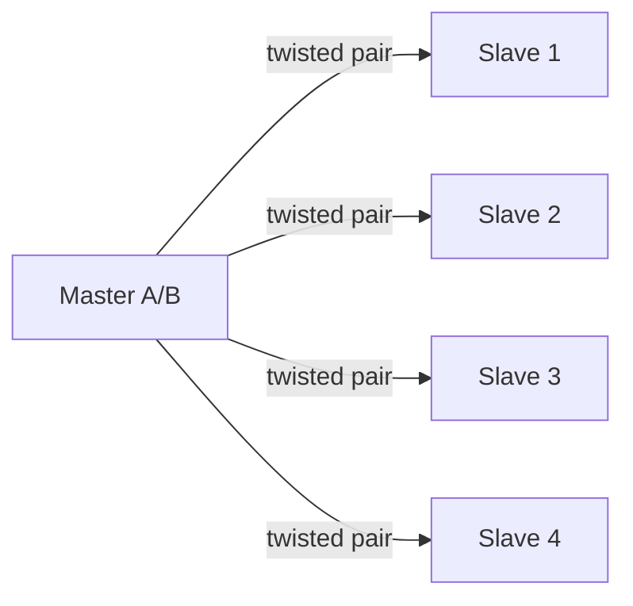

# Data Communication - Lecture 3: Serial Communication Interfaces

Lectures 1 and 2 gave the abstract model: five elements, bandwidth, impairments, capacity. This lecture shows how real devices talk: **SPI**, **SCI/UART**, **RS-232**, and **RS-485**. Each is one answer to the same question, how a transmitter turns data into a signal and a medium carries it to a receiver, under its own trade-off of **speed, distance, wiring cost, and device count**.

## Serial vs Parallel Transmission

| Criterion          | Serial                               | Parallel                                  |
| ------------------ | ------------------------------------ | ----------------------------------------- |
| **Wires**          | One data line (plus return)          | One line **per bit**, e.g. 8 data lines   |
| **Speed**          | Slower per transfer                  | Faster within one clock cycle             |
| **Cost**           | Cheap                                | Expensive                                 |
| **Distance**       | Long, because bits stay synchronized | Short, because wires **skew** out of step |
| **Bits per clock** | One bit after another                | A whole word at once                      |
| **Example**        | USB, UART, RS-232, RS-485            | Printer cable, CPU-to-memory bus          |

**Skew** is the reason parallel fails over distance: the separate wires have slightly different lengths and capacitances, so bits that left together arrive at different times. Serial has nothing to skew against itself.

## Two Families of Serial Communication

The core problem both solve: **how does the receiver know when each bit period begins and ends?**

| Aspect             | Synchronous                       | Asynchronous                          |
| ------------------ | --------------------------------- | ------------------------------------- |
| **Timing source**  | Shared **clock** line             | Each character re-synchronizes itself |
| **Framing**        | Preamble and postamble per block  | **Start** and **stop** bits per byte  |
| **Overhead**       | Typically **under 5%**            | **20-30%** of bandwidth               |
| **Speed**          | Higher                            | Lower                                 |
| **Cost**           | Higher (clock line, tighter spec) | Simple, cheap                         |
| **Course example** | **SPI**                           | **SCI**, which UART implements        |
| **Typical use**    | Large systems, networks           | Low-speed terminals, PCs              |

Overhead is the decisive row. Asynchronous spends two or three bits out of every ten on framing, so it wastes a fifth to a third of the channel on markers. Synchronous pays that cost once per large block.

## DTE and DCE

| Role                                   | What it is                     | Examples                       |
| -------------------------------------- | ------------------------------ | ------------------------------ |
| **DTE** (Data Terminal Equipment)      | Generates or uses the data     | PC, microcontroller, terminal  |
| **DCE** (Data Communication Equipment) | Provides the link between DTEs | Modem, USB-to-serial converter |

RS-232 signal directions are all defined relative to DTE and DCE, so this vocabulary is needed before Parts E and F.

> [!NOTE] Quick Check 1
> **(a)** A laptop connects directly to a microcontroller board with no modem, over UART. Synchronous or asynchronous? **(b)** Name the one synchronous and one asynchronous example used in this course.
>
> **Answer.** (a) **Asynchronous**. UART carries no separate clock line; every byte carries its own start and stop bits. (b) Synchronous is **SPI**. Asynchronous is **SCI**, the basis of UART.

## SPI: Serial Peripheral Interface

**SPI** is a synchronous protocol that exchanges data between a **master** (usually a microcontroller) and one or more **slaves** (sensors, memory chips, displays). The master generates the clock; the slave cannot.

### The Four Lines

| Line                | Name                       | Direction            | Purpose                     |
| ------------------- | -------------------------- | -------------------- | --------------------------- |
| **SCLK** (SCK, CLK) | Serial Clock               | Master to all slaves | Times every bit             |
| **MOSI**            | Master Out Slave In        | Master to slave      | Data toward the slave       |
| **MISO**            | Master In Slave Out        | Slave to master      | Data toward the master      |
| **SS** (CS)         | Slave Select / Chip Select | Master to one slave  | Enables that specific slave |

Because MOSI and MISO are separate, SPI is **full-duplex**: it transmits and receives at the same time.

### How a Transfer Runs

1. The master pulls the target slave's **SS** line LOW.
2. The master emits clock pulses on **SCLK**.
3. On each pulse, one bit goes out on **MOSI** and one bit comes back on **MISO**, simultaneously.
4. The master sets **SS** HIGH, ending the exchange.

Each additional slave needs its own SS line, which is why SPI grows a wire per device. Devices are typically **flash memory, temperature sensors, LCD/OLED displays, and SD cards**.

> [!WARNING] SPI has no built-in error checking
> There is no parity, no acknowledgement, no retry. It is acceptable only because SPI runs over very short, clean, on-board connections at high speed, where errors are rare. On a long cable the same design would be reckless. The timing specification must also be followed exactly, since the clock is the only thing defining bit boundaries.

## SCI: Serial Communications Interface

**SCI** is the hardware module that provides **asynchronous, full-duplex, serial** communication over a Tx line and an Rx line. It is what a UART implements.

| Feature             | Detail                                              |
| ------------------- | --------------------------------------------------- |
| **Synchronization** | None shared; each frame carries start and stop bits |
| **Duplex**          | Full-duplex (separate Tx and Rx)                    |
| **Idle level**      | Constant `1`                                        |
| **Start bit**       | `0`                                                 |
| **Data bits**       | Usually 8                                           |
| **Parity**          | Optional                                            |
| **Stop bits**       | One or more, `1`                                    |
| **Baud rate**       | e.g. 9600 bit/s                                     |

### SCI Components

1. **Transmitter (Tx)**: converts parallel data from the processor into serial form.
2. **Receiver (Rx)**: converts incoming serial data back to parallel.
3. **Baud rate generator**: controls the timing of transmission and reception.
4. **Status registers**: report conditions such as "data ready" or "transmission complete".

Typical links are microcontroller to PC (via UART/RS-232), microcontroller to sensor, and microcontroller to Bluetooth or Wi-Fi modules.

> [!NOTE] Quick Check 2
> **(a)** Which uses more bandwidth on overhead, synchronous or asynchronous, and why? **(b)** SPI has no error checking. What design choice makes that acceptable?
>
> **Answer.** (a) **Asynchronous**, because every byte carries its own start and stop bits (20-30% overhead), against one preamble/postamble per large block for synchronous (under 5%). (b) SPI is used over very short, clean, chip-to-chip connections at high speed, a low-noise environment where errors are rare.

## Asynchronous Framing in Detail

When Windows lists a **COM port**, that is a real asynchronous serial interface, usually a UART reached today through a USB-to-serial converter. Behind the abstraction sits one byte packaged into a fixed frame.

### The Four Settings Both Ends Must Agree On

| Setting       | Values            | Default in practice |
| ------------- | ----------------- | ------------------- |
| **Start bit** | Always `0`        | Fixed               |
| **Data bits** | 5 to 8            | 8                   |
| **Parity**    | None / Even / Odd | None                |
| **Stop bits** | 1 or 2            | 1                   |

**Mismatch any one of these and the link decodes garbage, even with a perfectly clean signal.**

### Frame Order

Every byte travels as one package in this order: **start bit, data bits, parity bit, stop bit(s)**. The line **idles HIGH**; the start bit's drop to LOW is what tells the receiver that a new byte begins now.

```text
idle  start  D0  D1  D2  D3  D4  D5  D6  D7  P  stop stop  idle
 1      0     .   .   .   .   .   .   .   .   .    1    1     1
```

### Data Bits Are Sent LSB First

The **least-significant bit** goes first. For `(B9)16 = 1011 1001`, the transmission order is bit 0, bit 1, ... bit 7, that is `1, 0, 0, 1, 1, 1, 0, 1`. The waveform looks nothing like the written binary number, because the written form is MSB first.

### Parity

An **optional** extra bit that catches simple errors.

- **Even parity**: the parity bit is chosen so the total count of 1-bits, data **plus** parity, is **even**.
- **Odd parity**: the parity bit is chosen so the total count is **odd**.

> [!WARNING] Parity is weak
> Parity reliably catches a **single** flipped bit. Two flipped bits restore the original count and pass unnoticed. It is error **detection** only, never correction.

### Stop Bits

One or two **HIGH** bits mark the end of the package. They guarantee a minimum gap before the next start bit can legally appear.

### Noise and Framing Errors

Noise on the line can be misread **as** a start bit. The receiver then begins reading a byte one bit too early and every subsequent bit lands in the wrong position. This is where Lecture 2's impairments become concrete: attenuation and noise are not theoretical on a real serial link.

## Worked Framing Examples

All examples use one start bit, 8 data bits, and two stop bits unless stated otherwise.

### Example 1: `(8B)16`, Even Parity

1. `(8B)16 = 1000 1011`.
2. Count the 1s: **four**, already even, so the parity bit is `0`.
3. LSB-first data order: `1, 1, 0, 1, 0, 0, 0, 1`.

| Start | D0  | D1  | D2  | D3  | D4  | D5  | D6  | D7  | Parity | Stop | Stop |
| ----- | --- | --- | --- | --- | --- | --- | --- | --- | ------ | ---- | ---- |
| 0     | 1   | 1   | 0   | 1   | 0   | 0   | 0   | 1   | 0      | 1    | 1    |

### Example 2: `(8C)16`, Even Parity

1. `(8C)16 = 1000 1100`.
2. Three 1s is odd, so parity must be `1` to reach an even total.
3. LSB-first data order: `0, 0, 1, 1, 0, 0, 0, 1`.

| Start | D0  | D1  | D2  | D3  | D4  | D5  | D6  | D7  | Parity | Stop | Stop |
| ----- | --- | --- | --- | --- | --- | --- | --- | --- | ------ | ---- | ---- |
| 0     | 0   | 0   | 1   | 1   | 0   | 0   | 0   | 1   | 1      | 1    | 1    |

### Example 3: `(8C)16`, Odd Parity

Same data, three 1s, which is already odd, so the parity bit must be `0` to keep the total odd.

| Start | D0  | D1  | D2  | D3  | D4  | D5  | D6  | D7  | Parity | Stop | Stop |
| ----- | --- | --- | --- | --- | --- | --- | --- | --- | ------ | ---- | ---- |
| 0     | 0   | 0   | 1   | 1   | 0   | 0   | 0   | 1   | 0      | 1    | 1    |

> [!NOTE] Source inconsistency in Example 3
> The slide's prose line reads "parity bit = 0" but the frame summary on the same slide prints "1 (parity)". Since three 1s is already odd, **0 is correct** and the printed summary is a typo. The slide's timing diagram also shows 0 at the parity position.

### Example 4: `(4D)16`, Odd Parity, One Stop Bit

1. `(4D)16 = 0100 1101`, four 1s, even.
2. For odd parity, add `1` to make five.
3. LSB-first data: `1, 0, 1, 1, 0, 0, 1, 0`.

| Start | D0  | D1  | D2  | D3  | D4  | D5  | D6  | D7  | Parity | Stop |
| ----- | --- | --- | --- | --- | --- | --- | --- | --- | ------ | ---- |
| 0     | 1   | 0   | 1   | 1   | 0   | 0   | 1   | 0   | 1      | 1    |

### Example 5: `(4A)16`, No Parity

This is the handwritten slide example. `(4A)16 = 0100 1010`, four 1s. With parity set to **None**, the parity slot disappears:

| Start | D0  | D1  | D2  | D3  | D4  | D5  | D6  | D7  | Stop | Stop |
| ----- | --- | --- | --- | --- | --- | --- | --- | --- | ---- | ---- |
| 0     | 0   | 1   | 0   | 1   | 0   | 0   | 1   | 0   | 1    | 1    |

### Parity Summary Table

| Byte | Binary      | 1s  | Even parity | Odd parity |
| ---- | ----------- | --- | ----------- | ---------- |
| `8B` | `1000 1011` | 4   | 0           | 1          |
| `8C` | `1000 1100` | 3   | 1           | 0          |
| `4D` | `0100 1101` | 4   | 0           | 1          |
| `5A` | `0101 1010` | 4   | 0           | 1          |
| `C3` | `1100 0011` | 4   | 0           | 1          |
| `F0` | `1111 0000` | 4   | 0           | 1          |

## UART and USART

Both convert **parallel** data inside the processor into **serial** data on the wire, and back again on receive. Internally each uses a **shift register**: parallel data loads in all at once, then shifts out one bit at a time.

| Feature         | UART                                                                    | USART                                                                        |
| --------------- | ----------------------------------------------------------------------- | ---------------------------------------------------------------------------- |
| **Full name**   | Universal Asynchronous Receiver/Transmitter                             | Universal Synchronous/Asynchronous Receiver/Transmitter                      |
| **Clock**       | None external; start and stop bits synchronize                          | External clock in synchronous mode; start and stop bits in asynchronous mode |
| **Modes**       | Asynchronous only                                                       | Both synchronous and asynchronous                                            |
| **Data unit**   | One byte at a time, 7 or 8 data bits plus optional parity and stop bits | Frames whose size depends on mode and configuration                          |
| **Typical use** | PC serial ports, GPS modules                                            | Microcontroller peripherals needing either mode                              |
| **Speed**       | Lower                                                                   | Higher in synchronous mode                                                   |

### Core Hardware Functions

1. **Parallel-to-serial** conversion on send, **serial-to-parallel** on receive.
2. **Automatic framing**, adding start, parity, and stop bits so software does not have to.
3. **Parity checking** and detection of two specific faults:
   - **Framing error**: a stop bit was not where expected, so the frame boundaries are wrong.
   - **Overrun error**: a new character arrived before the CPU read the previous one out of the receive register, so data was lost.

A UART is just another I/O device on the system bus from the CPU's point of view. Some microcontrollers, such as the **ADuC832**, have one built in, so no separate chip is needed.

> [!NOTE] Quick Check 4
> **(a)** Difference between a framing error and an overrun error? **(b)** Why can a USART reach higher, steadier rates than a UART in synchronous mode?
>
> **Answer.** (a) Framing error means a stop bit was not where expected, so the frame boundaries are wrong. Overrun means a new character arrived before the CPU read the previous one, so data was lost. (b) It sends an explicit clock alongside the data, so the receiver never has to guess timing from start bits alone and can run faster and more reliably.

## Master and Slave

In any **synchronous** link (SPI, or a USART in synchronous mode), one device is always the **master**, and it is the one that generates the clock. The slave's transmission is synchronized to the master's clock. The same master/slave idea reappears in RS-485, where it becomes a software rule about who may transmit.

## RS-232

**RS-232** is a serial standard for connecting a **DTE** (a computer) to a **DCE** (a modem), or directly to an instrument such as a data logger. It is what a PC's COM port historically provided.

### Architecture

- **Point-to-point**: exactly two devices, and only those two.
- **Full-duplex**: two independent channels, one per direction, so both can send and receive at once.
- **Control signals** travel alongside the data channels for flow control and modem status.

### Handshaking Signals

| Signal  | Full Name           | Direction  | Function                             |
| ------- | ------------------- | ---------- | ------------------------------------ |
| **RTS** | Request To Send     | DTE to DCE | DTE requests permission to send data |
| **CTS** | Clear To Send       | DCE to DTE | DCE says it is ready to receive      |
| **DSR** | Data Set Ready      | DCE to DTE | DCE is powered on and ready          |
| **DTR** | Data Terminal Ready | DTE to DCE | DTE is powered on and ready          |
| **DCD** | Data Carrier Detect | DCE to DTE | Remote carrier detected              |
| **RI**  | Ring Indicator      | DCE to DTE | Incoming call on a modem             |

The exchange order before data flows is **DTR/DSR** (both sides powered), then **RTS/CTS** (receiver buffer free). These signals improve reliability but are often skipped on short, simple point-to-point links.

### DB-9 Pinout

| Pin | Signal | Pin | Signal |
| --- | ------ | --- | ------ |
| 1   | DCD    | 6   | DSR    |
| 2   | RXD    | 7   | RTS    |
| 3   | TXD    | 8   | CTS    |
| 4   | DTR    | 9   | RI     |
| 5   | GND    |     |        |

Older equipment uses the 25-pin **DB-25**, which carries the same signals plus a protective ground.

| Pin | Signal                  | Pin | Signal                   |
| --- | ----------------------- | --- | ------------------------ |
| 1   | PGND, protective ground | 8   | CD, carrier detect       |
| 2   | TXD, transmit data      | 20  | DTR, data terminal ready |
| 3   | RXD, receive data       | 22  | RI, ring indicator       |
| 4   | RTS, ready to send      | 7   | SG, signal ground        |
| 5   | CTS, clear to send      |     |                          |
| 6   | DSR, data set ready     |     |                          |

> [!WARNING] DTE and DCE use opposite pin roles
> Per the standard, **male connectors carry DTE pin functions and female connectors carry DCE pin functions**. A cable wired straight through therefore connects TXD to TXD, which is why some links need a null-modem crossover.

### Electrical Signaling: MARK and SPACE

RS-232 is **unbalanced**: each signal is one wire measured against a shared ground.

| State              | Logic | Voltage  |
| ------------------ | ----- | -------- |
| **MARK** (idle)    | `1`   | Negative |
| **SPACE** (active) | `0`   | Positive |

A receiver reads below **-3 V** as MARK and above **+3 V** as SPACE. The standard allows up to **±15 V**. This is **inverted** relative to ordinary digital logic, where a high level means 1.

> [!WARNING] Why a transceiver is mandatory
> A microcontroller pin swings 0 V to +5 V (TTL). RS-232 needs negative and positive rails. Connecting the two directly will not work and can damage the pin. A **MAX232** or **MAX233** transceiver converts between the two; the MAX233 is preferred in new designs because it needs fewer external components.

### Speed and Distance

- Standard maximum: **20 kbit/s**. Modern equipment commonly runs **115,200 baud** by exceeding the old standard.
- **15 m (50 ft)** at maximum baud rate is the commonly quoted limit.
- The cable behaves like a capacitor and inductor, so longer cable or higher speed distorts the signal more. **Length and speed trade directly against each other.** Higher capacitance also raises interference between adjacent signal wires.

### RS-232 Data Format

RS-232 is a **character-oriented** protocol, and it uses an **asynchronous** protocol: no clock travels with the data, and both ends run an internal clock at the same rate. The **start bit** re-synchronizes the clocks when needed.

Typical byte: start bit `0`, 8 data bits (LSB first), optional parity, one or two stop bits. Standard baud rates include 75, 110, 300, 1200, 2400, 4800, **9600**, 14400, 19200, 28800, 33600, 56000, 115000, and rarely 330000. **9600 is the safe choice** because it is so widely supported.

Application payloads are packed simply:

```text
<Header-string><Code identifier><INFO-FIELD><Terminator-string>
```

Header and terminator are software-configurable. RS-232 supports two common handshakes: **hardware RTS/CTS** and **software XON/XOFF**.

> [!NOTE] Quick Check 5
> **(a)** Which DB-9 pin carries transmit data, and which carries receive? **(b)** Why can't a microcontroller pin drive an RS-232 line directly?
>
> **Answer.** (a) Pin **3** is TXD, pin **2** is RXD. (b) RS-232 uses roughly ±3 V to ±15 V, incompatible with TTL logic at 0 V/+5 V, so a transceiver such as the MAX232 must convert.

## RS-485

**RS-485** is an **EIA** (Electronics Industries Alliance) standard interface, very common in data acquisition. It provides a **balanced** transmission line that can be shared in **multidrop** mode, giving high data rates over long distances in electrically hostile environments such as factory floors.

### Differential Signaling: The Whole Point

RS-485 is **balanced / differential**: every signal uses a **pair** of wires, A and B, always driven to **opposite** voltages. The receiver reads only the **difference** between them.

Noise from a motor or a ground shift couples onto both wires almost equally. This is called **common-mode noise**. Because the receiver subtracts one wire from the other, the shared noise cancels before it can flip a bit. RS-232 has a single signal wire and nothing to cancel against.

### The Multidrop Bus



- One twisted pair is shared by every device. The standard allows up to **32 drivers and 32 receivers**.
- **Terminator resistors** at each physical **end** of the bus absorb the signal instead of letting it reflect back and corrupt new transmissions.
- The driver has an **Enable** direction-control signal, so a device can release the bus when it is not talking.
- **Only one device may transmit at any instant.** This is a **software** rule, normally enforced by the master polling each slave in turn, not an electrical property of the medium.

### Half-Duplex and Full-Duplex

| Variant         | Wires | Behaviour                                                                                                   |
| --------------- | ----- | ----------------------------------------------------------------------------------------------------------- |
| **Half-duplex** | 2     | One shared pair; only one device transmits at a time                                                        |
| **Full-duplex** | 4     | A second pair lets the master send and receive at once, but only one slave may drive the shared return pair |

Half-duplex is far more common in practice, because most multidrop jobs (polling sensors) do not need simultaneous two-way traffic.

### Speed and Distance

- Standard: **100 kbit/s** over up to **1200 m (4000 ft)**, against RS-232's 20 kbit/s and 15 m.
- Some slides in the deck quote **up to 10 Mbit/s** for RS-485 depending on cable length and network conditions. Treat that as a short-cable, non-standard figure; **100 kbit/s at 1200 m is the standard guarantee** and the number to quote for distance.

> [!NOTE] Quick Check 6
> **(a)** A motor induces a spike on an RS-485 cable. Why is it far less likely to flip a bit than the same spike on RS-232? **(b)** A half-duplex bus has one master and five slaves. How many may transmit at once?
>
> **Answer.** (a) The spike couples onto both wires almost equally, and the receiver responds only to the difference, so the common-mode noise cancels. RS-232 has one signal wire with nothing to cancel against. (b) **Exactly one**, regardless of how many devices share the bus.

## Comparing and Choosing

### RS-232 vs RS-485

| Aspect                 | RS-232                          | RS-485                                 |
| ---------------------- | ------------------------------- | -------------------------------------- |
| **Architecture**       | Point-to-point, 2 devices       | Multipoint, many devices on one bus    |
| **Signaling**          | Unbalanced, one wire per signal | Balanced differential, two wires       |
| **Noise immunity**     | Lower                           | High                                   |
| **Max standard speed** | 20 kbit/s                       | 100 kbit/s                             |
| **Max distance**       | ~15 m (50 ft)                   | ~1200 m (4000 ft)                      |
| **Devices**            | 2                               | Up to 32 drivers plus 32 receivers     |
| **Transmit rule**      | No restriction, peer-to-peer    | One transmitter at a time, by software |

**RS-485 is not simply a better RS-232.** They solve different problems: 232 is a peer-to-peer link with no arbitration, 485 is a shared bus that needs a protocol on top.

### The Whole Lecture in One Table

| Interface    | Family       | Wires                    | Duplex       | Devices           | Distance    | Speed      | Error checking           |
| ------------ | ------------ | ------------------------ | ------------ | ----------------- | ----------- | ---------- | ------------------------ |
| **SPI**      | Synchronous  | 4 (SCLK, MOSI, MISO, SS) | Full         | Many, one SS each | Centimetres | Very high  | None                     |
| **UART/SCI** | Asynchronous | 2 (Tx, Rx)               | Full         | 2                 | Short       | Moderate   | Parity, framing, overrun |
| **RS-232**   | Asynchronous | 3 minimum, 9 typical     | Full         | 2                 | ~15 m       | 20 kbit/s  | Parity                   |
| **RS-485**   | Asynchronous | 2 or 4                   | Half or full | 32+32             | ~1200 m     | 100 kbit/s | None in the standard     |

### Decision Rules

- **SPI**: chip-to-chip on a board, very short clean wiring, high speed needed, error checking not needed.
- **UART/RS-232**: exactly two devices, cable under 15 m, simple point-to-point, such as a PC to an instrument.
- **RS-485**: many devices on one cable, long distance, or an electrically noisy environment.

There is no single best interface, only the one matching the job's **distance, device count, noise, and cost**.

## Worked Scenario: Twelve Sensors on a Factory Floor

**Problem.** A factory wants one control-room PC connected to twelve temperature sensors across a 400 m floor near large motors. A colleague proposes twelve separate RS-232 cables, one per sensor. Recommend a standard and justify.

**Answer: RS-485.** Three facts rule RS-232 out:

1. **Device count.** RS-232 is point-to-point, so twelve sensors need twelve cables and twelve PC ports. RS-485 needs one pair for all twelve.
2. **Distance.** RS-232's ~15 m limit cannot cover 400 m. RS-485 reaches 1200 m.
3. **Noise.** The motors create exactly the environment where RS-485's differential signaling pays off, and where RS-232's single-ended wire fails.

**The trade-off to acknowledge:** the twelve sensors must now be **polled one at a time** over the shared bus, so the master needs a polling schedule and each sensor needs an address. A good answer states this cost, not just RS-485's advantages.

## Self-Assessment

| Level          | Question                                                                                              | Answer                                                                                                                                                                  |
| -------------- | ----------------------------------------------------------------------------------------------------- | ----------------------------------------------------------------------------------------------------------------------------------------------------------------------- |
| **Remember**   | Name the four parts of an asynchronous frame in order, and the idle line level.                       | Start bit, data bits, parity bit, stop bit(s). Idle is **HIGH** (`1`).                                                                                                  |
| **Understand** | Why can a USART in synchronous mode reach higher, steadier rates?                                     | It sends an explicit clock, so the receiver never guesses timing from start bits and can run faster with less drift.                                                    |
| **Apply**      | Frame `(5A)16`: 1 start bit, 8 data bits, even parity, 1 stop bit.                                    | `(5A)16 = 0101 1010`, four 1s, so parity `0`. LSB-first data `0,1,0,1,1,0,1,0`. Frame in order: start `0`, then data `0 1 0 1 1 0 1 0`, then parity `0`, then stop `1`. |
| **Analyze**    | Why is RS-485's one-transmitter rule a software limitation, not an electrical one?                    | The driver merely has an Enable pin; nothing in the physics prevents two drivers from driving the pair. The protocol must enforce turn-taking.                          |
| **Evaluate**   | A campus links a security PC to 15 door controllers 600 m away, near elevator motors. Which standard? | **RS-485**: 15 devices, 600 m, and motor noise all exceed RS-232's point-to-point, 15 m, and single-ended limits.                                                       |
| **Create**     | Propose a round-robin polling scheme for the 15 controllers.                                          | Master assigns addresses 1-15, sends a request frame to address 1, waits a bounded timeout for the reply, then moves to 2, and wraps after 15.                          |

### Homework

1. Complete the self-assessment.
2. Frame `(C3)16` and `(F0)16` under **both** even and odd parity, four frames total. Answers are in the parity summary table above.
3. Stretch: sketch a 4-device RS-485 bus with one master, three slaves, and terminators at both physical ends.

_27 min read (source: 51 min)_
