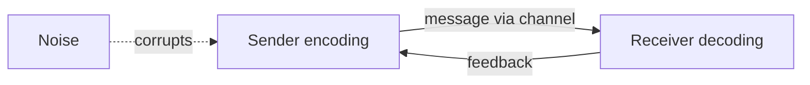
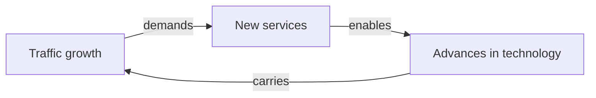

# Data Communication - Section 1: Foundations Review

This deck reviews Lectures 1 and 2 in five blocks: why data communication matters, the communication model, where the field is heading, networks and topologies, and transmission terminology.

## Four Terms That Must Not Blur

| Term              | Definition                                                                                                                    | Classic Example                                 |
| ----------------- | ----------------------------------------------------------------------------------------------------------------------------- | ----------------------------------------------- |
| **Data**          | Raw representation of facts: numbers, characters, symbols, before interpretation                                              | The bytes `25, 6, 2026`                         |
| **Information**   | Data organized and interpreted so it means something to someone                                                               | The same bytes read as **25 June 2026**         |
| **Signal**        | The physical form data takes so it can travel a medium                                                                        | Voltage on a wire, light in fibre, radio in air |
| **Communication** | The whole activity of exchanging information between sender and receiver, across space and sometimes time, using agreed rules | A voice note from your phone to a friend        |

> [!WARNING] The classic wrong sentence
> Never say "the data travelled through the cable." Strictly, the **signal** travels. The data is what that signal represents. Exam questions on this distinction are common because the everyday phrase is wrong.

### Everyday Actions Are Communication Problems

| Action                   | What must happen                                                                            |
| ------------------------ | ------------------------------------------------------------------------------------------- |
| WhatsApp voice note      | Voice becomes data, crosses a mobile network, becomes sound again, with no noticeable delay |
| Streaming video          | Large volumes arrive fast and **in order**, or the video freezes or corrupts                |
| Browsing a website       | A request crosses thousands of kilometres and the reply returns in well under a second      |
| Factory sensor on RS-485 | A temperature reading crosses a cable to a control room                                     |

The shared question: **how do we represent information as a signal, send it reliably, and make sure the receiver understands it correctly?**

## The Communication Model

### Big Picture

| Role         | Function                                                 |
| ------------ | -------------------------------------------------------- |
| **Encoding** | Machine converts data into a signal suited to the medium |
| **Channel**  | Anything from one cable to an entire network             |
| **Decoding** | The reverse of what the transmitter did                  |
| **Feedback** | Confirmation travelling back to the sender               |

### Five Key Elements

| #   | Element                 | Function                                                        | Voice-note Example                      |
| --- | ----------------------- | --------------------------------------------------------------- | --------------------------------------- |
| 1   | **Source**              | Generates the data to be transmitted                            | Phone microphone plus the app recording |
| 2   | **Transmitter**         | Converts and encodes data into a signal suitable for the medium | Phone radio chip                        |
| 3   | **Transmission system** | The path the signal travels                                     | Towers, backbone, Internet              |
| 4   | **Receiver**            | Accepts the signal and decodes it back into usable form         | Friend's phone radio                    |
| 5   | **Destination**         | Takes the incoming data and uses it                             | Friend's speaker plus app               |

A **protocol** is the agreed set of rules both ends follow. It is what lets the five blocks work together; without it the hardware is connected but not communicating.

### The Simplified Model in Symbols

| Stage | Quantity | Meaning            |
| ----- | -------- | ------------------ |
| 1     | $m$      | Input information  |
| 2     | $g(t)$   | Input data         |
| 3     | $s(t)$   | Transmitted signal |
| 4     | $r(t)$   | Received signal    |
| 5     | $g'(t)$  | Output data        |
| 6     | $m'$     | Output information |

**Ideal versus real.** We want $g'(t) = g(t)$ and $m' = m$. The transmission system adds impairments, so in practice $r(t) \ne s(t)$. Detecting and handling that difference is exactly the job of the six communication tasks.

### Six Tasks That Make the Model Work

| #   | Task                               | Purpose                                                    | Example                           |
| --- | ---------------------------------- | ---------------------------------------------------------- | --------------------------------- |
| 1   | **Interfacing**                    | Physically connecting the device to the medium             | A port or RS-485 terminals        |
| 2   | **Signal generation**              | Producing a signal the medium can carry                    | Voltage levels for 1s and 0s      |
| 3   | **Synchronization**                | Sender and receiver agree on timing                        | Both ends agree on 9600 bit/s     |
| 4   | **Exchange management**            | Agreeing when to start, pause, and end a conversation      | Turn-taking on a half-duplex link |
| 5   | **Error detection and correction** | Noticing, and sometimes fixing, bits that arrive wrong     | A parity bit flags a flipped bit  |
| 6   | **Flow control**                   | Preventing a fast sender from overwhelming a slow receiver | Receiver tells sender to pause    |

## Tracing a WhatsApp Voice Note

| Element                 | In the example                         | What changes here                                   |
| ----------------------- | -------------------------------------- | --------------------------------------------------- |
| **Source**              | Phone microphone plus WhatsApp app     | Sound becomes digitized data                        |
| **Transmitter**         | Phone radio chip                       | Digitized voice becomes a radio signal              |
| **Transmission system** | Operator towers, backbone, Internet    | Signal crosses the network and picks up impairments |
| **Receiver**            | Radio of the friend's phone            | Signal is decoded back into data                    |
| **Destination**         | Speaker plus app on the friend's phone | Decoded data becomes sound again                    |

The same message exists as **sound, data, and signal** at different points. Data communication is the machinery that converts between those forms reliably.

## Three Forces That Keep the Field Changing

| Force                           | Driver                                                                                                                          |
| ------------------------------- | ------------------------------------------------------------------------------------------------------------------------------- |
| **Traffic growth**              | More people and devices online; one household runs phone, laptop, smart TV, IoT sensors at once                                 |
| **Development of new services** | HD video calling needs far more data per second than a phone call, and needs low latency, not just eventual delivery            |
| **Advances in technology**      | Fibre optics, 5G, and more efficient encoding carry the extra traffic; rising speeds and falling prices encourage more services |

The three feed each other. Technology **enables** new services, which drive **more** traffic, which demands further technology. This is a loop, not three independent trends.

### Service Rate Expectations

Lowest speed at which each service is rated "Good":

| Service                   | Rate (kbit/s) | Group        |
| ------------------------- | ------------- | ------------ |
| Transaction processing    | 10            | Old services |
| Messaging and text apps   | 10            | Old services |
| Voice                     | 10            | Old services |
| Location services         | 14            | Old services |
| Still image transfers     | 64            | Mid-range    |
| Internet and VPN access   | 64            | Mid-range    |
| Database access           | 64            | Mid-range    |
| Enhanced web surfing      | 144           | Mid-range    |
| Low-quality video         | 144           | Mid-range    |
| Hi-fi audio               | 144           | Mid-range    |
| Large file transfer       | 144           | Mid-range    |
| Moderate video            | 384           | Demanding    |
| Interactive entertainment | 2000          | Demanding    |
| High-quality video        | 2000          | Demanding    |

The grouping is the point: voice, messaging, and transactions are acceptable at **9.6 kbit/s**, web and low-quality video at **144 kbit/s**, and high-quality video and interactive entertainment need about **2000 kbit/s**.

## Networks and the Internet

| Type                         | Scope                            | Technologies                         |
| ---------------------------- | -------------------------------- | ------------------------------------ |
| **LAN** (Local Area Network) | Single building or cluster       | Ethernet, token ring, star, wireless |
| **WAN** (Wide Area Network)  | City to city, country to country | Telephone network, ISDN, ATM         |
| **Wireless**                 | No cable between nodes           | Radio, microwave, satellite          |

**Internet.** Evolved from **ARPANET**, developed to solve communication across arbitrary, multiple, packet-switched networks, with **TCP/IP** as its foundation.

## Physical Topologies

**Physical topology** is the physical layout of nodes on a network. Three fundamental shapes exist, plus hybrids such as several stars joined together.

### Bus

One cable, the **bus**, connects all nodes with no connectivity devices.

| Advantages                    | Disadvantages                             |
| ----------------------------- | ----------------------------------------- |
| Works well for small networks | Management costs can be high              |
| Relatively inexpensive        | Potential for congestion as traffic grows |
| Easy to add to                | A cable fault affects the whole segment   |

### Ring

Each node connects to its two nearest neighbours, forming a circle.

| Advantages                                                 | Disadvantages                             |
| ---------------------------------------------------------- | ----------------------------------------- |
| Easier to manage; easy to locate a defective node or cable | Expensive                                 |
| Well suited to long distances on a LAN                     | More cable and equipment at the start     |
| Handles high-volume traffic                                | Fewer equipment options than bus          |
| Enables reliable communication                             | Fewer options for expansion to high speed |

**Token passing** is the access method: a **token** signal circulates and **authorizes** the node holding it to transmit. This is what gives the ring its predictable performance.

### Star

Every node connects through a central device, a **hub** or switch.

| Advantages                                                                               | Disadvantages                            |
| ---------------------------------------------------------------------------------------- | ---------------------------------------- |
| Most popular topology; wide equipment choice                                             | The **hub is a single point of failure** |
| Low start-up cost; easy to manage                                                        | Requires more cable than bus             |
| Nodes easily moved, isolated, or interconnected                                          |                                          |
| Scalable, with many expansion options                                                    |                                          |
| Any single cable connects only two devices, so a cabling fault affects two nodes at most |                                          |

### Bus, Ring, Star Side by Side

| Criterion               | Bus                                     | Ring                                             | Star                                                               |
| ----------------------- | --------------------------------------- | ------------------------------------------------ | ------------------------------------------------------------------ |
| **Layout**              | One shared cable joins all nodes        | Each node joined to two neighbours in a circle   | Every node wired to a central hub                                  |
| **Cost**                | Relatively inexpensive                  | Expensive; more cable and equipment at the start | Low start-up cost; more cable than bus                             |
| **Management**          | Management costs can be high            | Easier; defects easy to locate                   | Easy                                                               |
| **Failure and traffic** | Congestion with heavy traffic           | Reliable; handles high volume via token passing  | Cable fault hits at most 2 nodes; hub is a single point of failure |
| **Growth**              | Easy to add to; best for small networks | Fewer options to expand to high speed            | Scalable, many expansion options                                   |
| **Popularity**          | More widely used than ring              | Less used, fewer equipment options               | Most popular, wide equipment choice                                |

## Transmission Terminology

### The Medium

| Media type                    | Signal is confined?        | Examples                                                                            |
| ----------------------------- | -------------------------- | ----------------------------------------------------------------------------------- |
| **Guided media**              | Yes, to a physical path    | Copper twisted pair, coaxial cable, optical fibre                                   |
| **Unguided media** (wireless) | No, radiates through space | Radio and Wi-Fi, microwave and satellite, propagation through air, vacuum, seawater |

Medium choice directly affects **how far** a signal travels, **how fast** data can be sent, and **how much** it costs.

Successful transmission depends on two factors: **the quality of the signal** being transmitted, and **the characteristics of the transmission medium**.

### Links

| Configuration      | Definition                                                                                                          |
| ------------------ | ------------------------------------------------------------------------------------------------------------------- |
| **Point-to-point** | Only two devices share the medium; the signal propagates directly from transmitter to receiver, amplifiers excepted |
| **Multipoint**     | More than two devices share the same medium                                                                         |

| Point-to-point examples                                                                         | Multipoint examples                                                             |
| ----------------------------------------------------------------------------------------------- | ------------------------------------------------------------------------------- |
| Cable between two devices, dedicated RS-232 link, directional microwave link between two towers | Bus topology, RS-485 bus with several devices on one pair, shared radio channel |

### Direction Modes

| Mode            | Rule                                      | Example          | Why it fits                                   |
| --------------- | ----------------------------------------- | ---------------- | --------------------------------------------- |
| **Simplex**     | One direction only                        | Cable television | The viewer never sends anything back          |
| **Half-duplex** | Both may transmit, but only one at a time | Police radio     | Both sides talk, but turn-taking is natural   |
| **Full-duplex** | Both may transmit simultaneously          | Telephone        | Conversation overlaps and must not be clipped |

### Channel Performance Measures

| Measure                      | Unit and meaning                                                                         |
| ---------------------------- | ---------------------------------------------------------------------------------------- |
| **Spectral bandwidth**       | Hz, the range of frequencies the channel carries                                         |
| **Symbol rate**              | baud, pulses or symbols per second                                                       |
| **Bit rate**                 | bit/s: gross signalling rate, net information rate, channel capacity, maximum throughput |
| **Channel utilization**      | How much of the channel's capability is actually in use                                  |
| **Link spectral efficiency** | bit/s achieved per Hz of bandwidth                                                       |
| **Signal-to-noise measures** | SNR, signal-to-interference, $E_b/N_0$, carrier-to-interference, all in decibels         |
| **Error rates**              | BER (bit-error rate) and PER (packet-error rate)                                         |
| **Latency**                  | seconds: propagation time plus transmission time                                         |
| **Delay jitter**             | Variation in delay, which reveals transient congestion                                   |

## Review Drills

| Prompt                                                   | Answer                                                          |
| -------------------------------------------------------- | --------------------------------------------------------------- |
| Name the five elements in order.                         | Source, transmitter, transmission system, receiver, destination |
| Which element converts data into a signal?               | The **transmitter**                                             |
| Which task prevents a slow receiver being flooded?       | **Flow control**                                                |
| Which topology has the hub as its weak point?            | **Star**                                                        |
| Which topology uses token passing?                       | **Ring**                                                        |
| Which mode does a telephone use?                         | **Full-duplex**                                                 |
| Which media type includes seawater propagation?          | **Unguided**                                                    |
| What replaced ARPANET as the foundation of the Internet? | **TCP/IP**                                                      |

_12 min read (source: 14 min)_
