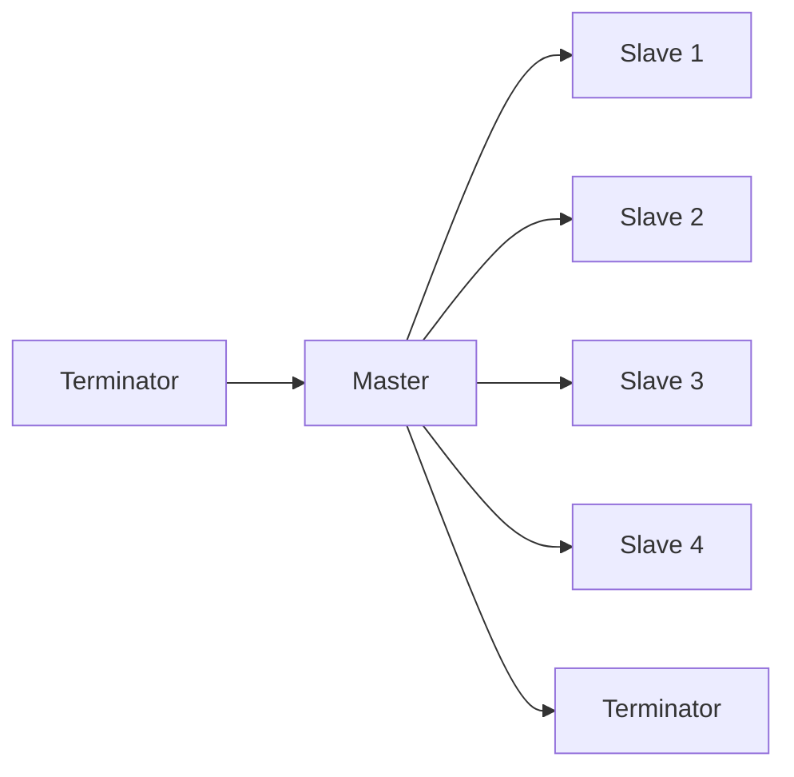

# Data Communication - Section 4: UART, RS-232, and RS-485

This deck is the second half of the Lecture 3 lab: the chips that frame data, then the two wired standards that carry it. It also carries a corrections table at the end listing the slips found in the lecture slides, so the correct values are on record in one place.

## UART and USART: Parallel-to-Serial Converters

**UART** and **USART** convert parallel data inside the processor into serial data on the wire, and back on receive.

| Block                       | What it does                           |
| --------------------------- | -------------------------------------- |
| Transmit holding register   | CPU writes one byte                    |
| Tx shift register           | Clocks the byte out, one bit at a time |
| Receive holding register    | Holds a received byte for the CPU      |
| Rx shift register           | Collects incoming bits                 |
| Baud-rate / clock generator | Sets the timing                        |

**Loading a byte.** The CPU writes `0x41` to the transmit register in one bus cycle. The UART then clocks out start + 8 data bits + stop = 10 bit-times by itself, freeing the CPU.

### Core Functions

1. **Convert**: parallel to serial on send, serial to parallel on receive.
2. **Frame automatically**: add the start bit, parity bit, and stop bit(s) to every character, so software does not have to.
3. **Check**: parity, plus two error types.

### Error Types

| Error             | What it means                                                                  | How it happens                                                                  |
| ----------------- | ------------------------------------------------------------------------------ | ------------------------------------------------------------------------------- |
| **Parity error**  | Received parity bit does not match the data                                    | A noise spike flips one data bit in a frame                                     |
| **Framing error** | A stop bit was not where expected, so frame boundaries are wrong               | Baud-rate mismatch, or noise read as a start bit                                |
| **Overrun error** | A new character arrived before the CPU read the previous one, so data was lost | CPU busy for more than one character time (1.04 ms at 9600 8N1) without reading |

> [!NOTE] Overrun at high speeds
> At 115,200 baud one character lasts only 87 µs, so the CPU must read the receiver quickly or use a buffer or interrupt. Polling every few milliseconds at 9600 8N1 (character time 1.04 ms) means about five characters arrive between reads, and with a 1-byte buffer the extra ones are lost. Fix: a FIFO buffer or an interrupt.

### UART vs USART

| Feature          | UART                                                                                 | USART                                                                      |
| ---------------- | ------------------------------------------------------------------------------------ | -------------------------------------------------------------------------- |
| **Clock signal** | None; start and stop bits synchronize                                                | External clock in synchronous mode; start/stop bits in asynchronous mode   |
| **Modes**        | Asynchronous only                                                                    | Synchronous and asynchronous                                               |
| **Data unit**    | Character-sized frames, commonly 7 or 8 data bits plus optional parity and stop bits | Frames whose size and format depend on device configuration and mode       |
| **Data rate**    | Lower; the receiver must know the baud rate beforehand                               | Typically higher and steadier in synchronous mode, with the clock supplied |
| **Typical use**  | PC serial ports, GPS modules                                                         | Microcontroller peripherals and interfaces needing either mode             |

It sends an explicit clock alongside the data, so the receiver never has to guess timing from start bits alone. That is why a USART in synchronous mode reaches higher, steadier rates.

### Real Hardware

| View                         | Detail                                                                                                                                           |
| ---------------------------- | ------------------------------------------------------------------------------------------------------------------------------------------------ |
| **CPU's point of view**      | A UART is another I/O device on the bus. Many microcontrollers integrate one (e.g. ADuC832), so no separate chip is needed.                      |
| **Real USART block (STM32)** | Shift registers, a baud-rate/clock generator, and RX/TX/CTS/RTS pins.                                                                            |
| **Boards you will meet**     | PIC18F boards expose UART pins. USB-to-serial converters give a laptop a COM port.                                                               |
| **Master and slave**         | In a synchronous link (SPI, or USART synchronous mode) one device is the master and generates the clock; the slave's data is synchronized to it. |

**Same USART, two modes.** Asynchronous: 9600 baud 8N1 to a GPS module, no clock pin. Synchronous: the USART drives a clock pin so a peripheral shifts data on every pulse.

### Configuring a UART in Code

**Python (pyserial) on a PC:**

```python
import serial
port = serial.Serial(
  'COM3',
  baudrate=9600,
  bytesize=8,
  parity='N',
  stopbits=1)
port.write(b'A')  # 0x41
```

**Arduino-style microcontroller:**

```cpp
void setup() {
  Serial.begin(9600);  // default format: 8N1
}

void loop() {
  Serial.write('A');  // 0x41
  delay(1000);
}
```

Mapping: `baudrate` = bit rate, `bytesize` = data bits, `parity` = none/even/odd, `stopbits` = 1 or 2. The start bit is added automatically by the UART.

## RS-232: Point-to-Point, Unbalanced

**RS-232** is the standard for connecting a **DTE** (a computer) to a **DCE** (a modem), or directly to a device such as a data logger.

| Aspect           | Detail                                                                                            |
| ---------------- | ------------------------------------------------------------------------------------------------- |
| **Purpose**      | Connect a DTE to a DCE or to another device                                                       |
| **Architecture** | Bi-directional, **point-to-point**: exactly two devices                                           |
| **Duplex**       | Two independent channels, one per way: **full-duplex**. Control signals ride alongside            |
| **Devices**      | Modems, GPS receivers, electronic balances, data loggers, lab instruments, industrial controllers |

### Signals and Handshaking

| Signal  | Full name           | Direction  | Function                             |
| ------- | ------------------- | ---------- | ------------------------------------ |
| **RTS** | Request To Send     | DTE to DCE | DTE requests permission to send data |
| **CTS** | Clear To Send       | DCE to DTE | DCE says it is ready to receive      |
| **DSR** | Data Set Ready      | DCE to DTE | DCE is powered on and ready          |
| **DTR** | Data Terminal Ready | DTE to DCE | DTE is powered on and ready          |
| **DCD** | Data Carrier Detect | DCE to DTE | Modem status: carrier detected       |
| **RI**  | Ring Indicator      | DCE to DTE | Modem status: incoming ring          |

**Flow control vs modem control.** RTS and CTS carry flow control; DCD, DTR, DSR, and RI carry modem control. On the DB-9, DCD is pin 1 and RI is pin 9.

### DB-9 Pinout

DB-9 face seen looking into the connector on a PC, pins 1-5 on the top row, 6-9 on the bottom row.

| Pin | Signal |
| --- | ------ |
| 1   | DCD    |
| 2   | RXD    |
| 3   | TXD    |
| 4   | DTR    |
| 5   | GND    |
| 6   | DSR    |
| 7   | RTS    |
| 8   | CTS    |
| 9   | RI     |

**TXD is pin 3 on a DB-9 but pin 2 on a DB-25. Always check which connector you are holding.** Both connectors swap TXD and RXD between DTE and DCE ends.

### DB-25 and Cross-Reference

| DB-25 pin | Signal   | Meaning             | DB-9 pin |
| --------- | -------- | ------------------- | -------- |
| 1         | PGND     | Protective ground   | (shell)  |
| 2         | TXD      | Transmit data       | 3        |
| 3         | RXD      | Receive data        | 2        |
| 4         | RTS      | Request to send     | 7        |
| 5         | CTS      | Clear to send       | 8        |
| 6         | DSR      | Data set ready      | 6        |
| 7         | SG       | Signal ground       | 5        |
| 8         | CD (DCD) | Carrier detect      | 1        |
| 20        | DTR      | Data terminal ready | 4        |
| 22        | RI       | Ring indicator      | 9        |

Older equipment uses the larger DB-25 with the same signals plus a protective ground. Per the standard, **male connectors carry DTE pin functions and female connectors carry DCE functions**.

### MARK and SPACE: Inverted Logic

Frame for `'A'` (8N1): idle, start 0, data `1,0,0,0,0,0,1,0`, stop 1, idle.

| Line voltage | Interpreted as                 | Logic |
| ------------ | ------------------------------ | ----- |
| -12 V        | MARK (idle)                    | 1     |
| -5 V         | MARK                           | 1     |
| -2 V         | Undefined (between thresholds) | -     |
| +2 V         | Undefined                      | -     |
| +8 V         | SPACE                          | 0     |
| +13 V        | SPACE                          | 0     |

Thresholds: below **-3 V** is MARK (1); above **+3 V** is SPACE (0). The standard allows about ±3 V to ±15 V.

> [!WARNING] Inverted, and not TTL
> The RS-232 waveform is the mirror image of the TTL one. A microcontroller pin swings 0 to +5 V; RS-232 needs negative and positive rails. Connecting the two directly does not work. A **MAX232** or **MAX233** transceiver converts between them. The MAX233 is +5 V powered and needs fewer external components, because the chip generates the ± voltages internally from a single +5 V supply.

**Check yourself.** Which logic value is a +9 V reading? **SPACE = 0.**

### Speed and Distance

| Limit                  | Value                                                                                                           |
| ---------------------- | --------------------------------------------------------------------------------------------------------------- |
| Standard maximum speed | 20 kbit/s; modern equipment commonly reaches 115,200 baud                                                       |
| Distance               | About 15 m (50 ft) at the maximum practical baud rate                                                           |
| Why limited            | Cable capacitance and inductance distort edges; higher capacitance also raises crosstalk between adjacent wires |

Standard baud rates: 75, 110, 300, 1200, 2400, 4800, **9600**, 14400, 19200, 28800, 33600, 56000, 115200. **9600** is the safe choice because it is very widely supported.

**Extra.** 9600 baud, 8N1, 15 m cable: can you also run 115,200 baud? Possibly on short, good cable, but it exceeds the standard's 20 kbit/s, and a longer cable makes it worse.

### Handshaking, Data Format, and Flow Control

**Hardware handshake (RTS/CTS, DTR/DSR).**

1. DTR and DSR: each side shows it is powered on and ready.
2. Sender raises RTS: "may I send?"
3. Receiver answers CTS when its buffer is free.
4. Data flows; CTS drops to pause the sender.

**Software handshake (XON/XOFF).** The receiver sends a special character over the normal data line to say stop (XOFF) or go (XON), so no extra wires are needed. In ASCII these are DC3 = `13h` and DC1 = `11h`.

**Message format.**

```text
<Header-string><Code identifier><INFO-FIELD><Terminator-string>
```

Header and terminator are configurable by software. Example: a balance sends `ST,GS, 12.34g\r\n` after each reading, where `ST,GS` is the header and code, the number is the info field, and `\r\n` is the terminator.

### Asynchronous Protocol and Cabling

RS-232 sends **no clock** with the data. Both ends run internal clocks at the same rate, and the start bit synchronizes them when needed. It is **character-oriented**: intended for single 8-bit blocks, start bit, 8 data bits, stop bit(s). 7-bit ASCII often uses the eighth bit as a parity bit.

| Signal | PC (DTE) end         | Straight-through to a DCE device   | Null-modem to another DTE      |
| ------ | -------------------- | ---------------------------------- | ------------------------------ |
| Data   | TXD pin 3, RXD pin 2 | 3 to 3, 2 to 2                     | 3 to 2, 2 to 3 (crossed)       |
| Ground | GND pin 5            | 5 to 5                             | 5 to 5                         |
| Use    | -                    | PC to modem, PC to DCE-wired board | PC to PC, PC to DTE instrument |

A straight-through cable connects TXD to TXD, which works only when the far end is DCE-wired. Two DTEs cannot be wired straight through, because both transmit on the same pin.

> [!NOTE] Quick Check 5, extra answers
> **(a)** Pin 3 = TXD (transmit), pin 2 = RXD (receive). **(b)** RS-232 uses about ±3 V to ±15 V, incompatible with TTL (0/+5 V), so a transceiver such as the MAX232 converts between them. **(c)** A scope shows the line idle at -11 V: negative is MARK, so logic **1** (idle). **(d)** 115,200 baud on 15 m: possible on short, good cable but beyond the standard's 20 kbit/s, and a longer cable makes it worse. **(e)** Minimal 3-wire link: **TXD, RXD, and GND** only, no handshaking.

## RS-485: Balanced, Differential, Multidrop

**RS-485** is built for distance and noise.

| Aspect            | Detail                                                                                                                           |
| ----------------- | -------------------------------------------------------------------------------------------------------------------------------- |
| **Balanced line** | Every signal uses a pair of wires driven to opposite voltages; the receiver reads the difference                                 |
| **Multidrop**     | One bus shared by many devices: up to 32 drivers and 32 receivers per the standard                                               |
| **Reach**         | 100 kbit/s at up to 1200 m (4000 ft) per the lecture; shorter cables allow much higher rates, up to 10 Mbit/s                    |
| **Real uses**     | Modbus RTU (industrial sensors, meters, PLCs), DMX512 (stage and architectural lighting), Profibus (factory automation fieldbus) |

### Differential Signalling: Why Noise Resistance Works

| Case                                 | A     | B     | A - B         |
| ------------------------------------ | ----- | ----- | ------------- |
| Normal state 1                       | 3.5 V | 0.5 V | +3.0 V        |
| Normal state 2                       | 0.5 V | 3.5 V | -3.0 V        |
| State 1 with 4 V noise on both wires | 7.5 V | 4.5 V | +3.0 V (same) |
| State 2 with 4 V noise on both wires | 4.5 V | 7.5 V | -3.0 V (same) |

The receiver sees a clean ±3.0 V difference even when both wires carry the same 4 V noise. **By contrast, an RS-232 wire has nothing to cancel against**: a +4 V spike lands directly on the one signal wire.

### The Half-Duplex Multidrop Bus



| Property               | Detail                                                                            |
| ---------------------- | --------------------------------------------------------------------------------- |
| One pair, many devices | Up to 32 drivers plus 32 receivers share one twisted pair                         |
| Terminators            | Resistors at both ends absorb the signal instead of reflecting it                 |
| One talker at a time   | A **software** rule: the master polls each slave in turn, not an electrical limit |

### Line Drivers, Half-Duplex and Full-Duplex Wiring

**2-wire half-duplex (most common).** One pair, `485+ / 485-`. Each node has TX/RX and an **ENABLE** input. A node turns its driver on only while it transmits and off to listen, otherwise two drivers would fight on the bus.

**4-wire full-duplex option.** Two pairs: `TX485±` for the master-to-slave direction and `RX485±` for the return. Only one slave may still drive the shared return pair.

**Why 2-wire is common.** Most multidrop jobs (polling sensors) do not need simultaneous two-way traffic, and 2 wires cost less than 4.

### Polling Schedule and Bus Timing

Illustrative assumptions: 9600 baud 8N1, request 8 bytes, reply 7 bytes, 5 ms turnaround per exchange.

| Slaves | Per exchange | Full scan | Scans per second |
| ------ | ------------ | --------- | ---------------- |
| 4      | 20.6 ms      | 83 ms     | 12.1             |
| 12     | 20.6 ms      | 248 ms    | 4.0              |
| 15     | 20.6 ms      | 309 ms    | 3.2              |
| 32     | 20.6 ms      | 660 ms    | 1.5              |

Sequence: master sends "Slave 3, read", the slave enables its driver and replies, it releases the bus, and the master moves to "Slave 4, read".

> [!WARNING] The trade-off
> RS-485 saves wire, one pair for all slaves, but every device shares the bus. More slaves mean a longer scan, and a faulty slave that never releases the bus can block everyone.

### Extra Answers

- **(c)** Why put terminators only at the two physical ends? The ends are where reflections happen, and resistors there absorb the wave. Terminating every node would load the bus.
- **(d)** Can two slaves reply at the same time if the master asks both? No. Their drivers would fight. The master must address them one at a time.

## Comparing and Choosing

### RS-232 vs RS-485

| Aspect                 | RS-232                                    | RS-485                                                  |
| ---------------------- | ----------------------------------------- | ------------------------------------------------------- |
| **Architecture**       | Point-to-point (2 devices)                | Multipoint; many devices on one bus                     |
| **Signalling**         | Unbalanced: 1 wire per signal plus ground | Balanced differential: 2 wires per signal               |
| **Noise immunity**     | Lower                                     | High                                                    |
| **Speed**              | 20 kbit/s per the standard                | 100 kbit/s at 1200 m; up to 10 Mbit/s on shorter cables |
| **Max distance**       | About 15 m (50 ft)                        | About 1200 m (4000 ft)                                  |
| **Duplex**             | Full-duplex (2 data channels)             | Half-duplex (2-wire) or full-duplex (4-wire)            |
| **Software behaviour** | Either side can send at any time          | Only one transmitter at a time                          |

### Choosing the Right Serial Tool

| Job                                  | Choice        |
| ------------------------------------ | ------------- |
| Accelerometer to MCU on the same PCB | SPI           |
| PC to a lab balance 3 m away         | RS-232 / UART |
| 30 energy meters along 800 m         | RS-485        |
| GPS module to a microcontroller      | UART          |
| 5 PLCs 200 m apart in a motor room   | RS-485        |

Decision order: chip-to-chip on one board at high speed means SPI. Many devices, more than 15 m, or a noisy environment means RS-485. Exactly two devices on a short cable means UART or RS-232.

### Factory Scenario: 12 Sensors, 400 m, Large Motors

| Requirement        | Twelve RS-232 runs                         | One RS-485 bus                          |
| ------------------ | ------------------------------------------ | --------------------------------------- |
| Devices and cables | 12 cables and 12 PC ports (point-to-point) | One twisted pair serves all 12 sensors  |
| Distance (400 m)   | About 15 m limit, hopeless                 | Reaches about 1200 m                    |
| Noise (motors)     | Single-ended; spikes land on the signal    | Differential; common-mode noise cancels |

**Recommendation: RS-485.** The trade-off to acknowledge: the 12 sensors share one bus, so the master must poll them one at a time, about 250 ms per scan at 9600 baud under the earlier assumptions.

### Campus Door Controllers: 600 m, 15 Devices

**Choice: RS-485**, because 600 m is inside the 1200 m limit (RS-232 is about 15 m), 15 controllers fit on one bus (at most 32), and elevator motors make it a noisy site where differential signalling is needed.

**Round-robin polling.** Controllers are numbered 1 to 15. The master loops: send a request to address $n$, enable the receiver, wait for a reply with a timeout, process it or log a fault on timeout, then move to the next address.

```python
n = 1
while True:
  send_request(n)
  enable_rx()
  reply = wait(timeout=0.030)  # 30 ms
  if reply:
    process(reply)
  else:
    log_fault(n)
  n = 1 if n == 15 else n + 1
```

Scan time: $15 \times 20.6 \text{ ms} \approx 309 \text{ ms}$ under the earlier timing assumptions.

## Summary

| Key point     | Summary                                                                                        |
| ------------- | ---------------------------------------------------------------------------------------------- |
| **Families**  | Serial vs parallel; synchronous (SPI) vs asynchronous (SCI/UART)                               |
| **Mechanism** | Async framing, start / data / parity / stop, lets a byte self-synchronize with no shared clock |
| **Chips**     | UART (async only); USART (async plus sync, with its own clock line)                            |
| **Standards** | RS-232: point-to-point, unbalanced, about 15 m. RS-485: multidrop, differential, about 1200 m  |
| **Numbers**   | RS-232: 20 kbit/s, 2 devices. RS-485: 100 kbit/s at 1200 m, 32 + 32 devices                    |
| **Practical** | Interface choice is a trade-off of distance, device count, noise, and cost                     |

Common misconceptions: **"RS-485 is just a better RS-232"** is false, each solves a different problem; **"parity catches every error"** is false, it reliably catches only a single flipped bit.

## Self-Assessment and Homework Answers

| #   | Question                                                                                  | Answer                                                                                                                                                                                                        |
| --- | ----------------------------------------------------------------------------------------- | ------------------------------------------------------------------------------------------------------------------------------------------------------------------------------------------------------------- |
| 1   | Name the four parts of an asynchronous byte frame in order, and the idle line level       | Start bit, data bits, parity bit (optional), stop bit(s). Idle is logic 1 (HIGH, MARK).                                                                                                                       |
| 2   | Why can a USART in synchronous mode reach higher, steadier rates than a UART?             | It sends an explicit clock with the data, so the receiver does not infer timing from start bits and can run faster and steadier.                                                                              |
| 3   | Frame `5A₁₆`: 1 start, 8 data bits, even parity, 1 stop                                   | `5A` = `01011010`, four 1s, so parity 0. Frame: `0 -> 01011010 -> 0 -> 1`.                                                                                                                                    |
| 4   | Why is RS-485's one transmitter at a time rule a software limitation?                     | Electrically several drivers could be enabled at once; nothing physical prevents it. The master's polling and addressing protocol ensures only one driver is enabled, otherwise they collide.                 |
| 5   | Campus security PC to 15 door controllers, 600 m, near elevator motors: RS-232 or RS-485? | RS-485: 600 m is within 1200 m, 15 devices fit on one bus (at most 32), and differential signalling resists motor noise. RS-232 is limited to about 15 m and two devices per cable.                           |
| 6   | Round-robin polling scheme for the 15 controllers                                         | Master loops over addresses 1-15: send request, enable receiver, wait for reply with timeout, log a fault on timeout, move to the next address. Scan about 309 ms at 9600 baud under the earlier assumptions. |

**Homework frames.** `C3` even: `0 -> 11000011 -> 0 -> 1`. `C3` odd: `0 -> 11000011 -> 1 -> 1`. `F0` even: `0 -> 00001111 -> 0 -> 1`. `F0` odd: `0 -> 00001111 -> 1 -> 1`.

## Corrections to the Lecture Slides

| Where                               | What the slide says                                              | Value used here                                                            |
| ----------------------------------- | ---------------------------------------------------------------- | -------------------------------------------------------------------------- |
| Configuring a serial port           | Start bit (always 1)                                             | Start bit is **logic 0** (LOW); the idle line is 1, as in the frame slides |
| Worked example 3 (`8C`, odd parity) | Text says parity bit 1, its table shows 0                        | Parity = **0** (three 1s are already odd)                                  |
| RS-485 speed                        | 100 kbit/s on one slide, up to 10 Mbit/s on the comparison table | Both: 100 kbit/s at 1200 m, higher rates on shorter cables                 |
| RS-232 baud list                    | 115,000                                                          | **115,200**, the standard rate                                             |

_21 min read (source: 25 min)_
