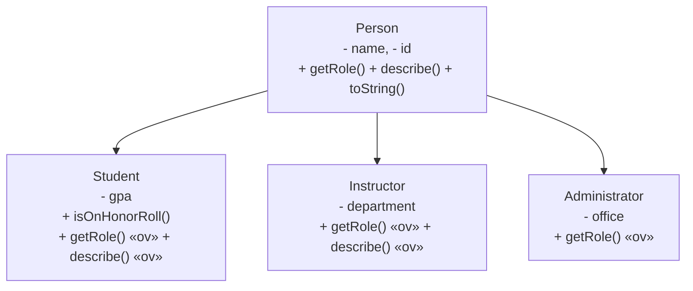

<script setup>
import Stepper from '@viz/Stepper.vue'
</script>

# Java II - Lecture 3

## Four Pillars: Where Each Lives

| Pillar            | Meaning                                                  | Java example                          |
| ----------------- | ------------------------------------------------------- | ------------------------------------- |
| **Encapsulation** | Bundling data and methods; controlling access            | `private` fields + `public` methods   |
| **Inheritance**   | Creating a new class based on an existing one            | `class Dog extends Animal`            |
| **Polymorphism**  | One interface/method call, many behaviors                | Method overriding                     |
| **Abstraction**   | Hiding implementation details, exposing essentials       | `abstract class`, `interface`         |

Liang (§11.7) names **three** pillars — encapsulation, inheritance, polymorphism — and treats abstraction as the design idea behind classes, abstract classes, and interfaces. Both views are accepted in this course; abstraction is not optional, just not counted as its own pillar.

## Part 1 — Inheritance

### Why Inheritance Exists

Student, Instructor, Employee, Administrator all repeat `name`, `id`, `getName()`. Copy-pasting into four classes means more code, more bugs, harder maintenance. The fix is to **generalize**: move the common part into one superclass (`Person`) and let each specific class `extend` it, adding only what is special.

**Generalization** moves up the hierarchy; **specialization** moves down it. Superclasses are **more general**; subclasses are **more specific**.

### The is-a Relationship

Inheritance models **is-a**:

| Term          | Also called                          |
| ------------- | ------------------------------------ |
| **Superclass** | parent class, base class, supertype  |
| **Subclass**   | child class, derived class, subtype  |

Rules:

- Every class except `Object` has **exactly one direct superclass** — Java supports **single inheritance of classes** only.
- Java classes form hierarchies of **many levels**.
- Use inheritance only when the sentence "A ___ is a ___" is true. `Car` **has an** `Engine` → composition, not inheritance.

Checkpoint answers: **(a)** Yes — every class is a subclass of `Object`. **(b)** No. **(c)** Yes, indirectly (through `Student`).

### The Object Class

Every class in Java directly or indirectly extends **`Object`** (package `java.lang`). Its **11 methods** are inherited by all classes. This lecture focuses on `toString()` and `equals()`. `finalize()` is deprecated (Java 9+) and must not be used.

### Creating a Subclass: What Is Inherited?

```java
public class Student extends Person {
  private double gpa;              // added

  public Student(String name, double gpa) {
    super(name);                  // Person part
    this.gpa = gpa;
  }
  public double getGpa() {        // added
    return gpa;
  }
}
```

| Member                              | Inherited?                                        |
| ----------------------------------- | ------------------------------------------------- |
| public methods of the superclass    | Yes, usable directly (e.g. `getName()`)            |
| protected members                   | Yes, accessible                                   |
| `private` fields (e.g. `name`)      | Inherited but **not directly accessible** — use methods |
| Constructors                        | **NOT inherited** — call with `super(...)`         |

Which lines compile?

```java
Student s = new Student("Mona", 3.6);
System.out.println(s.getName());  // (1) OK — inherited public method
System.out.println(s.getGpa());   // (2) OK — Student's own method
System.out.println(s.name);       // (3) compile error — private in Person
Person p = new Person("Ali");
System.out.println(p.getGpa());   // (4) compile error — Person is not a Student
```

A subclass can add fields and methods, and override inherited ones (Part 3). `extends` names exactly one superclass. (Liang §11.2, §11.3.1 — constructors are not inherited)

## Constructors and Constructor Chaining

Constructors are **not inherited**. A subclass constructor's first task is to invoke its direct superclass's constructor, explicitly or implicitly — this ensures the inherited instance variables are initialized properly.

- If you write no explicit call, Java inserts **`super()`** (the no-arg constructor).
- A class's default constructor calls the superclass's default no-arg constructor.
- The chain ends at **`Object`**'s constructor; the original subclass constructor body finishes **last**.

```java
class Person {
  public Person() {
    System.out.println("(1) Person constructor");
  }
}
class Student extends Person {
  public Student() {
    System.out.println("(2) Student constructor");
  }
}
class GraduateStudent extends Student {
  public GraduateStudent() {
    super();                     // optional: added automatically
    System.out.println("(3) GraduateStudent constructor");
  }
}
// main: new GraduateStudent();
```

<Stepper label="Constructor chaining: new GraduateStudent()" :steps="[
  { title: 'GraduateStudent() starts', detail: 'Its first task is to call super() — the direct superclass constructor.', note: 'Your code runs only after the parent part exists.' },
  { title: 'Student() starts', detail: 'Also calls super() implicitly, before its own body.', note: 'The chain goes one class up at a time.' },
  { title: 'Person() starts', detail: 'Calls Object() implicitly. The chain has reached the top of the hierarchy.', note: 'The last constructor called is always Object’s.' },
  { title: 'Object() runs first', detail: 'Nothing prints; control returns to Person.', note: 'Object is the root of every class hierarchy.' },
  { title: '(1) Person constructor prints', detail: 'Person body finishes; Student body runs.', note: 'Parent part initializes before the child part can use it.' },
  { title: '(2) Student constructor prints', detail: 'Student body finishes; GraduateStudent body runs.', note: 'Each superclass completes before its subclass.' },
  { title: '(3) GraduateStudent constructor prints', detail: 'The original caller’s body runs last.', note: 'Execution order: Object → Person → Student → GraduateStudent.' }
]" />

```text
Output
(1) Person constructor
(2) Student constructor
(3) GraduateStudent constructor
```

> [!WARNING] Find the Error: implicit `super()`
> ```java
> class Person {
>   private String name;
>   public Person(String n) { name = n; }   // no no-arg constructor
> }
> public class Student extends Person {
>   private double gpa;
>   public Student(double gpa) {
>     this.gpa = gpa;                       // line 8: what is inserted?
>   }
> }
> ```
> The compiler inserts `super();` — but `Person` has **no no-arg constructor**. Error at line 8: `constructor Person in class Person cannot be applied to given types`.
> Fix: call the existing constructor as the first statement: `super("Unknown");`

**Rule:** `super(...)` must be the **first statement** of a constructor (Liang §11.3.1). If you write neither `super(...)` nor `this(...)`, Java adds `super()`. Give any class designed to be extended a no-arg constructor (Liang §11.3.2).

## Method Overriding

A subclass may replace an inherited method with its own implementation — useful when the inherited version is inappropriate or needs a customized version.

```java
public class Animal {
  public String sound() { return "..."; }
}
public class Dog extends Animal {
  @Override
  public String sound() { return "Woof"; }
}
public class Cat extends Animal {
  @Override
  public String sound() { return "Meow"; }
}
```

**Overriding**: a subclass provides a new implementation of an inherited method with the **same signature** and the same (or compatible) return type (Liang §11.4). `@Override` asks the compiler to verify the override — with it, `Sound()` (capital S) is a compile error instead of silently inheriting. An overriding method can access the superclass version with **`super.method()`**.

### Overriding vs. Overloading

| Aspect     | Overriding                        | Overloading                         |
| ---------- | --------------------------------- | ----------------------------------- |
| Where      | superclass + subclass             | same class (or subclass)            |
| Signature  | same name, same parameters        | same name, **different** parameters |
| Return     | same (or subtype)                 | can differ                          |
| Decided    | at **run time** (dynamic binding) | at **compile time**                 |
| Purpose    | specialize inherited behavior     | same action, different inputs       |

```java
class A { public void p(double x) { System.out.println("A.p(double) " + x); } }
class B extends A { @Override public void p(double x) { System.out.println("B.p(double) " + x); } }
class C extends A { public void p(int x) { System.out.println("C.p(int) " + x); } }
// main
new B().p(10);   // B.p(double) 10.0
new B().p(10.0); // B.p(double) 10.0
new C().p(10);   // C.p(int) 10
new C().p(10.0); // A.p(double) 10.0
```

`B` overrides, `C` overloads: both calls on B hit `B.p(double)`; `p(10)` matches `C.p(int)`; `p(10.0)` matches the inherited `A.p(double)`.

## The Payroll Hierarchy (Case Study)

**CommissionEmployee** sells on commission (percentage of sales). Base-salaried commission employees add a base salary. The wrong way to build `BasePlusCommissionEmployee` is copy-and-paste — error-prone, time-consuming, and terrible for maintenance. The right way: extend `CommissionEmployee` and add only the base salary.

Inheritance has a cost: the superclass's **`private` members are hidden** — the subclass runtime contains them, but the compiler rejects direct access.

### `protected` Members

Declaring a superclass member `protected` gives it an **intermediate level of access**: accessible by members of the superclass, members of its subclasses, and members of **other classes in the same package** (package access). All public and protected superclass members keep their access modifier in the subclass.

| Modifier   | Same class | Same package | Subclass (other pkg) | Anywhere |
| ---------- | ---------- | ------------ | -------------------- | -------- |
| `public`   | ✓          | ✓            | ✓                    | ✓        |
| `protected`| ✓          | ✓            | ✓                    | ✗        |
| *(default)*| ✓          | ✓            | ✗                    | ✗        |
| `private`  | ✓          | ✗            | ✗                    | ✗        |

(Liang §11.14, Table 11.2 Data and Methods Visibility)

**Design guidance:**

- Keep data fields `private` (encapsulation). Give subclasses access through public or protected **methods**, not protected fields.
- Use `protected` for members intended for subclasses (e.g. a helper method) — not as a shortcut to skip get/set.
- `protected` also opens the member to **every class in the same package**, which is not always desirable.
- An overriding method may **widen** visibility (`protected` → `public`) but never narrow it.

### Design A vs. Design B

```java
// Design A — class Employee { protected double salary; }
class Manager extends Employee {
  void giveBonus() { salary = -500; }   // no check!
}

// Design B — class Employee {
//   private double salary;
//   protected void setSalary(double s) { if (s >= 0) salary = s; }
//   public double getSalary() { return salary; }
}
```

**Design B wins:** the subclass can only change `salary` through `setSalary`, which rejects invalid values in one place; and `Employee` may later change how `salary` is stored without breaking `Manager` — subclasses depend on **services, not data**.

## Part 2 — Polymorphism

**Polymorphism** ("many forms") lets you write programs that process objects of different subclasses — all sharing the same superclass — in the same way, decoupling code from the concrete classes.

### One Variable, Many Forms

```java
Animal a1 = new Dog();
Animal a2 = new Cat();
System.out.println(a1.sound());   // Woof
System.out.println(a2.sound());   // Meow
```

Definition (Liang §11.7):

> Polymorphism means that a variable of a supertype can refer to a subtype object.

- Assigning `Animal a = new Dog()` is legal because every Dog **is an** Animal.
- `Dog d = new Animal()` is **not** legal — an Animal is not necessarily a Dog.
- The **declared type** decides which methods you may call at compile time; the **actual type** of the object decides which implementation runs at run time.

Benefit: write code once for `Animal`; it works for every present and future subclass (e.g. a game sending `move` to every animal, a payroll processing every employee).

### Dynamic Binding

The compiler checks the call against the **variable's class** (if that class has the method, the call is compiled). At execution time, the **object's type** selects the method — this is **dynamic binding** (Liang §11.5).

```java
Animal a1 = new Dog();
a1.sound();   // compiles (Animal has sound()); runs Dog.sound()
a1.fetch();   // compile error: Animal has no fetch()
```

```java
class Person { @Override public String toString() { return "Person"; } }
class Student extends Person { @Override public String toString() { return "Student"; } }
class GraduateStudent extends Student { }
static void m(Object x) { System.out.println(x.toString()); }
// main
m(new GraduateStudent());   // Student
m(new Student());           // Student
m(new Person());            // Person
m(new Object());            // java.lang.Object@6d06d69c
```

Java searches for `toString()` starting at the **actual class** and moving up: GraduateStudent → Student → Person → Object. `Object`'s own `toString()` prints `ClassName@hashCode`.

### Polymorphic Collections

```java
ArrayList<Animal> zoo = new ArrayList<>();
zoo.add(new Dog());
zoo.add(new Cat());
zoo.add(new Bird());                       // new subclass
for (Animal a : zoo)
  System.out.println(a.getClass().getSimpleName() + ": " + a.sound());
```

```text
Dog: Woof
Cat: Meow
Bird: Tweet
```

The loop never mentions Dog, Cat or Bird. Adding a new subclass requires **no change** to the loop — this is the main practical benefit of polymorphism.

### Casting: Upcasting and Downcasting

|                | Upcasting (implicit) | Downcasting (explicit) |
| -------------- | -------------------- | ---------------------- |
| Example        | `Animal a = new Dog();` | `Dog d = (Dog) a;`  |
| Safety         | Always safe          | Unchecked — you promise the compiler |
| When needed    | Always automatic     | Only when you need a method that exists solely in the subclass |

A cast **never changes the object** — it only changes how the compiler views the reference.

```java
Animal a = new Dog();
// a.fetch();  compile error: Animal has no fetch()
// Dog d = a;  compile error: incompatible types
Dog d = (Dog) a;   // explicit downcast
d.fetch();          // Dog fetches the ball
```

### Safe Downcasting with `instanceof`

```java
Animal a = new Cat();
Dog d = (Dog) a;    // compiles (both are Animals)...
d.fetch();
```

Runs: `java.lang.ClassCastException: class Cat cannot be cast to class Dog`.

```java
if (a instanceof Dog) {   // test first...
  Dog d = (Dog) a;        // then cast
  d.fetch();
} else {
  System.out.println("Not a Dog");
}
```

- `x instanceof C` is true when the object referred to by `x` is a `C` **or a subclass of C**. Always test before a downcast you are not sure about.
- Java 16+ pattern: `if (a instanceof Dog dog) dog.fetch();`
- `instanceof` is a Java keyword — all lowercase.

### `toString()` and `equals()`

```java
public class Person {
  private String name, id;
  public Person(String name, String id) {
    this.name = name; this.id = id;
  }
  @Override
  public String toString() {
    return "Person[name=" + name + ", id=" + id + "]";
  }
  @Override
  public boolean equals(Object o) {
    if (this == o) return true;
    if (!(o instanceof Person)) return false;
    Person other = (Person) o;
    return id.equals(other.id);
  }
}
```

```java
Person p1 = new Person("Mona", "2024001");
Person p2 = new Person("Mona", "2024001");
Person p3 = p1;
System.out.println(p1);           // Person[name=Mona, id=2024001]
System.out.println(p1 == p2);     // false
System.out.println(p1.equals(p2)); // true
System.out.println(p1 == p3);      // true
```

> [!WARNING] Common mistakes
> - `==` compares **references** (same object?); `equals()` compares **contents** as defined by the class.
> - Writing `equals(Person o)` **overloads** it — use `equals(Object o)` with `@Override` so it actually *is* the override.
> - Override **`hashCode()`** together with `equals()`.

## Abstract Classes (Preview of Chapter 13)

Abstract classes are for hierarchies where instances should never be created — they supply a superclass from which other classes inherit, and in which client code can be written against superclass types.

```java
public abstract class Shape {
  public abstract double area();   // no body — must be overridden
  public String describe() {
    return getClass().getSimpleName()
      + " area = " + String.format("%.2f", area());
  }
}
public class Circle extends Shape {
  private double radius;
  public Circle(double radius) { this.radius = radius; }
  @Override
  public double area() { return Math.PI * radius * radius; }
}
// Shape s = new Shape();   compile error: Shape is abstract
Shape s = new Circle(1);    // OK — can be a variable type
```

Rules:

1. Declared with `abstract`; **cannot be instantiated**.
2. Normally contains one or more abstract methods — each with **no body**.
3. A class that contains an abstract method **must be abstract**, even if it also has concrete methods.
4. **Constructors and static methods cannot be abstract.**
5. **Concrete subclasses** must implement every inherited abstract method (or be abstract themselves).
6. Abstract classes are used only as superclasses ("abstract superclasses") and may span several levels.

## `final` Methods and Classes

- A **final method** cannot be overridden in a subclass. All subclasses use the same implementation.
- **Private methods** cannot be overridden either — they are not visible to the subclass.
- **Static methods** are never overridden — a same-signature static method in a subclass **hides** the superclass one (Liang §11.4).
- A **final class** cannot be a superclass (no class can extend it); all of its methods are implicitly final. `String` is the canonical example.

```java
final class Money { }
class Bonus extends Money { }             // line 2: compile error — cannot inherit from final Money
class Account {
  public final void close() { }
}
class Savings extends Account {
  public void close() { }                 // line 7: compile error — cannot override final method
}
```

Use `final` to protect a design or for security; most classes stay non-final so they can be extended.

## Integrated Case Study: Campus People



`«ov»` = overrides the `Person` version. Arrows point to the superclass (is-a).

```java
public class Person {                       // Student/Instructor/Administrator all extend this
  private String name;
  private String id;
  public Person(String name, String id) { this.name = name; this.id = id; }
  public String getName() { return name; }
  public String getId() { return id; }
  public String getRole() { return "Person"; }
  public String describe() { return getRole() + ": " + name + " (" + id + ")"; }
  @Override public String toString() { return describe(); }
}

public class Student extends Person {
  private double gpa;
  public Student(String name, String id, double gpa) {
    super(name, id);                        // constructor chaining
    this.gpa = gpa;
  }
  public boolean isOnHonorRoll() { return gpa >= 3.5; }
  @Override public String getRole() { return "Student"; }
  @Override public String describe() {
    return super.describe() + ", GPA " + gpa;   // reuse the superclass version, then add to it
  }
}
```

```java
public class Instructor extends Person {
  private String department;
  public Instructor(String name, String id, String department) {
    super(name, id); this.department = department;
  }
  @Override public String getRole() { return "Instructor"; }
  @Override public String describe() { return super.describe() + ", Dept. " + department; }
}

public class Administrator extends Person {
  private String office;
  public Administrator(String name, String id, String office) {
    super(name, id); this.office = office;
  }
  @Override public String getRole() { return "Administrator"; }
  // describe() NOT overridden
}
```

> [!NOTE] The subtle part
> `Administrator` does not override `describe()`. The inherited `describe()` calls `getRole()`, which is bound at **run time** to `Administrator.getRole()`. Output: `Administrator: Salma (A301)`. Overriding one small method can change the behavior of inherited code — a powerful effect.

### Polymorphic Processing

```java
ArrayList<Person> people = new ArrayList<>();
people.add(new Student("Mona", "S101", 3.7));
people.add(new Instructor("Hany", "I201", "CS"));
people.add(new Administrator("Salma", "A301", "Registrar"));
for (Person p : people)
  System.out.println(p.describe());

for (Person p : people)
  if (p instanceof Student) {
    Student s = (Student) p;                   // safe downcast
    if (s.isOnHonorRoll())
      System.out.println(s.getName() + " is on the honor roll");
  }
```

```text
Student: Mona (S101), GPA 3.7
Instructor: Hany (I201), Dept. CS
Administrator: Salma (A301)
Mona is on the honor roll
```

Concepts used: inheritance, constructor chaining, overriding, polymorphism, dynamic binding, casting + `instanceof`.

### Extending the Hierarchy

1. **Create:** an `Alumnus` class (graduation year), overriding `getRole()`. Add one to the list; no existing lines must change.
2. **Evaluate:** `class Course extends Person` so a course "gets name and id for free" — bad design. "A Course is a Person" is false. **Reuse must never break the is-a rule** — use composition (an `Instructor has Courses`).
3. **Apply:** make `Administrator` print its office by calling `super.describe()`.

## Exit Questions

1. Which keyword creates a subclass? What does `super(...)` do, and where must it appear? *(Remember)*
2. What is printed? (Analyze)

   ```java
   class A {
     A() { System.out.print("A "); }
     void show() { System.out.print("A.show "); }
   }
   class B extends A {
     B() { System.out.print("B "); }
     @Override void show() { System.out.print("B.show "); }
   }
   // main: A x = new B(); x.show();
   ```
   *Answer: `A B B.show` — constructor chaining (`Object` → `A` → `B`), then dynamic binding to `B.show()`.*
3. `Animal a = new Dog(); Dog d = a;` — does it compile? Fix it.
   *It does not; `a` needs an explicit downcast: `Dog d = (Dog) a;` (test with `instanceof` first).*
4. Should `Car` extend `Engine`? Justify. *(Evaluate)*
   *No — "a Car is an Engine" is false; a Car **has an** Engine. Use composition.*
5. Design a `Vehicle` hierarchy (`Car`, `Bus`, `Bicycle`) with an overridden `describe()`, and process all vehicles in one `ArrayList<Vehicle>`. *(Create)*

## Reading

Liang, *Introduction to Java Programming and Data Structures* (2022): Chapter 11 (§11.1–11.10, 11.14–11.15), §13.2 preview. Code figures: Deitel, Ch. 9–10.

## See Also (Java I)

- [Java I — Book Chapter 9](/College/yearTwo/secondTerm/Java/Book/Chapter-9) — Objects and Classes — the foundation this lecture builds on
- [Lecture 2](/College/yearThree/firstTerm/Java/Lectures/Lecture-2) — constructors, `this`, access modifiers (required background)

_22 min read (source: 44 min)_
