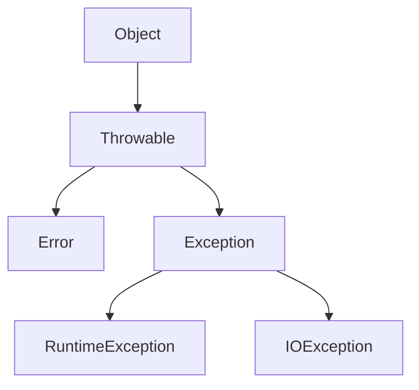

<script setup>
import Stepper from '@viz/Stepper.vue'
</script>

# Java II - Lecture 4

## Lecture Map

| Part | Topic | Slides |
| ---- | ----- | ------ |
| Part 1 | **Interfaces** — contract, `implements`, Java 8/9 members, Payable case study, `Comparable`, interface vs. abstract class | 5–27 |
| Part 2 | **Arrays & ArrayList** — arrays of objects, ArrayList methods, `remove(int)` vs `remove(Object)` | 28–47 |
| Part 3 | **enum** — constants, `name`/`ordinal`/`values`, fields/constructors/methods, switch | 48–66 |
| Part 4 | **Exception handling** — `throw`/`try`/`catch`/`finally`, propagation, checked vs. unchecked | 67–96 |

Main reference: Liang, *Introduction to Java Programming and Data Structures* (2022) §13.5–13.8, §7.2, §9.11, §11.11–11.12, Appendix I, Ch. 12.

## Part 1 — Interfaces

### Why Interfaces? The Single-Inheritance Wall

After Lecture 3's abstract `Animal` hierarchy, the requirement changes: some objects (Chicken, Apple, Broccoli) need `howToEat()`. `Tiger` is not edible, and `Apple` is not an `Animal`.

- Putting `howToEat()` in `Animal` is wrong for `Tiger`.
- An `Edible` superclass doesn't work: `Chicken` already extends `Animal`, and **a class can extend only one superclass**.

Solution — an **interface**: a class can extend one class and **implement many interfaces**.

### What Is an Interface?

> “An interface is a class-like construct for defining common operations for objects.” — Liang §13.5

- Compiled into its own bytecode file (`Edible.class`), like a class.
- **Cannot be instantiated**: `new Edible()` is an error.
- **Can be used as a data type**: `Edible e = new Apple();`
- A class `implements` an interface — the relationship is called **interface inheritance** (Liang).
- Interface names are often adjectives (`Comparable`, `Edible`) or nouns (`Payable`).

```java
public interface Edible {
  /** Describe how to eat */
  public abstract String howToEat();   // modifiers may be omitted
}
```

**Syntax — creating and using:**

```java
modifier interface InterfaceName {
  // constants + abstract methods (+ Java 8 default/static, Java 9 private)
}

// implementing: contract with the compiler
public class ClassName extends SuperclassName
  implements FirstInterface, SecondInterface, ... { }
```

A concrete class that implements an interface must implement **all** its abstract methods; otherwise it must be declared `abstract`. Implementing is like signing a contract: *“I will declare all the methods specified by the interface, or I will declare my class abstract.”*

### What an Interface May Contain (Java 8 and 9)

```java
interface Payable {
  double TAX_RATE = 0.10;            // constant
  double getPaymentAmount();         // abstract

  default double netAmount() {       // Java 8
    return round(getPaymentAmount() * (1 - TAX_RATE));
  }
  static String currency() {         // Java 8
    return "EGP";
  }
  private static double round(double v) {   // Java 9, helper only
    return Math.round(v * 100) / 100.0;
  }
}
```

| Member          | Implicit modifiers      |
| --------------- | ----------------------- |
| Constant        | `public static final`   |
| Abstract method | `public abstract`       |
| Default method  | `public` (has a body)   |
| Static method   | `public` (has a body)   |
| Private method  | Java 9, helper only     |

> [!WARNING] What an interface may NOT contain
> - **No instance variables** and **no constructors**.
> - Implementing class must make the method **public** (it was public in the interface). Weaker access = compile error.

```java
// Find the Error — Code 1
interface A { void m1(); }
class B implements A {
  void m1() { ... }             // ERROR: cannot assign weaker access privileges; was public
}
// Find the Error — Code 2
Shape s = new Shape();          // ERROR: Shape is abstract; cannot be instantiated
// Fix: Shape s = new Square(2);
```

### Interface as a Type — Example (Liang Listing 13.7)

```java
interface Edible { String howToEat(); }
abstract class Animal { public abstract String sound(); }
class Chicken extends Animal implements Edible {
  public String howToEat() { return "Chicken: Fry it"; }
  public String sound() { return "Chicken: cock-a-doodle-doo"; }
}
class Tiger extends Animal {
  public String sound() { return "Tiger: RROOAARR"; }
}
abstract class Fruit implements Edible { }   // no howToEat() — stays abstract
class Apple extends Fruit {
  public String howToEat() { return "Apple: Make apple cider"; }
}
// main:
Object[] objects = { new Tiger(), new Chicken(), new Apple() };
for (Object o : objects) {
  if (o instanceof Edible) System.out.println(((Edible) o).howToEat());
  if (o instanceof Animal) System.out.println(((Animal) o).sound());
}
```

```text
Tiger: RROOAARR
Chicken: Fry it
Chicken: cock-a-doodle-doo
Apple: Make apple cider
```

**Predict — an interface as a type:**

```java
interface Shape { double area(); }
class Square implements Shape {
  private double side;
  Square(double side) { this.side = side; }
  public double area() { return side * side; }
  public String toString() { return "Square"; }
}
class Circle implements Shape {
  private double r;
  Circle(double r) { this.r = r; }
  public double area() { return 3 * r * r; }   // pi ~ 3
  public String toString() { return "Circle"; }
}
// main:
Shape[] shapes = { new Square(2), new Circle(1) };
double total = 0;
for (Shape s : shapes) {
  total += s.area();
  System.out.print(s + " ");
}
System.out.println(total);
Shape x = shapes[0];
System.out.println(x instanceof Square);   // true
System.out.println(x instanceof Shape);    // true
```

```text
Square Circle 7.0
```

Each object runs its own `area()` (4 + 3 = 7.0) via dynamic binding; `x` is-a `Square` and is-a `Shape`, so both `instanceof` tests are true.

### Case Study: Payroll System (Payable)

An accounts-payable application must handle **employees** (payment = earnings) and **invoices** (payment = total goods cost). The required operation is the same — "get the payment amount" — for **unrelated classes**.

```java
public interface Payable {
  double getPaymentAmount();          // no body
}

public class Invoice implements Payable {
  private final String partNumber;
  private final String partDescription;
  private int quantity;
  private double pricePerItem;
  public Invoice(String partNumber, String partDescription, int quantity, double pricePerItem) {
    this.partNumber = partNumber;
    this.partDescription = partDescription;
    setQuantity(quantity);            // validates >= 0
    setPricePerItem(pricePerItem);
  }
  public void setQuantity(int quantity) {
    if (quantity < 0) throw new IllegalArgumentException("Quantity must be >= 0");
    this.quantity = quantity;
  }
  // setPricePerItem(...), getQuantity(), getPricePerItem() similar
  @Override   // carries out the contract with interface Payable
  public double getPaymentAmount() { return getQuantity() * getPricePerItem(); }
}

public abstract class Employee implements Payable {
  private final String firstName, lastName, socialSecurityNumber;
  public Employee(String firstName, String lastName, String ssn) {
    this.firstName = firstName; this.lastName = lastName; this.socialSecurityNumber = ssn;
  }
  // getPaymentAmount() NOT implemented -> Employee must stay abstract
}

public class SalariedEmployee extends Employee {
  private double weeklySalary;
  public SalariedEmployee(String first, String last, String ssn, double salary) {
    super(first, last, ssn);
    setWeeklySalary(salary);          // validates >= 0.0
  }
  @Override   // makes the class concrete
  public double getPaymentAmount() { return getWeeklySalary(); }
}
```

```java
// PayableInterfaceTest.java (main)
Payable[] payableObjects = {
  new Invoice("01234", "seat", 2, 375.00),
  new Invoice("56789", "tire", 4, 79.95),
  new SalariedEmployee("John", "Smith", "111-11-1111", 800.00),
  new SalariedEmployee("Lisa", "Barnes", "888-88-8888", 1200.00)
};
for (Payable currentPayable : payableObjects)
  System.out.printf("%n%s%npayment due: $%,.2f%n",
    currentPayable, currentPayable.getPaymentAmount());
```

Unrelated classes (`Invoice`, `SalariedEmployee`) run in **one loop**; adding a new payable class needs no change to the loop. Once a class implements an interface, **all its subclasses** are also interface types.

### Common Interfaces of the Java API

| Interface | Purpose | Where |
| --------- | ------- | ----- |
| **Comparable&lt;E&gt;** | `compareTo(E o)` — natural order, e.g. sorting | Liang §13.6 · today |
| **Cloneable** | marker interface (no methods): object may be copied with `clone()` | Liang §13.7 |
| **Serializable** | marker interface: objects can be written to/read from a stream | files, networking |
| **Runnable** | `run()` — task executed by a thread | multithreading |
| **ActionListener** | GUI event-listener interfaces: respond to user actions | GUI |
| **AutoCloseable** | `close()` — used by try-with-resources | Liang §12.11 |

A **marker interface** has no methods; it only marks a class as having a property. Many Java classes implement `Comparable`: `String`, `Integer`, `Double`, `Character`, `Date`.

### The Comparable Interface

```java
// java.lang.Comparable<E>
public interface Comparable<E> {
  public int compareTo(E o);
}
```

```java
class Student implements Comparable<Student> {
  private String name;
  private double gpa;
  Student(String name, double gpa) { ... }
  @Override   // natural order: by GPA
  public int compareTo(Student o) {
    if (gpa < o.gpa) return -1;
    else if (gpa > o.gpa) return 1;
    else return 0;
  }
  public String toString() { return name + "(" + gpa + ")"; }
}
```

```java
Student[] arr = { new Student("Malak", 3.2), new Student("Maryam", 3.8), new Student("Salma", 2.9) };
Arrays.sort(arr);   // uses compareTo
System.out.println(Arrays.toString(arr));   // [Salma(2.9), Malak(3.2), Maryam(3.8)]
System.out.println(arr[0].compareTo(arr[1]));   // -1
```

`compareTo` returns a **negative integer, zero, or a positive integer** if this object is less than, equal to, or greater than the given object.

### Interfaces vs. Abstract Classes

| Aspect | Abstract class | Interface |
| ------ | -------------- | --------- |
| Variables | No restrictions | All must be **public static final** |
| Constructors | Yes — invoked by subclasses (constructor chaining); **cannot be instantiated** with `new` | **None** — cannot be instantiated with `new` |
| Methods | No restrictions | `public abstract`, `default`, `static` (and `private` since Java 9) |

A class can extend **only one** superclass but implement **many** interfaces. An interface can extend other interfaces (a **subinterface**) but never an abstract class.

**Design guide (Liang §13.8):**

- **Strong is-a** (clear parent–child): use a class. `GregorianCalendar is a Calendar`.
- **Weak is-a / is-kind-of** (object has a property): use an interface. All strings are comparable → `String implements Comparable`.
- Interfaces are more flexible: they give a common supertype to **unrelated** classes.

> [!NOTE] Quick check (True/False)
> 1. An interface is compiled into a separate bytecode file. — **True**
> 2. An interface can have static methods. — **True**
> 3. An interface can extend one or more interfaces. — **True**
> 4. An interface can extend an abstract class. — **False**
> 5. An interface can have default methods. — **True**
> 6. An abstract class cannot have constructors. — **False**
> 7. A class can implement at most one interface. — **False**

## Part 2 — Arrays and ArrayList

### Array Refresher

| Property | Detail |
| -------- | ------ |
| Elements | Same type; primitives or references |
| Length | **Fixed** once created |
| Index | Referenced by index; nonnegative integer; expression may serve as index |
| Identity | Arrays are **objects** → **reference types** |
| Length | Every array knows its own length via a `length` **instance variable** |

### An Array of Objects Is an Array of References

```java
Student[] arr = new Student[3];   // arr[0..2] are null
arr[0] = new Student("Malak", "Hamad", "12345", new MyDate(12,3,1997), "22222", "Arts", 2);
arr[0].setLevel(4);
// arr[1].getLevel();   NullPointerException — array exists, element doesn't
```

Three steps: **declare** (`Student[] arr`), **create** the array (`new Student[3]`), **initialize** each element (`new Student(...)`).

```java
// Case study solution
arr[0].setLevel(4);                               // task 1
for (Student s : arr)                             // task 2
  if (s.getFName().equals("Maryam") && s.getLName().equals("Nabil"))
    s.setDob(new MyDate(22, 12, 1999));
arr[arr.length - 1].setFaculty("Dentistry");     // task 3
for (Student s : arr) System.out.println(s);
```

> [!NOTE]
> `arr.length` is a **field, not a method**. Use `equals` (not `==`) for Strings. The last index is `arr.length - 1`. Prefer for-each when you need every element.

### Collections and `ArrayList<T>`

Collections organize, store and retrieve data without knowing how it's stored. **`java.util.ArrayList<T>`** dynamically resizes and is **generic** — works only with **reference (object) types**.

```java
ArrayList<Student> list = new ArrayList<>();
// ArrayList<int> ✗  →  use ArrayList<Integer> ✓
```

| Operation | Array | ArrayList |
| --------- | ----- | --------- |
| Creating | `String[] a = new String[10];` | `ArrayList<String> list = new ArrayList<>();` |
| Access element | `a[index]` | `list.get(index)` |
| Update element | `a[index] = "London";` | `list.set(index, "London")` |
| Return size | `a.length` | `list.size()` |
| Add element | — | `list.add("London")` — appends |
| Insert element | — | `list.add(index, "London")` — shifts right |
| Remove element | — | `list.remove(index)` · `list.remove(Object)` |
| Remove all | — | `list.clear()` |

**Trace It: the remove trap**

```java
ArrayList<Integer> list = new ArrayList<>();
list.add(1); list.add(2); list.add(3);
list.remove(1);                    // removes INDEX 1 (the value 2)
System.out.println(list);          // [1, 3]
list.remove(Integer.valueOf(3));   // removes OBJECT 3
System.out.println(list);          // [1]

ArrayList<String> cityList = new ArrayList<>();
cityList.add("London"); cityList.add("Cairo");
cityList.add(1, "Paris");          // [London, Paris, Cairo]
cityList.set(0, "Tokyo");          // [Tokyo, Paris, Cairo]
cityList.remove("Cairo");
System.out.println(cityList + " " + cityList.size() + " " + cityList.indexOf("Cairo") + " " + cityList.contains("Paris"));
```

```text
[Tokyo, Paris] 2 -1 true
```

> [!WARNING] Common mistakes
> - `remove(1)` removes the **element at index 1**; `remove(Integer.valueOf(1))` removes the **object 1**.
> - `indexOf` returns **-1** when the element is absent.
> - `get(i)` / `set(i, e)` need an existing index — on a 1-element list `get(1)` throws `IndexOutOfBoundsException`.
> - Removing inside a counting for loop **skips elements** because the list shrinks under you.

### Case Study Revisited (ArrayList of Students)

```java
// don't forget: import java.util.ArrayList
ArrayList<Student> myList = new ArrayList<>();           // naming: lowercase, not MyList
myList.add(new Student("Malak", "Hamad", "12345", new MyDate(12,3,1997), "22222", "Arts", 2));
myList.add(new Student("Maryam", "Nabil", "34567", new MyDate(10,2,1998), "33333", "Medicine", 1));
myList.add(new Student("Salma", "Hamdy", "47689", new MyDate(3,5,1995), "44444", "Computer Science", 3));

myList.get(0).setDob(new MyDate(22, 2, 1998));           // task 1
myList.get(myList.size() - 1).setLevel(5);               // task 2
for (Student s : myList)                                 // task 3
  if (s.getFName().equals("Maryam"))
    s.setFaculty("Dentistry");
```

### Putting It Together: `ArrayList<Payable>`

```java
ArrayList<Payable> bills = new ArrayList<>();
bills.add(new Invoice("01234", "seat", 2, 375.00));
bills.add(new SalariedEmployee("John", "Smith", "111-11-1111", 800.00));
bills.add(new Invoice("56789", "tire", 4, 79.95));
double total = 0;
for (Payable p : bills)
  total += p.getPaymentAmount();                         // dynamic binding
System.out.printf("%d items, total due: $%,.2f%n", bills.size(), total);  // 3 items, total due: $1,869.80

bills.remove(0);                                         // removes the 700-item seat invoice
System.out.println(bills.size() + " " + (bills.get(0) instanceof Employee));   // 2 true
```

`750.00 + 800.00 + 319.80 = 1,869.80` — each object computes its own payment. After `remove(0)` the list holds 2 elements and the first, a SalariedEmployee, is-an `Employee`.

## Part 3 — Enums

> “An enumerated type defines a list of enumerated values. Each value is an identifier.” — Liang, Appendix I

```java
public enum Month { JANUARY, FEBRUARY, /* ... */ DECEMBER }

public enum Suit { CLUBS, DIAMONDS, HEARTS, SPADES }
```

An enum is a **type-safe** set of values spelled **UPPERCASE**. It is a subtype of `Object` and `Comparable`. `C` enums are really ints; Java enums are **objects**. Usually its own `.java` file.

| Member | Behavior |
| ------ | -------- |
| `name()` | Name of the constant (`"JANUARY"`). `toString()` also returns it and can be overridden |
| `ordinal()` | Position, **first value = 0** |
| `values()` | Static: returns an **array of all values** |
| `valueOf(String)` | Static: returns the value with that name |
| `compareTo()` | Compares by **ordinal** |

```java
enum Day { SUNDAY, MONDAY, TUESDAY, WEDNESDAY, THURSDAY, FRIDAY, SATURDAY }
Day day1 = Day.FRIDAY;
Day day2 = Day.THURSDAY;
System.out.println(day1.name() + " " + day1.ordinal());   // FRIDAY 5
System.out.println(day2.ordinal());                       // 4
System.out.println(day1.compareTo(day2));                 // 1
```

Enum members are printable: if an enum has `toString()`, it is used; otherwise the **member name** is printed.

**enum with data fields, constructor, and methods:**

```java
public enum TrafficLight {
  RED("Please stop"), GREEN("Please go"), YELLOW("Please caution");

  private String description;
  private TrafficLight(String description) {   // constructor is private by default
    this.description = description;
  }
  public String getDescription() { return description; }
}
```

Rules (Liang I.4): the value declaration must be the **first statement**; each value's argument is passed to the constructor; the constructor is **private** (private by default); `new TrafficLight(...)` is an error (*enum classes may not be instantiated*).

```java
public enum Month {
  /* values */ JANUARY("January", 0), FEBRUARY("February", 1), /* ... */;
  public final String name;
  private int index;
  Month(String name, int index) { this.name = name; this.index = index; }
}
```

**Using enum in a switch** — case labels use the **unqualified** value:

```java
static String activity(Day day) {
  switch (day) {
    case MONDAY: return "Play soccer";
    case TUESDAY: return "Piano lesson";
    case FRIDAY:
    case SATURDAY: return "Weekend";
    default:
      return "Study Java";
  }
}
// up to Java 20, "case Day.MONDAY:" is a compile error; Java 21 accepts it
```

> [!NOTE] `==` vs `.equals` for enums
> `==` is safe for enum values (each enumerated value is a **unique object**). `day == Day.MONDAY` and `day.equals(Day.MONDAY)` are equivalent.

**Case study — enum for token types** (good OO design: the object carries its own properties):

```java
public enum TokenType {
  IDENT("[A-Za-z_]\\w*"),
  NUMBER("(\\d+\\.?|\\.\\d)\\d*([Ee][+-]?\\d+)?"),
  OPERATOR("[-+*/^]"),
  ASSIGN("="),
  SEPARATOR("[()]");

  public final String regex;
  public final Pattern pattern;
  TokenType(String regex) {
    this.regex = regex;
    this.pattern = Pattern.compile(regex);   // import java.util.regex.Pattern;
  }
}

public class Token {
  private TokenType type;
  private String value;
  Token(TokenType type, String value) { this.type = type; this.value = value; }
  TokenType type() { return type; }
}

static Token classify(String s) {
  TokenType type = null;
  for (TokenType t : TokenType.values())
    if (s.matches(t.regex)) type = t;
  return new Token(type, s);
}
```

Advantages: **type safety**; all properties of a token in one place; **more efficient** than String comparison; and no silent string mistypes (`token.type == TokenType.NUMBER` fails at compile time if misspelled, unlike `.equals("NUMBEE")` which compiles and silently never matches). Adding a new token type = one line in the enum; the `values()` loop never changes.

A safer `Date` class uses an enum for the month:

```java
public class MyDate {
  private int year;
  private Month month;   // cannot hold an invalid value like 12 as a String
  private int day;
  public MyDate(int year, Month month, int day) { this.year = year; this.month = month; this.day = day; }
  public String toString() { return "" + day + " " + month.name + " " + year; }   // Today is 9 December 2005
}
```

## Part 4 — Exception Handling

> “An exception is an object that represents an error or a condition that prevents execution from proceeding normally.” — Liang §12.1

An **exception** signals a problem at run time. Without handling, the JVM prints a **stack trace** and terminates abnormally; with handling, the exception is thrown, a caller catches it, and the program continues. Everyday analogy: a cancelled flight (the exception) goes to the airline desk (the handler), which rebooks you — the trip continues.

Examples that throw: `ArrayIndexOutOfBoundsException`, `ClassCastException`, `NullPointerException`.

### Throwable Hierarchy (Liang §12.3)



- Only classes that extend **`Throwable`** can be used with exception handling.
- Subclasses of **`RuntimeException`** and all of **`Error`** are **unchecked** — typically caused by defects in your code (out-of-bounds, null dereference, bad casts).
- Subclasses of `Exception` that are **not** `RuntimeException` are **checked** — caused by conditions outside the program's control (e.g. `FileNotFoundException` — the file doesn't exist).
- The compiler enforces a **catch-or-declare** requirement for checked exceptions only.

### Declaring, Throwing, Catching

```java
public static int quotient(int number1, int number2)
  throws ArithmeticException {                       // declare (only matters for checked types)
  if (number2 == 0)
    throw new ArithmeticException("Divisor cannot be zero");   // throw
  return number1 / number2;
}
public static void main(String[] args) {
  try {                                             // catch
    int result = quotient(5, 0);
    System.out.println("5 / 0 is " + result);       // skipped
  }
  catch (ArithmeticException ex) {
    System.out.println("Exception: " + ex.getMessage());
    System.out.println(ex);                         // toString()
  }
  System.out.println("Execution continues ...");
}
```

```text
Exception: Divisor cannot be zero
java.lang.ArithmeticException: Divisor cannot be zero
Execution continues ...
```

Three operations: **declare** (`throws` in the method header), **throw** (`throw new ...Exception(msg);`), **catch** (`try { } catch (Type ex) { }`). Tip: the keyword to **declare** is `throws`; the keyword to **throw** is `throw`.

### try / catch / finally Mechanics

```java
// Divide by zero — integer arithmetic throws ArithmeticException;
// floating-point division by zero yields Infinity or NaN, not an exception
try {
  System.out.print("A ");
  int r = 10 / d;
  System.out.print("B ");
}
catch (ArithmeticException ex) {
  System.out.print("C ");
}
finally {
  System.out.print("D ");
}
System.out.println("E");
// test(2): A B D E  ·  test(0): A C D E
```

- If an exception occurs in `try`: the try block **terminates immediately**, control jumps to the **first matching catch**, the `finally` block runs, and execution resumes after the try statement.
- If no exception occurs: the catch blocks are skipped; `finally` still runs.
- **`finally` always runs** — after normal completion or after the catch completes. Use `System.err` for error output.

### Order of catch Blocks and Multi-catch

```java
try {
  int[] a = new int[2];
  a[2] = 5;
}
catch (Exception ex) {           // ERROR: RuntimeException has already been caught — subclass first!
  System.out.println("Exception");
}
catch (RuntimeException ex) {
  System.out.println("RuntimeException");
}
// Fix: catch the subclass first, then the superclass

String[] data = { "10", "abc", null };
for (String s : data) {
  try {
    int n = Integer.parseInt(s.trim());
    System.out.println("n = " + n);
  }
  catch (NumberFormatException | NullPointerException ex) {   // JDK 7 multi-catch
    System.out.println("Bad input: " + ex.getClass().getSimpleName());
  }
}
// Output:
// n = 10
// Bad input: NumberFormatException
// Bad input: NullPointerException
```

If multiple catch blocks match, only the **first** executes. An **uncaught exception** has no matching catch — the program terminates and a stack trace is printed.

### How Java Finds a Handler: Propagation

<Stepper label="Exception propagation" :steps="[
  { title: 'method3 throws', detail: 'JVM searches for a matching catch in the current method first. None found — the exception leaves method3.', note: 'Local variables of the aborted method go out of scope (eligible for GC).' },
  { title: 'method2 is searched', detail: 'If method2 has catch (Exception2 ex2), it runs; statement5 is skipped, statement6 executes.', note: 'Handlers are tried in source order; first match wins.' },
  { title: 'method1 is searched', detail: 'If the match was not found (or method2 was aborted), control passes one level up. Matching catch (Exception1 ex1): statement3 skipped, statement4 executes.', note: 'Each method is aborted as control passes out of it.' },
  { title: 'main is the last chance', detail: 'If main matches, the program continues or ends gracefully. No match anywhere: JVM prints the stack trace and terminates — statement1 and statement2 do not run.', note: '“Unknown Source” in a stack trace means the debug symbols were not available.' }
]" />

Handlers propagate **backward** through the call chain, starting from the method that detected the problem (Liang §12.4 Key Point). Callable example: `method3` throws `Exception3` → caught in `method2` (`Exception2`) → `method1` (`Exception1`) → `main`. Any uncaught exception ends the program.

### Checked vs. Unchecked — Catch or Declare

```java
import java.io.*;
import java.util.Scanner;

// (b) DECLARE: let the caller deal with it
static String firstLine(String fileName)
  throws FileNotFoundException {                  // caller must catch or declare too
  Scanner input = new Scanner(new File(fileName));
  return input.nextLine();
}

// (a) CATCH: handle it here
public static void main(String[] args) {
  try {
    System.out.println(firstLine("marks.txt"));
  }
  catch (FileNotFoundException ex) {
    System.out.println("File not found: " + ex.getMessage());
  }
}
```

Without `throws`: `unreported exception FileNotFoundException; must be caught or declared to be thrown`. Unchecked exceptions (`ArithmeticException`, `NullPointerException`, `IndexOutOfBoundsException`) need no handling; checked exceptions (`IOException`, `FileNotFoundException`, `ClassNotFoundException`) do. The compiler checks **checked exceptions only**.

### When to Use Exception Handling

Exception handling is designed for **synchronous errors** — errors that occur when a statement executes. A method should throw when the error needs to be handled by its caller (Liang §12.6):

- out-of-range array indices
- integer division by zero
- invalid method arguments (`IllegalArgumentException`)
- invalid input (`InputMismatchException`)
- a file that does not exist (`FileNotFoundException`)

Simple, expected situations are better handled with plain `if` statements.

## Common Mistakes to Avoid

| Mistake | Fix |
| ------- | --- |
| Implementing an interface method without `public` | `public double getPaymentAmount()` |
| `new Payable()` | `new Invoice(...)` — a class that implements it |
| Not implementing all abstract methods | implement them, or declare the class `abstract` |
| Calling a method on an array element that is still `null` | `arr[i] = new Student(...)` first |
| `ArrayList<int>` | `ArrayList<Integer>` |
| `list.remove(3)` to remove the value 3 | `list.remove(Integer.valueOf(3))` |
| enum constructor called with `new` | use the values: `TrafficLight.RED` |
| `catch (Exception)` before `catch (RuntimeException)` | subclass first, superclass last |
| Ignoring a checked exception | catch it or add `throws` to the header |

## Exit Questions

1. List what a Java 21 interface may contain, and two things it may **not** contain. *(Remember)*
2. What is printed? (Analyze)

   ```java
   ArrayList<String> l = new ArrayList<>();
   l.add("A"); l.add("B"); l.add("C");
   l.remove(0);
   l.remove("D");
   System.out.println(l + " " + l.size());
   ```
   *Answer: `[B, C] 2` — `remove(0)` removes "A" (index 0); `remove("D")` removes nothing (object not found).*
3. Write an enum `Level` with three values. What is `Level.ADVANCED.ordinal()`? *(Apply)*
4. What is printed? (Analyze)

   ```java
   try {
     int[] a = new int[1];
     a[1] = 3;
     System.out.print("w ");
   }
   catch (RuntimeException ex) { System.out.print("x "); }
   finally { System.out.print("z"); }
   ```
   *Answer: `x z` — `a[1] = 3` throws `ArrayIndexOutOfBoundsException` (unchecked); w never prints; finally always runs.*
5. Invoices, students and reports must all be printable with `print()`. Interface or abstract class? Justify. *(Evaluate)*

## Reading

Liang, *Introduction to Java Programming and Data Structures* (2022): §13.5–13.8 (interfaces), §7.2, §9.11, §11.11–11.12, Appendix I (enum), §12.1–12.6 (exceptions). Deitel, *Java How to Program*: Ch. 7, 10, 11.

## See Also (Java I)

- [Java I — Lecture 5](/College/yearTwo/secondTerm/Java/Lectures/Lecture-5) — arrays and exception handling (Java I treatment)
- [Java I — Section 6](/College/yearTwo/secondTerm/Java/Sections/Section-6) — exception handling keywords, try/catch/multi-catch, file handling
- [Java I — Section 5](/College/yearTwo/secondTerm/Java/Sections/Section-5) — arrays in depth

_27 min read (source: 52 min)_
