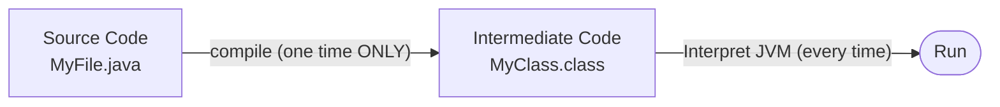
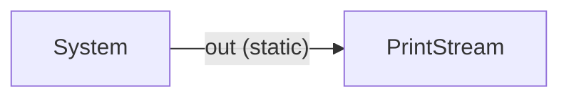
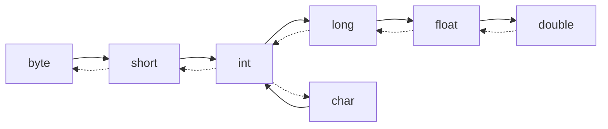

# Java II - Section 1

## Brief History of Java

- Java was created by **Sun Microsystems** in **May 1995**.
- The goal: a language for controlling any hardware — but that was too advanced, so the scope narrowed.
- The **Green Team**, assembled and led by **James Gosling**, built it.
- **Platform and OS independent** — the same bytecode runs wherever the JVM lives.
- **Free license**; development cost stays minimal.
- Java is everywhere: mobile phones, games, navigation systems, e-business solutions.

| Use case | Examples |
| -------- | --------- |
| Desktop applications | standalone programs |
| Web applications | server-side / browser-delivered apps |
| Enterprise applications | large business systems |
| Mobile applications | phones, handhelds |
| Smart card applications | embedded smart cards |
| Embedded applications | Sun SPOT, Raspberry Pi |

## Java Principles

Primary design goals of the language:

- **Simple, object oriented, and easy to learn.**
- **Robust and secure.**
- **Architecture neutral and portable.**
- **Compiled and interpreted.**
- **Multithreaded.**
- **Networked.**

## Java Features

- **Easy to learn** — syntax follows C++.
- **Dynamic memory management** — garbage collection; **no pointers**.
- **Machine and platform independent** — separate application layer, JVM layer, and OS/hardware.
- **Both compiled and interpreted** — compiled **one time only** to intermediate code; interpreted by the JVM **every time**:



- **Dynamic linking** of libraries — Java depends on dynamic linking. The **JDK** contains the JVM, JRE, libraries, compiler, and utilities.
- **Fully object oriented** — made up of classes; **no multiple inheritance**.
- **Multithreaded** — programs can run multiple threads of execution in parallel (e.g. GUI thread, event-handling thread, GC thread).
- **Networked** — predefined classes simplify network programming through **sockets (TCP/UDP)**.

## Your First Java Application

```java
class HelloWorld
{
    public static void main(String[] args)
    {
        System.out.println("Hello Java");
    }
}
```

- File name: **`hello.java`** (matches the class name; case-sensitive).
- The `main()` method:
  - Must return **void**.
  - Must be **static** — the interpreter calls it first, **before any object is created**.
  - Must be **public** — directly accessible.
  - Accepts an **array of strings** parameter (`args`) — used when the OS passes command-line arguments to the application.
- `out` is a **static reference** created in class **System**; it refers to an object of class **PrintStream** — a ready-made stream attached to standard output (the screen).



| System | PrintStream |
| ------ | ----------- |
| `+ PrintStream out:static` | `+ Print(String): void` · `+ println(String): void` |

## Identifiers

An **identifier** is the name given to a feature (variable, method, or class).

- An identifier begins with: a **letter**, **`$`**, or **underscore**.
- Subsequent characters may be: a **letter**, **`$`**, **underscore**, or **digits**.

## Data Types

Java data types are classified into **two** types: **Primitive** and **Reference**.

| Category | Type | Size | Range / Standard |
| -------- | ---- | ---- | --------------- |
| Boolean | `boolean` | 1 bit | `true` / `false` |
| Integer | `byte` | 1 byte | −2⁷ … 2⁷−1 (−128 … +127) |
| | `short` | 2 bytes | −2¹⁵ … 2¹⁵−1 (−32 768 … +32 767) |
| | `int` | 4 bytes | −2³¹ … 2³¹−1 |
| | `long` | 8 bytes | −2⁶³ … 2⁶³−1 |
| Floating point | `float` | 4 bytes | IEEE 754 |
| | `double` | 8 bytes | IEEE 754 |
| Character | `char` | 2 bytes | unsigned Unicode (0 … 2¹⁶−1) |

**Reference types:** Arrays, Classes, Interfaces.

## Operators

Operators are classified into: **Unary · Arithmetic · Assignment · Relational · Shift · Bitwise/Logical · Short-circuit · Ternary**.

### Unary Operators

| `+` | `-` | `++` | `--` | `!` | `~` | `()` |
| --- | --- | ---- | ---- | -- | --- | ---- |
| positive | negative | increment | decrement | boolean complement | bitwise inversion | casting |

**Widening (implicit casting)** — byte → short → int → long → float → double, and char → int.



**Narrowing** (requires **explicit casting**) — the dotted arrows above; e.g. `int myInt = (int) myDouble;`

### Arithmetic Operators

| `+` | `-` | `*` | `/` | `%` |
| --- | --- | --- | --- | --- |
| add | subtract | multiply | division | modulo |

### Assignment Operators

`=`, `+=`, `-=`, `*=`, `/=`, `%=`, `&=`, `|=`, `^=`

### Relational Operators

`<`, `<=`, `>`, `>=`, `==`, `!=`, `instanceof`

> [!NOTE]
> Relational operations must be performed on **homogeneous** data types.

### Shift Operators

| `>>` | `<<` | `>>>` |
| ---- | ---- | ----- |
| right shift | left shift | unsigned right shift |

### Bitwise and Logical Operators

| `&` | `\|` | `^` |
| --- | --- | --- |
| AND | OR | XOR |

### Short-circuit Operators

| `&&` | `\|\|` |
| ---- | ------ |
| condition1 AND condition2 | condition1 OR condition2 |

### Ternary Operator

```java
condition ? trueStatement : falseStatement

// example
int y = 15;
int z = 12;
int x = y < z ? 10 : 11;   // if (y < z) x = 10; else x = 11;
```

## What Is an Array?

- An array is a collection of variables of the **same data type**.
- Each element holds a single item.
- Items can be **primitives or object references**.
- The length is determined **when the array is created**.
- Java arrays are **homogeneous**. You can create:
  - an array of primitives,
  - an array of object references, or
  - an **array of arrays**.
- If you create an array of object references, you can store **subtypes** of the declared type.

### Declaring an Array

```java
DataType[] arrayIdentifier;                 // declaration
arrayIdentifier = new DataType[size];       // construction

DataType[] arrayIdentifier = { val1, val2, val3, val4 };  // one line

arrayIdentifier.length                      // size (number of elements)
```

```java
// Example: array of primitives
int[] myArr;
myArr = new int[3];
myArr[0] = 15;
myArr[1] = 30;
myArr[2] = 45;
System.out.println(myArr[2]);   // 45

// myArr[3] = ... ;             // ILLEGAL — ArrayIndexOutOfBoundsException
```

## Flow Control: Branching

### if / else — Binary Branching

```java
if (boolean_expr) {
    ...                         // true statements
} [else {
    ...                         // false statements
}]
```

```java
int grade = 48;
if (grade > 60)
    System.out.println("Pass");
else {
    System.out.println("Fail");
}
```

### switch — Multiple Branching

```java
switch (myVariable) {
    case value1:
        ...
        break;
    case value2:
        ...
        break;
    default:
        ...
}
```

`switch` expressions may be: **byte, short, int, char, enum, String (Java 7+)**.

## Flow Control: Iteration

### while — condition checked at the **beginning**

```java
while (boolean_condition) {
    ...
}
```

### do..while — condition checked at the **end**

```java
// both forms are equivalent to the while example above
do {
    System.out.println(x);
    x++;
} while (x < 10);
```

### for — number of iterations predetermined

```java
for (initialization ; loop_condition ; step) {
    ...
}

for (int i = 0; i < 10; i++) {
    ...
}
```

You may use `break` and `continue` to skip or terminate iterations.

### Enhanced for — iterate arrays/collections

```java
for (type identifier : iterable_expression) {
    // statements
}

double[] samples = new double[50];

double average = 0.0;
for (int i = 0; i < samples.length; i++)
    average += samples[i];
average /= samples.length;

double average = 0.0;       // enhanced form
for (double value : samples)
    average += value;
average /= samples.length;
```

## break and continue

- **`break`** can be used in **loops or switch**. It transfers control to the **first statement after** the loop body or switch body.

```java
while (age <= 65) {
    balance = payment * 1;
    if (balance >= 25000)
        break;              // exit the loop now
}
// execution resumes here
```

- **`continue`** can be used **only in loops**. It abandons the current iteration and jumps to the next one.

```java
for (int year = 2000; year <= 2099; year++) {
    if (year % 100 == 0)
        continue;           // skip this iteration
}
```

## Try Exercises (Solved)

1. **Compute the natural logarithm of 2** by adding up to `n` terms of the series `1 - 1/2 + 1/3 - 1/4 + 1/5 - ... 1/n`, where `n` is a positive integer input by the user.

```java
Scanner sc = new Scanner(System.in);

double n = sc.nextDouble();
double sum = 0;
int mark = 1;
for (double i = 1; i <= n; i++) {
    sum = sum + (mark * (1 / i));
    mark = mark * -1;
}
System.out.println(sum);
```

2. **Reverse the digits of an integer input by the user** (e.g. `12345` → `54321`).

```java
Scanner sc = new Scanner(System.in);
int num = sc.nextInt();
int reminder = 0;
int reverse = 0;
int temp = num;
while (temp > 0) {
    reminder = temp % 10;
    reverse = reverse * 10 + reminder;
    temp = temp / 10;
}
System.out.println(reverse);
```

3. **Count repeated elements in an array.**

```java
int[] arrl = {1, 3, 5, 1, 1, 7, 7, 8, 1, 8};
int count = 0;

for (int i = 0; i < arrl.length; i++) {
    for (int j = i + 1; j < arrl.length; j++) {
        if (arrl[j] == arrl[i]) {
            count = count + 1;
            break;
        }
    }
}
System.out.println(count);
```

## Task

> Given an array `{10, 20, 30, 40}`, insert the element `100` in position 2 — output should be `{10, 20, 100, 30, 40}`.

## See Also (Java I)

- [Java I — Section 1](/College/yearTwo/secondTerm/Java/Sections/Section-1) — flowcharts, JDK/JRE/JVM, program structure and execution stages
- [Java I — Section 2](/College/yearTwo/secondTerm/Java/Sections/Section-2) — Scanner input, operator tables, `if` variants and worked exam tasks
- [Java I — Section 3](/College/yearTwo/secondTerm/Java/Sections/Section-3) — switch, for loops, break
- [Java I — Section 4](/College/yearTwo/secondTerm/Java/Sections/Section-4) — while, do-while, continue, prime logic
- [Java I — Section 5](/College/yearTwo/secondTerm/Java/Sections/Section-5) — arrays, for-each, frequency/counting problems

_10 min read (source: 13 min)_
