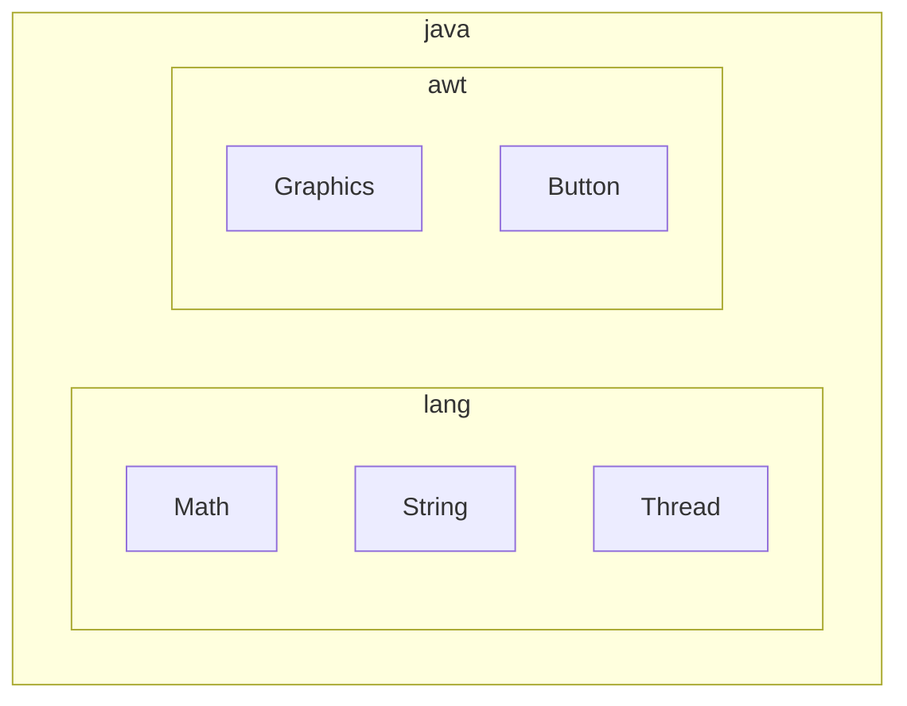

# Java II - Section 2

## What Is OOP?

- OOP is **mapping the real world to software**.
- OOP is a community of interacting agents called **objects**.
- Each object has **a role to play**.
- Objects can share some of their characteristics with each other, but each object is **unique by itself**.
- Objects can **interact** with each other to accomplish tasks.

## What Is a Class?

- A class is a **blueprint of objects** — an **object factory** — a **template to create objects**.
- A class is a **user-defined data type**:
  - describes the data (**attributes**),
  - defines the behavior (**methods**).

## What Is an Object?

- An object is an **instance of a class**.
- Property values of one object instance differ from those of other instances of the same class.
- Object instances of the same class **share the same behavior (methods)**.
- Objects are **allocated on the heap** by the `new` operator.

**Class vs. object** (analogous to a house blueprint vs. the houses built from it): the class (`wireframe house` icon) represents the general design; objects are the individual constructions.

## Declaring Classes

```text
➤ <modifier>* class <class_name> {
    <attribute_declaration>*
    <constructor_declaration>*
    <method_declaration>*
}
```

```java
public class SerratedDisc {
    private int size;
    private int numberOfPins;

    public void spin() {
        System.out.println("The disc is spenning now . . . ");
    }
}
```

- A `.java` file-name extension.
- The `class` keyword.
- The `public` keyword — an access modifier meaning "available to the public".
- **No `main` → can't execute** from that class.

```java
// Student.java
public class Student {
    // data...
    // methods...     // not static!!
}
```

## Accessing Object Members

```text
<object>.<member>
```

```java
public class Counter {
    public static final int MAX = 100;
    private int value = 0;

    public void inc() {
        if (value < MAX) {
            ++value;
        }
    }
    public int getValue() {
        return value;
    }
}

Counter c = new Counter();
c.inc();
int i = c.getValue();
```

## The Four OOP Principles

| Encapsulation | Inheritance | Abstraction | Polymorphism |
| ------------- | ----------- | ----------- | ------------- |

Four columns of a "temple": the principles hold the OOP roof up together.

### Encapsulation

Encapsulation is the process of **wrapping code and data together into a single unit**. Make **all data members `private`**, then expose **public getter/setter** methods to reach them. The point is to **hide class attributes from the outside world** — no one can touch them directly — but to let **class methods act as the interface** to access them.

```java
public class Student {
    private String name;

    public String getName() {           // getter
        return name;
    }
    public void setName(String name) {  // setter
        this.name = name;
    }
}
```

```java
class Test {
    public static void main(String[] args) {
        Student s = new Student();
        s.setName("vijay");
        System.out.println(s.getName());
    }
}
```

### Types of Modifiers

There are two types of modifiers: **access modifiers** and **non-access modifiers**. Access modifiers specify accessibility (scope) of a data member, method, constructor or class.

**Four access modifiers:** `private`, `default`, `protected`, `public`.

| Modifier | Top-level class | Methods | Variables |
| -------- | --------------- | ------- | --------- |
| `public` | Yes | Yes | Yes |
| `protected` | − | Yes | Yes |
| `default` (no modifier) | Yes | Yes | Yes |
| `private` | − | Yes | Yes |
| `final` | Yes | Yes | Yes |
| `static` | − | Yes | Yes |
| `abstract` | Yes | Yes | − |
| `native` | − | Yes | − |
| `transient` | − | − | Yes |
| `volatile` | − | − | Yes |
| `synchronized` | − | Yes | − |

**Scope of each access modifier:**

| Modifier | Accessible from |
| -------- | --------------- |
| `private` | **only within the class** |
| `default` | **only within the package** |
| `protected` | **within the package** and **outside the package through inheritance** (only) |
| `public` | **everywhere** — the widest scope |

### Getters and Setters

Private variables can only be accessed within the same class. To access them from outside, provide public **`get`/`set`** methods. Syntax: start with `get` or `set`, then the variable name with the first letter capitalized (e.g. `getName` / `setName`).

- **Accessor methods (get methods)** — allow the object to **read** data; simple retrieval of member data.
- **Mutator methods (set methods)** — allow the object to **change** data; manipulation driven by the application.

## Constructor

- **Role:** object initialization.
- Name **must** be the same as the class name.
- **Must not** have a return type (not even `void`).
- Every class should have **at least one constructor**.
- If you don't write a constructor, the compiler generates the **default constructor**.
- Constructors are usually declared **`public`**... but can be declared **`private`** (then you cannot use them outside the class).
- A class can have **more than one constructor**.
- The constructor is **invoked automatically** on the new object.

### Declaring Constructors — Syntax

```java
[<modifier>] <class_name>(<argument>*) {
    <statement>*
}

public class Date {
    private int year, month, day;

    public Date(int y, int m, int d) {
        if (verify(y, m, d)) {
            year = y; month = m; day = d;
        }
    }

    private boolean verify(int y, int m, int d) {
        // ...
    }
}
```

### Default Constructor

- There is always at least one constructor in every class.
- If the programmer supplies none, the compiler generates the **default constructor**.
- The default constructor **takes no arguments** and its **body is empty**.

```java
public class Date {
    private int year, month, day;

    // default constructor, generated by the compiler --> public Date() {}
}
```

### Overloaded Constructors

- Enable objects of a class to be initialized in **different ways**.
- Multiple constructor declarations with **different signatures**.
- The compiler differentiates signatures by: **number of parameters**, **types of parameters**, and **order of the parameter types**.

## Packages

Packages help manage large software systems. They contain:

- **Classes**
- **Sub-packages**



### The Package Statement

```java
// Syntax
package <top_pkg_name>[.<sub_pkg_name>]*;

// Examples
package java.lang;

public class String {
    // ...
}
```

- The statement goes at the **beginning** of the source file.
- Only **one** package declaration per source file.
- If **no package** name is declared → the class is placed in the **default package**.

## UML — Graphical Class Representation

The UML shows:

- **Class name** (e.g. `Person`)
- **`-` means private** access (e.g. `-firstName: String`)
- **`+` means public** access (e.g. `+getFirstName(): String`)
- **State** (attributes) and **behaviour** (methods)

Example:

```text
        Person
--------------------
- firstName: String
--------------------
+ getFirstName(): String
```

## Try Exercise — Circle Class

Create a class `Circle` with a **UML** depiction `- radius : double = 1.0`, `- color : String = "red"`, constructors `Circle()`, `Circle(radius:double)`, `Circle(radius:double, color:String)`, methods `getRadius():double`, `getColor():String`, `setRadius(radius:double):void`, `setColor(color:String):void`, `getArea():double`, and print a filled `"Circle[radius=?,color=?]"` depiction. Then create objects and test it.

```java
public class Circle {
    private double radius;
    private String color;

    public Circle(double radius, String color) {
        this.radius = radius;
        this.color = color;
    }
    public Circle(double radius) {
        this.radius = radius;
    }
    public Circle() {
        radius = 1.0;
        color = "red";
    }

    public double getRadius() {
        return radius;
    }
    public void setRadius(double radius) {
        this.radius = radius;
    }
    public String getColor() {
        return color;
    }
    public void setColor(String color) {
        this.color = color;
    }
    public double getArea() {
        return 3.14 * radius * radius;
    }
}

public class Main {
    public static void main(String[] args) {
        Circle c  = new Circle();
        Circle c1 = new Circle(5.0);
        Circle c2 = new Circle(4, "blue");

        System.out.println(c1.getRadius());
        System.out.println("Raduis" + c2.getRadius() + ",Color : " + c2.getColor());
        System.out.println(c1.getArea());
        System.out.println(c.getRadius());
        c1.setRadius(6);
        System.out.println(c1.getRadius());
    }
}
```

## Task — Employee Class (UML Design)

Create a class `Employee` with:

| UML | Meaning |
| --- | ------- |
| `-id:int` | private attribute |
| `-firstName:String` | private attribute |
| `-lastName:String` | private attribute |
| `-salary:int` | private attribute |
| `+Employee(id:int,firstName:String,lastName:String,salary:int)` | full constructor |
| `+getID():int` | accessor |
| `+getFirstName():String` | accessor |
| `+getLastName():String` | accessor |
| `+getName():String` | returns `"firstName lastName"` |
| `+getSalary():int` | accessor |
| `+setSalary(salary:int):void` | mutator |
| `+getAnnualSalary():int` | salary × 12 |
| `+raiseSalary(int percent):int` | Increase the salary by the percent, return the new salary |

## Reading

Java II — Encapsulation, access modifiers, constructors, packages and UML.

## See Also (Java I)

- [Java I — Lecture 8](/College/yearTwo/secondTerm/Java/Lectures/Lecture-8) — OOP basics: creating objects and accessing members
- [Java I — Book Chapter 9](/College/yearTwo/secondTerm/Java/Book/Chapter-9) — Objects and Classes (Liang)
- [Lecture 2](/College/yearThree/firstTerm/Java/Lectures/Lecture-2) — Java II Lecture 2 covers the same ground in full depth (UML, encapsulation, constructors, `static`/`final`)

_9 min read (source: 10 min)_
