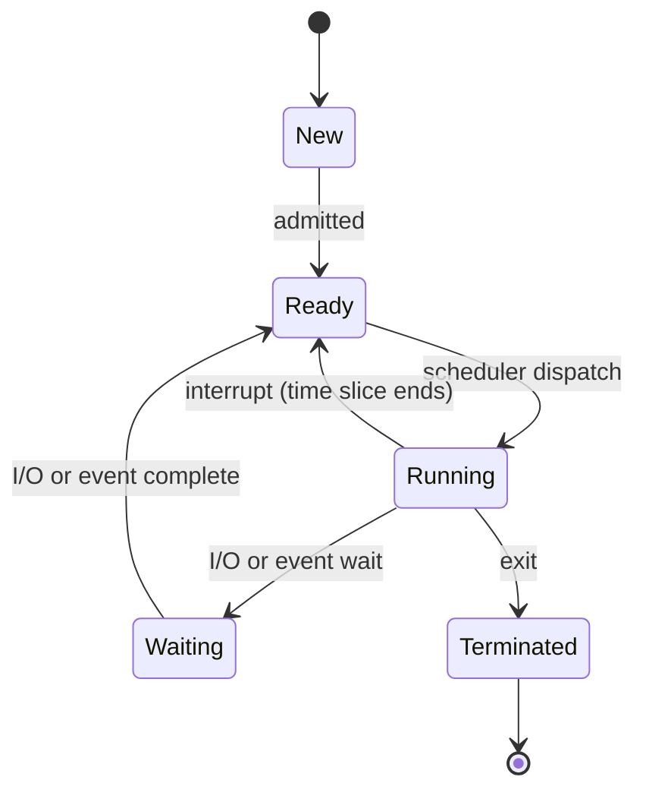

## Process Concept

A **process** is a program in execution — a running instance of a program. It includes more than code:

| Section   | Contents                                                               |
| --------- | ---------------------------------------------------------------------- |
| **Text**  | The program code                                                       |
| **Data**  | Global and static variables                                            |
| **Heap**  | Memory allocated dynamically at run time (`malloc`)                    |
| **Stack** | Temporary data: function parameters, return addresses, local variables |

## Process State

As a process executes it moves through five states:

| State          | Meaning                                                   |
| -------------- | --------------------------------------------------------- |
| **New**        | The process is being created                              |
| **Ready**      | In memory, waiting to be assigned to a processor          |
| **Running**    | Instructions are being executed                           |
| **Waiting**    | Waiting for an event (e.g., I/O completion or a resource) |
| **Terminated** | Execution has finished                                    |

> [!NOTE]
> A process moves **running -> ready** when preempted, but **running -> waiting** only when it must wait for an event. These are different transitions and a common exam trap.

## Process Control Block (PCB)

The **Process Control Block (PCB)** is the OS data structure that stores everything about a process:

- **Process state** — running, waiting, etc.
- **Program counter** — address of the next instruction.
- **CPU registers** — all process-centric register contents.
- **CPU scheduling information** — priorities and scheduling-queue pointers.
- **Memory-management information** — memory allocated to the process.
- **Accounting information** — CPU used, elapsed time, time limits.
- **I/O status information** — allocated devices and open files.

## Context Switch

When the CPU switches to another process, the system saves the old process's state and loads the new one's — a **context switch**. The **context** is represented in the PCB.

- Context-switch time is **pure overhead**: no useful work is done.
- Switch time depends on hardware support — typically a few milliseconds; systems with multiple register sets (e.g., Sun UltraSPARC) can switch by changing a pointer.

## Process Scheduling

The objective of **multiprogramming** is to keep some process running at all times, maximizing CPU utilization. The **process scheduler** selects the next process from the available processes for execution on the CPU.

### Scheduling Queues

| Queue                       | Holds                                                                          |
| --------------------------- | ------------------------------------------------------------------------------ |
| **Job queue**               | All processes that have entered the system (waiting to be loaded into memory)  |
| **Ready queue**             | Processes in main memory ready to execute, waiting for the CPU                 |
| **Waiting (blocked) queue** | Processes paused until an event occurs (I/O completion, resource availability) |
| **Device (I/O) queue**      | Processes waiting for a specific I/O device; return to ready when I/O finishes |

## Operations on Processes

The system must provide mechanisms for **process creation**, **process termination**, **interprocess communication**, and **synchronization**.

### Process Creation

Reasons a process is created:

| Reason                                  | Example                                       |
| --------------------------------------- | --------------------------------------------- |
| **System initialization**               | Background processes created at boot          |
| **User request**                        | Opening a program (double-clicking a browser) |
| **Process creation by another process** | A parent creates a child                      |
| **Batch job initiation**                | A new job loaded in a batch system            |

The creator is the **parent process**; the new process is the **child process**. A parent may create many children, forming a **process tree**. After creation, parent and child may **execute concurrently**, or the parent may **wait until the child finishes**.

Steps in creation:

1. Assign a unique **Process ID (PID)**.
2. Allocate memory for code, data, and stack.
3. Initialize the **PCB** (state, program counter, registers, priority, I/O information).
4. Set up **file descriptors** (open files, I/O channels).
5. Add the process to the **ready queue**.

### Process Termination

**Termination** ends execution and frees the process's resources (memory, files, I/O devices).

| Type                       | Causes                                                                                                                                                                                                       |
| -------------------------- | ------------------------------------------------------------------------------------------------------------------------------------------------------------------------------------------------------------ |
| **Normal**                 | `exit()` system call, user closes a program, batch job completes                                                                                                                                             |
| **Abnormal (involuntary)** | Fatal error (division by zero, invalid memory access), parent termination (children killed), killed by another process (`kill`, End Task), resource error (insufficient memory, stack overflow, I/O failure) |

## Interprocess Communication (IPC)

- **Independent process** — cannot affect or be affected by another process.
- **Cooperating process** — can affect or be affected by another process.

Reasons for cooperation: **share data**, **notify events**, **synchronize** (one waits for another), and **exchange information** between programs.

Two IPC models:

| Model               | Mechanism                                                            | Speed / trade-off                                 |
| ------------------- | -------------------------------------------------------------------- | ------------------------------------------------- |
| **Shared memory**   | Processes read/write a common memory region                          | Fast once set up; requires synchronization        |
| **Message passing** | Processes exchange messages via `send(message)` / `receive(message)` | No shared variables; good for distributed systems |

### Message Passing

To communicate, processes P and Q must **establish a link** and **exchange messages** via send/receive. Design questions include how links are established, whether a link can involve more than two processes, how many links exist per pair, whether message size is fixed or variable, and whether links are unidirectional or bidirectional.

#### Direct Communication

Processes name each other explicitly:

- `send(P, message)` — send to process P
- `receive(Q, message)` — receive from process Q

Link properties: links are established automatically; a link is associated with exactly one pair of processes; exactly one link exists per pair; the link may be unidirectional but is usually bidirectional.

#### Indirect Communication

Processes communicate through an intermediate **mailbox (message queue)** managed by the kernel:

1. A process sends a message to a shared mailbox.
2. The OS stores the message until retrieved.
3. The receiving process fetches messages when ready.
4. Multiple processes can read from or write to the same mailbox.

Link properties: a link exists only if processes share a common mailbox; a link may involve many processes; each pair may share several links; links may be unidirectional or bidirectional. Operations: **create** a mailbox, **send/receive**, **destroy** a mailbox.

> [!WARNING]
> When several processes share a mailbox and multiple receivers are waiting, **who gets the message** is ambiguous. Solutions: allow a link to be associated with at most two processes, or allow only one process at a time to execute `receive`.

| Feature            | Direct Communication                                 | Indirect Communication (Mailbox)                      |
| ------------------ | ---------------------------------------------------- | ----------------------------------------------------- |
| Definition         | Processes communicate directly                       | Through an intermediate mailbox                       |
| Addressing         | Sender specifies the exact recipient                 | Sender targets a mailbox; receiver retrieves          |
| Process dependency | Tightly coupled (both must exist)                    | Loosely coupled (need not be active at the same time) |
| Synchronization    | Requires synchronization between sender and receiver | Messages can wait in the mailbox                      |
| Example            | `send(B, message)`                                   | Process A -> Mailbox X -> Process B                   |

### Synchronization in Message Passing

| Mode                     | Type         | Behavior                                        |
| ------------------------ | ------------ | ----------------------------------------------- |
| **Blocking send**        | Synchronous  | Sender blocks until the message is received     |
| **Blocking receive**     | Synchronous  | Receiver blocks until a message is available    |
| **Non-blocking send**    | Asynchronous | Sender sends and continues                      |
| **Non-blocking receive** | Asynchronous | Receiver gets a valid message or a null message |

_8 min read (source: 15 min)_
